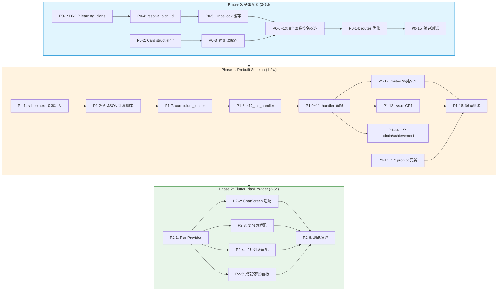

# Plan 系统 & Prebuilt Schema 实施设计文档

> **作者**: 高见远 (software-architect) + 齐活林 (team-lead)  
> **日期**: 2026-06-09  
> **状态**: V2.4 — 全量纳入定稿  
> **范围**: Plan 系统修复 + Prebuilt Schema 重构 + Flutter PlanProvider

---

## 0. 交付策略

> **一次交付，不做中间部署。** 所有 Phase 在本地开发环境完成、代码合并后，只在最终全量完成后一次性部署到 VPS。中间不发布任何更改。

### 实施节奏

```
Phase 0 (基础修复)     ─── 3 天 ───┐
                                   ├── 代码积累，不部署
Phase 1 (prebuilt 重构) ─── 2 周 ──┤
                                   ├── 代码积累，不部署
Phase 2 (Flutter 改)   ─── 3 天 ──┤
                                   │
                                   ▼
                        全量编译 + 一次性部署上线
```

### 不部署的后果

| 维度 | 影响 | 处理方式 |
|:----|:-----|:---------|
| API 兼容性 | Phase 1 会改 API 响应格式 | 无需兼容，前端与后端同时改完再部署 |
| 数据迁移 | JSON → SQLite 格式一次性切换 | 部署时跑一次迁移脚本即可 |
| 前端适配 | PlanProvider 改完后端 API | Phase 2 最后实施，确保 API 已稳定 |
| 回滚复杂度 | 一次回滚 3 个 Phase 的全部内容 | `git revert <完整分支>` 一次性回退 |

---

## 1. 现状分析

### 1.1 当前架构概览（改造前）

```
┌─────────────────────────────────────────────────────────────────┐
│                    Flutter 前端 (app/)                          │
│  ChatScreen (局部 _activePlan state)                            │
│  PlanApi extension on ChatClient ────→ GET/POST /api/…         │
│  复习页 / 卡片列表 / 成就 / 家长看板 ───→ 消费 plan data       │
│  无独立 PlanProvider（跨页面数据同步问题是已知痛点）              │
└─────────────────────────────────────────────────────────────────┘
                              │ HTTP / WS
                              ▼
┌─────────────────────────────────────────────────────────────────┐
│                 Backend (api_server crate)                       │
│  routes.rs     ─── REST API（~35 处 SQL 操作 cards/conversation │
│  plan_handler   ─── plan CRUD + CP2（~1800 行，18+ subquery）   │
│  ws.rs          ─── CP1 概念提取 + CP2 进度推进                  │
└─────────────────────────────────────────────────────────────────┘
                              ▼
┌─────────────────────────────────────────────────────────────────┐
│                    DB (SQLite)                                   │
│  cards:          front/back/plan_id/task_key/conv_id            │
│  conversation_plans: goal/plan_content/subject/grade_band       │
│  user_plan_progress: task_key/status                            │
│  card_memory:    FSRS 状态                                      │
│  review_log:     复习历史                                       │
│                                                                 │
│  ⚠️ 学习表和卡片表内容强制复制 N 份给每个用户（存储浪费）        │
│  ⚠️ Card struct 缺 plan_id/task_key 字段（类型安全漏洞）        │
│  ⚠️ plan_id 通过 subquery 间接关联（N+1 查询）                  │
│  ⚠️ learning_plans 废弃表残留（DDL 污染）                       │
└─────────────────────────────────────────────────────────────────┘
```

### 1.2 V2.2 Prebuilt Schema 目标架构（改造后）

```
                   全局共享（一份数据）
              ┌───────────────────────────────┐
              │  prebuilt_cards ─── 卡片注册表  │
              │  ├─ prebuilt_science_cards     │
              │  ├─ prebuilt_language_cards    │  ← domain 子表
              │  ├─ prebuilt_literature_cards  │
              │  ├─ prebuilt_humanities_cards  │
              │  prebuilt_plans/stages/tasks   │  ← plan 模板
              │  card_relations                │  ← 全局关系图
              └───────────┬───────────────────┘
                          │ prebuilt_card_id (引用)
              ┌───────────▼───────────────────┐
              │  user_cards (仅实例/状态)        │
              │  ├─ user_science_cards          │
              │  ├─ user_language_cards         │  ← CP1/自定义卡
              │  ├─ user_literature_cards       │
              │  ├─ user_humanities_cards       │
              │  plan_runs (替代 conv_plans)    │
              │  user_plan_progress (不变)       │
              │  card_memory (不变)              │
              └───────────────────────────────┘
                    用户私有（每用户 N 份）
```

---

## 2. 关键决策（修正版）

### 决策 1: Prebuilt Schema 重构 — ✅ 现在做

| 维度 | 架构师原判断 | 修正判断 |
|------|------------|---------|
| 结论 | ❌ 延期到 V3.0 | ✅ **本次实施** |
| 理由 | 存储收益在用户少时不明显 | 架构一致性和数据清晰度的收益**当前就有**；VPS 清库是零成本切换窗口 |
| 实施 | — | **Phase 1** 专做此工作 |

### 决策 2: Card struct 补全 — ✅ 立即做（Phase 0）

- +2 `Option<String>`（plan_id, task_key）
- 写入不受影响（params!），读取 3 处需适配

### 决策 3: subquery → 直接传参 — ✅ 立即做（Phase 0）

- 新增 `resolve_plan_id()` + plan_id OnceLock 缓存
- 8 个函数签名改造，消除 18+ 处 N+1

### 决策 4: learning_plans 清理 — ✅ 立即做（Phase 0）

- `DROP TABLE IF EXISTS learning_plans` — 代码 0 引用，零风险

### 决策 5: plan_id 缓存 — ✅ 立即做（Phase 0）

- 参考 `PREBUILT_CARD_CACHE` 的 `OnceLock` 模式
- 短期缓存（60s TTL）
- ~30 行代码，与 resolve_plan_id 同时引入

### 决策 6: Flutter PlanProvider — ✅ 本次做（Phase 2）

- 参考 `authProvider` 的 `StateNotifierProvider` 模式
- 统一 plan 状态管理，消除跨页面同步问题
- 与后端 Phase 0/1 的 API 变更一起适配

---

## 3. 三阶段实施任务

### Phase 0：基础修复（预先实施，2-3 天）

| # | 任务 | 涉及文件 | 预估 |
|---|------|---------|:----:|
| P0-1 | DROP learning_plans 表 | `schema.rs` | 0.5h |
| P0-2 | Card struct 补 plan_id/task_key | `shared_types/src/card.rs` | 1h |
| P0-3 | 适配 cards 读取点 | `routes.rs`（~3 处 SELECT） | 2h |
| P0-4 | resolve_plan_id 辅助函数 | `plan_handler.rs`（新增） | 1h |
| P0-5 | plan_id OnceLock 缓存 | `plan_handler.rs`（参考 PREBUILT_CARD_CACHE） | 1h |
| P0-6 | handle_plan_update 返回 plan_id | `plan_handler.rs` | 2h |
| P0-7 | upsert_learning_plan 接受 plan_id | `plan_handler.rs` | 2h |
| P0-8 | apply_plan_mutations 接受 plan_id | `plan_handler.rs` | 2h |
| P0-9 | auto_revert 接受 plan_id | `plan_handler.rs` | 1h |
| P0-10 | build_plan_context 接受 plan_id | `plan_handler.rs` | 1h |
| P0-11 | analyze_turn_progress 接受 plan_id | `plan_handler.rs` | 2h |
| P0-12 | unlock_next_cards 接受 plan_id | `plan_handler.rs` | 2h |
| P0-13 | force_plan_creation 联合改进 | `plan_handler.rs` | 1h |
| P0-14 | routes.rs 消除多余 resolve | `routes.rs` | 2h |
| P0-15 | 编译 + cargo test | — | 0.5h |
| | **Phase 0 合计** | **5 个后端文件** | **~20h** |

### Phase 1：Prebuilt Schema 重构（核心，1-2 周）

| # | 任务 | 涉及文件 | 预估 |
|---|------|---------|:----:|
| P1-1 | schema.rs 建 10 张新表 + 删 2 张旧表 | `schema.rs` | 4h |
| P1-2 | JSON 迁移脚本：science 卡重映射 | `scripts/migrate_v3_to_new_schema.py` | 4h |
| P1-3 | JSON 迁移脚本：language 卡重映射 | 同上脚本 | 3h |
| P1-4 | JSON 迁移脚本：literature 卡重映射 | 同上脚本 | 2h |
| P1-5 | JSON 迁移脚本：humanities 按 plan 重生成 | 同上脚本 | 2h |
| P1-6 | JSON 迁移脚本：plan 文件加 domain 字段 | 同上脚本 | 1h |
| P1-7 | curriculum_loader 改读新 JSON 格式 | `curriculum_loader.rs` | 4h |
| P1-8 | k12_init_handler 改写 plan_runs + user_cards | `routes.rs` | 4h |
| P1-9 | copy_prebuilt_card 改写 user_cards | `plan_handler.rs` | 2h |
| P1-10 | plan_handler 全部读写改 plan_runs | `plan_handler.rs` | 6h |
| P1-11 | fsrs_scheduler 改 user_cards JOIN | `card_engine/fsrs_scheduler.rs` | 4h |
| P1-12 | routes.rs 全部 ~35 处 SQL 改新表 | `routes.rs` | 8h |
| P1-13 | ws.rs CP1 制卡改 user_cards + 子表 | `ws.rs` | 4h |
| P1-14 | admin_handlers 改新表 | `admin_handlers.rs` | 3h |
| P1-15 | achievement_engine 改新表 | `achievement_engine.rs` | 3h |
| P1-16 | CP1 prompt 更新（extract.md + direct.md） | `prompts/concept/general/` | 2h |
| P1-17 | 验证 prompt（translation.md） | `prompts/verify/general/` | 1h |
| P1-18 | 编译 + cargo test | — | 2h |
| | **Phase 1 合计** | **10+ 文件** | **~60h** |

### Phase 2：Flutter PlanProvider（收尾，3-5 天）

| # | 任务 | 涉及文件 | 预估 |
|---|------|---------|:----:|
| P2-1 | PlanProvider/PlanNotifier + 数据结构 | `app/lib/providers/plan_provider.dart` (新) | 6h |
| P2-2 | ChatScreen 改用 PlanProvider | `app/lib/screens/chat_screen.dart` | 4h |
| P2-3 | 复习页改成 PlanProvider | `app/lib/screens/review_screen.dart` | 4h |
| P2-4 | 卡片列表页适配 | `app/lib/screens/card_list_screen.dart` | 3h |
| P2-5 | 成就页/家长看板适配 | `app/lib/screens/achievements_screen.dart` 等 | 3h |
| P2-6 | 测试 + 编译 | — | 2h |
| | **Phase 2 合计** | **5+ 文件（1 新）** | **~24h** |

---

## 4. 依赖图（全量）



---

## 5. 文件清单与变更量

| 阶段 | 文件 | 变更类型 | 行数 | 风险 |
|:----:|:----|:--------:|:----:|:----:|
| P0 | `shared_types/src/card.rs` | +2 字段 | +4 | 低 |
| P0 | `api_server/src/schema.rs` | +1 行 DROP | +1 | 低 |
| P0 | `api_server/src/plan_handler.rs` | 8 函数签名 + resolve_plan_id | -120/+80 | 中 |
| P0 | `api_server/src/routes.rs` | ~6 处 SQL 优化 | -30/+40 | 中 |
| P1 | `api_server/src/schema.rs` | +10 表 DDL, -2 旧表 | +150/-20 | 高 |
| P1 | `scripts/migrate_v3_to_new_schema.py` | 新增 | ~300 | 中 |
| P1 | `api_server/src/curriculum_loader.rs` | 改读 v4 目录结构 | ~50 | 中 |
| P1 | `api_server/src/routes.rs` | ~35 处 SQL 改新表 | -200/+300 | 高 |
| P1 | `api_server/src/plan_handler.rs` | conversation_plans→plan_runs | -80/+120 | 高 |
| P1 | `card_engine/src/fsrs_scheduler.rs` | cards→user_cards | -30/+50 | 高 |
| P1 | `api_server/src/ws.rs` | CP1 制卡改子表 | -20/+40 | 中 |
| P1 | `api_server/src/admin_handlers.rs` | 改新表名 | -20/+20 | 低 |
| P1 | `api_server/src/achievement_engine.rs` | 改新表名 | -15/+15 | 低 |
| P1 | `prompts/concept/general/extract.md` | 输出格式更新 | ~10 | 中 |
| P1 | `prompts/concept/general/direct.md` | 输出格式更新 | ~10 | 中 |
| P1 | `prompts/verify/general/translation.md` | 字段引用更新 | ~5 | 低 |
| P2 | `app/lib/providers/plan_provider.dart` | 新增 | ~120 | 中 |
| P2 | `app/lib/screens/chat_screen.dart` | provider 适配 | ~40 | 中 |
| P2 | `app/lib/screens/review_screen.dart` | provider 适配 | ~50 | 中 |
| P2 | `app/lib/screens/card_list_screen.dart` | provider 适配 | ~30 | 低 |
| P2 | `app/lib/screens/achievements_screen.dart` | provider 适配 | ~20 | 低 |
| | **总计** | **~21 个文件** | **~+1000/-200** | |

---

## 6. 时间线

```
Phase 0 (20h ≈ 3天) ── 并行：基础修复 + plan_id 缓存
         │
         ▼
Phase 1 (60h ≈ 2周) ── 核心：prebuilt schema 重构
         │
         ▼
Phase 2 (24h ≈ 3天) ── 收尾：Flutter PlanProvider
         │
         ▼
      部署上线
```

---

## 7. 共享知识与注意事项

### 7.1 实施顺序铁律

1. **Phase 0 必须先于 Phase 1**：Card struct 补全是后面一切的基础
2. **JSON 迁移脚本必须早于 curriculum_loader 改读**：不然启动时读不到新格式
3. **CP1 prompt 更新必须与 ws.rs 代码修改同步**：旧 prompt 输出写不进新 schema
4. **Flutter PlanProvider 在 Phase 0/1 后端 API 稳定后实施**：避免接口反复变更

### 7.2 事务要求

| 操作 | 事务范围 |
|------|---------|
| k12_init 写入（plan_runs + user_cards + card_memory） | 同一事务 |
| CP1 制卡（user_cards + user_*_cards + card_memory） | 同一事务 |
| plan 更新（plan_runs + user_plan_progress） | 同一事务 |

### 7.3 回滚方案

```
Phase 0 回滚: git revert <commit> → cargo build → systemctl restart
Phase 1 回滚: 同上，但需同时回滚 JSON 数据文件
Phase 2 回滚: git revert → flutter build + 重新部署前端
```

### 7.4 测试要点

| 测试 | 覆盖 |
|------|------|
| cargo test | Phase 0 全部单测 |
| K12 init → 复习 → CP1 → CP2 全链路 | Phase 1 核心验证 |
| 前端 plan 列表加载/刷新 | Phase 2 验证 |
