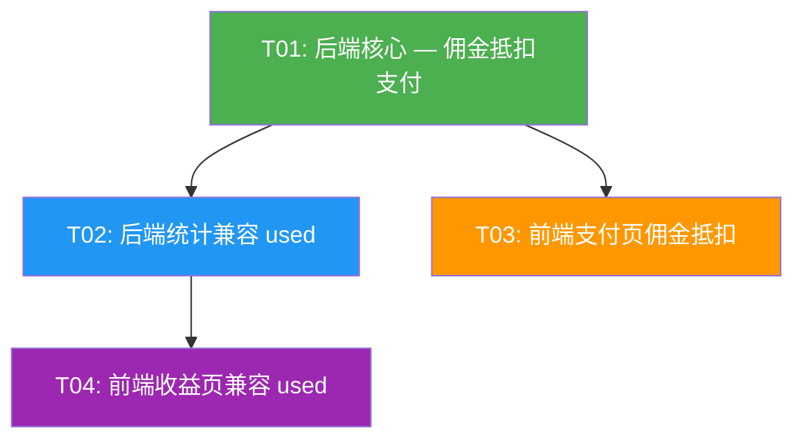

# 佣金直接抵扣订阅支付 — 系统设计方案

> 作者：高见远 (Architect)
> 版本：v2.0 (简化方案)
> 日期：2026-06-29

---

## 背景

CoEvo 已有完整的推广返现体系：

- **收益面板** (`earnings_page.dart`) — 展示累计收益、佣金明细、团队人数
- **佣金记录** (`distribution_commissions`) — status 流转：`locked` → `available` → `settled`
- **提现流程** — `POST /api/referral/withdraw` 将可用佣金提现到银行卡

**现有能力**：佣金 → 提现 → 银行卡（只能拿钱走）

**新增能力**：佣金 → 直接抵扣订阅支付（不用提现，直接当钱花）

---

## Part A: 系统设计

### 1. 实施思路

**不引入新表、不引入余额字段**，直接在现有 `distribution_commissions` 表上新增一个状态值 `used`，支付时允许用户勾选"使用佣金抵扣"：

```
用户选抵扣 ¥50 → POST /api/pay/native {commission_discount: 5000}
  │
  ├─ 查 SUM(commissions WHERE earner_id=? AND status='available') >= 5000
  │
  ├─ 事务内 FIFO 扣佣金（status → 'used'）
  │
  └─ 计算 final_price = plan_price - commission_discount
       ├─ = 0 → 直接激活（走现有免费路径）
       └─ > 0 → 微信付剩余金额（走现有支付路径）
```

### 2. 文件清单

| 文件路径 | 说明 | 操作 |
|----------|------|------|
| `backend/.../pay_handlers.rs` | `native_pay_handler` 增加 `commission_discount` 参数 | MODIFY |
| `backend/.../referral_handler.rs` | `my_stats` 排除 `used`；`my_commissions` 状态映射加 `已抵扣` | MODIFY |
| `backend/.../distribution_handler.rs` | 确认提现查询自动排除 `used`（SQL 不变） | 确认即可 |
| `app/lib/screens/pay_screen.dart` | 订阅支付页增加佣金抵扣选择 | MODIFY |
| `app/lib/pages/user/distribution/earnings_page.dart` | 状态标签增加 `used` → `已抵扣` | MODIFY |

### 3. 数据库变更

**唯一变更**：`distribution_commissions.status` 新增可用值 `'used'`

```
现有 status 值: 'locked' | 'available' | 'settled' | 'cancelled'
新增 status 值: 'used'   ← 标识被用户支付抵扣的佣金
```

DDL `status TEXT DEFAULT 'locked'` 无 CHECK 约束，可直接写入新值，无需 ALTER TABLE。

### 4. 后端 API 变更

| API | 变更 |
|-----|------|
| `POST /api/pay/native` | 新增可选参数 `commission_discount: i64`（分） |
| `GET /api/referral/my-stats` | `total_earned` 改为排除 `cancelled` + `used`（当前仅排除 `cancelled`） |
| `GET /api/referral/my-commissions` | 状态映射增加 `used` → `已抵扣` |

**请求体示例**：
```json
{
    "user_id": "u_abc123",
    "plan_id": "plan_monthly",
    "commission_discount": 5000
}
```

**响应 — 纯佣金支付（扣完 = 0）**：
```json
{
    "order_id": "OE...",
    "paid": true,
    "amount": 0,
    "new_expires": "2025-08-15",
    "commission_used": 5000,
    "commission_ids": ["c1", "c2"]
}
```

**响应 — 混合支付（扣完还有剩余）**：
```json
{
    "order_id": "OE...",
    "code_url": "weixin://...",
    "amount": 7000,
    "paid": false,
    "commission_used": 5000,
    "commission_ids": ["c1", "c2"]
}
```

### 5. 程序调用流程

#### 纯佣金支付（金额全抵扣）

```
用户选抵扣 ¥50 → POST /api/pay/native {commission_discount: 5000}
  → 查可用佣金: SUM(amount) WHERE earner_id=? AND status='available'
  → >= 5000 ✓ → FIFO 取佣金记录，累加凑够 5000
  → UPDATE distribution_commissions SET status='used' WHERE id IN (...) AND status='available'
  → final_price = 12000 - 5000 = 7000 > 0
  → 创建 NOTPAY 订单（amount=12000）→ 微信下单金额 7000
  → 返回 code_url，用户扫码付剩余
```

#### 佣金抵扣后的分销归因

佣金抵扣**仅影响用户支付金额**。上游推荐人的佣金按用户实际支付金额计算，与抵扣前一致。

#### 退款场景

退款时，将已抵扣的佣金恢复 `status='available'`，同时退还微信支付部分。

### 6. 安全设计

| 问题 | 方案 |
|------|------|
| 并发超扣 | `UPDATE ... WHERE id=? AND status='available'` — rows_affected=0 回滚重试 |
| 幂等 | 佣金扣减与订单创建在同一事务内，订单幂等检查已在现有逻辑中 |
| 佣金不足 | `commission_discount > SUM(available)` → 返回 400 错误 |
| 抵扣超套餐价 | `commission_discount > plan.price` → 返回 400 错误 |

---

## Part B: 任务分解

### 7. 任务列表

| ID | 名称 | 文件 | 依赖 | 优先级 |
|----|------|------|------|--------|
| **T01** | **后端核心 — 佣金抵扣支付** | `pay_handlers.rs` (修改) | 无 | **P0** |
| **T02** | **后端统计兼容 `used` 状态** | `referral_handler.rs` (修改) | T01 | **P0** |
| **T03** | **前端 — 支付页佣金抵扣** | `pay_screen.dart` (修改) | T01 | **P1** |
| **T04** | **前端 — 收益页兼容 `used`** | `earnings_page.dart` (修改) | T02 | **P1** |

#### T01: 后端核心 — 佣金抵扣支付

**修改 `pay_handlers.rs` 的 `native_pay_handler()`：**

1. 在参数解析段增加 `let commission_discount: Option<i64> = payload.get("commission_discount").and_then(|v| v.as_i64());`
2. 在 `final_price` 计算前插入佣金抵扣逻辑：
   - 如果 `commission_discount > 0`，**开启事务**
   - 查可用佣金总额：`SELECT COALESCE(SUM(amount),0) FROM distribution_commissions WHERE earner_id=? AND status='available'`
   - 不足则返回 `commission_insufficient`
   - FIFO 取记录：`SELECT id, amount FROM ... WHERE earner_id=? AND status='available' ORDER BY created_at ASC`
   - 遍历累加，凑够 `commission_discount`
   - 逐条条件更新：`UPDATE distribution_commissions SET status='used' WHERE id=? AND status='available'`，检查 rows_affected
   - 记录 `commission_used` 和 `commission_ids`
3. `final_price = base_price - commission_used`
4. 后续逻辑不变：`final_price <= 0` 走免费路径，`> 0` 走微信路径
5. 响应体增加 `commission_used`、`commission_ids` 字段

#### T02: 后端统计兼容 `used` 状态

**修改 `referral_handler.rs`：**

- `my_stats()`: `total_earned` 的 SQL 从 `WHERE status NOT IN ('cancelled')` 改为 `WHERE status NOT IN ('cancelled', 'used')`
- `my_commissions()`: 状态标签映射增加 `'used' → '已抵扣'`

#### T03: 前端 — 支付页佣金抵扣

**修改 `pay_screen.dart`：**

1. 在支付按钮上方显示"可用佣金 ¥XX"（调 `GET /api/referral/my-stats` 取 `total_earned`）
2. 添加"使用佣金支付"切换开关
3. 可输入抵扣金额（默认全部抵扣）
4. 点击支付时将 `commission_discount` 传入 `POST /api/pay/native`
5. 响应后展示：纯抵扣显示成功；混合支付显示微信二维码

#### T04: 前端 — 收益页兼容 `used`

**修改 `earnings_page.dart`：**

- `_statusColor()` 增加 `case 'used': return Colors.grey;`
- `_statusLabel()` 增加 `case 'used': return '已抵扣';`

### 8. 依赖包

无新增依赖。

### 9. 任务依赖图



### 10. 共享知识

**佣金状态流转：**
```
locked → available → settled     (标准结算流程)
locked → available → used        (新增：用户支付抵扣)
locked → cancelled               (活动作废)
```

**并发安全：**
- 佣金扣减：`UPDATE distribution_commissions SET status='used' WHERE id=? AND status='available'`
- rows_affected == 0 → 并发冲突，回滚重试
- 所有抵扣操作在事务内执行

**金额单位：** 分（1 元 = 100 分），前端展示时除以 100

**抵扣计算顺序：** `final_price = max(0, actual_price_or_plan_price - commission_discount)`

**分销归因不受影响：** `distribute_commission_on_payment` 基于 `payment_orders.amount`（套餐原价）计算佣金，用户抵扣不减少上游推荐人的返佣。

### 11. 用户展示逻辑

佣金的两条消费通道都在**个人页 → 收益面板**统一展示。

**数据层对齐（铁律）：** 每条 `distribution_commissions` 记录在 DB 中 `amount` 字段始终为正数（代表赚了多少）。但展示时根据 `status` 决定正负方向：

| status | 交易类型 | 显示方向 | 颜色 | 原因 |
|:-------|:---------|:---------|:-----|:-----|
| `available` | **收入** | `+` | 🟢 绿色 | 钱到手了，还没花 |
| `used` | **支出** | `−` | 🔴 红色 | 钱花掉了，支付订阅 |
| `settled` | **支出** | `−` | 🔴 红色 | 钱花掉了，提现到银行卡 |
| `paid` | **支出** | `−` | 🔴 红色 | 钱花掉了，已打款 |
| `locked` | 待定 | `+` | ⚫ 灰色 | 结算期未到，尚不可用 |

**聚合指标：**

| 指标 | SQL 计算 | 含义 |
|:-----|:---------|:-----|
| **累计收入** | `SUM(amount) WHERE status NOT IN ('cancelled', 'used')` | 历史总收入（只看赚了多少） |
| **可用佣金** | `SUM(amount) WHERE status='available'` | 当前还能花的（扣除已支出的） |

用户视角的展示示例：
```
收益面板
  ├── 累计收入: ¥120          ← 总共赚了这么多
  ├── 可用佣金: ¥80           ← 还剩的
  └── 交易流水:
        🟢 +¥30  可提现      ← 收入，还在手上
        🟢 +¥50  可提现      ← 收入，还在手上
        🔴 −¥20  已抵扣      ← 支出，支付订阅
        🔴 −¥20  已结算      ← 支出，提现到银行卡
```

**关键规则：** DB 中 `amount` 始终为正数；方向由前端根据 `status` 判断：
- `available` → 前端加 `+`，绿色
- `used` / `settled` / `paid` → 前端加 `−`，红色

这样**收入 + 支出 = 0**（¥120 - ¥120 = 0），账目永远对平。
