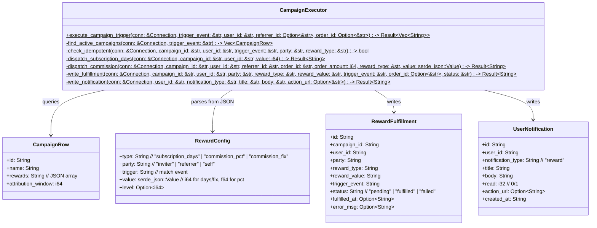
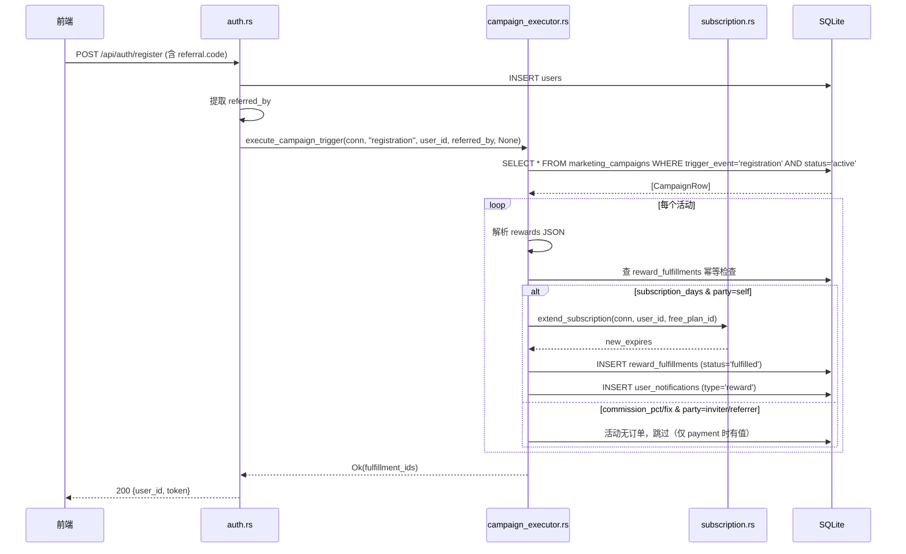
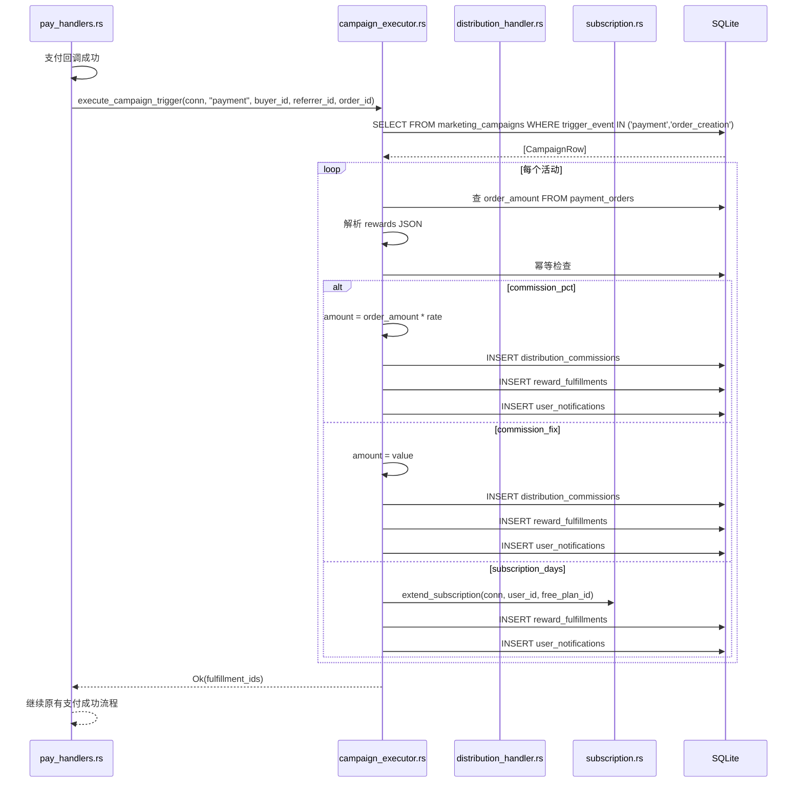
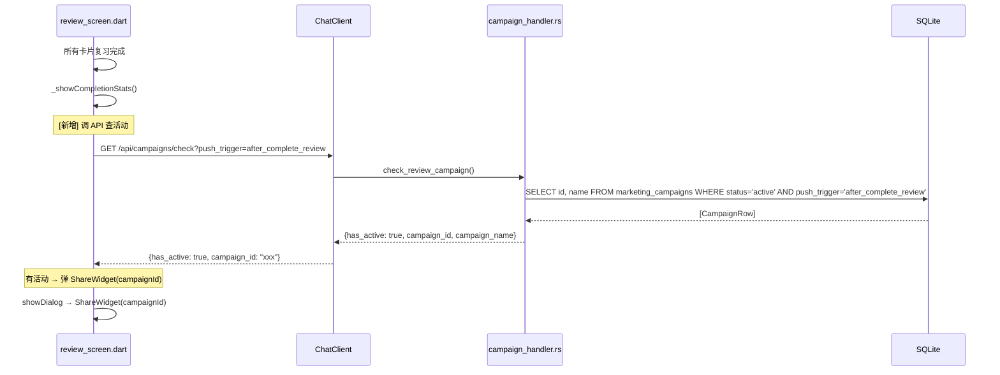
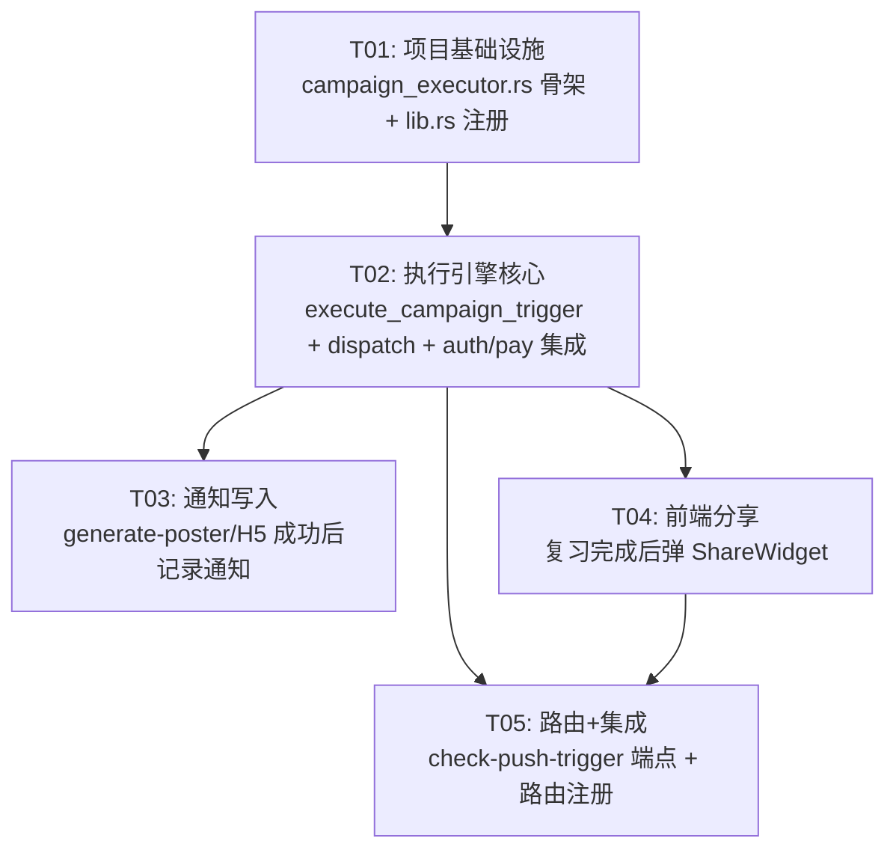

# 活动执行引擎 + 用户体验改进 — 系统设计文档

> 版本: v1.0 · 2026-06-19  
> 作者: Bob (Architect)  
> 基于: `campaign-engine-gap-analysis.md` + 完整代码审计

---

## Part A: System Design

---

### 1. Implementation Approach

#### 1.1 核心技术挑战

| # | 挑战 | 解决思路 |
|---|------|---------|
| 1 | 多个触发点（registration/payment）需要统一入口，避免重复代码 | 提取通用 `execute_campaign_trigger()`，消除 `pay_handlers.rs` 中现有内联逻辑 |
| 2 | 不同 reward_type（subscription_days / commission_pct / commission_fix）分发表不同 | 策略分发：`match reward_type` → 调用 `extend_subscription()` 或写 `distribution_commissions` |
| 3 | 幂等性 — 同一用户同一活动同一奖励不能重复发放 | 按 `(campaign_id, user_id, trigger_event, party, reward_type)` 查 `reward_fulfillments` |
| 4 | 奖励发放后用户无感知 | 自动写 `user_notifications` 表，前端使用已有的 `/api/notifications` 接口轮询 |
| 5 | 复习完成后需主动弹分享海报 | 在 `_showCompletionStats()` 中调 API 查 `push_trigger='after_complete_review'` 的活动 |

#### 1.2 框架与库选择

现有技术栈已包含所需全部依赖，无新增第三方库：

| 依赖 | 用途 | 是否新增 |
|------|------|---------|
| `rusqlite` | SQLite 数据库操作 | 已有 |
| `serde_json` | rewards JSON 解析 | 已有 |
| `uuid` | 生成 ID | 已有 |
| `chrono` | 时间处理 | 已有 |
| `tracing` | 日志 | 已有 |
| `flutter_riverpod` | 前端状态管理 | 已有 |
| `http` | 前端 HTTP 请求 | 已有 |

#### 1.3 架构模式

- **后端**: 函数式模块（无 trait/struct 过度抽象），按触发事件路由到 `campaign_executor` → 策略分发
- **前端**: Riverpod + 命令式 Widget，事件回调中触发活动检查

---

### 2. File List

```
backend/
├── crates/api_server/src/
│   ├── campaign_executor.rs          # [新建] 活动执行引擎核心
│   ├── campaign_executor_test.rs     # [新建] 引擎单元测试（可选，推荐内联测试）
│   ├── auth.rs                       # [修改] register() 末尾添加引擎调用
│   ├── pay_handlers.rs               # [重构] 删除内联佣金逻辑，改用引擎
│   ├── distribution_handler.rs       # [修改] 新增 insert_notification() 公共函数
│   ├── lib.rs                        # [修改] 添加 pub mod campaign_executor

app/
├── lib/
│   ├── screens/review_screen.dart    # [修改] _showCompletionStats() 中查活动弹分享
│   ├── widgets/share_widget.dart     # [修改] 支持从外部传入 campaignId
│   └── api/chat_client.dart          # [修改] 新增 check_review_campaign() API 调用
```

---

### 3. Data Structures and Interfaces

#### 3.1 Class Diagram — 数据模型与核心函数



#### 3.2 Rewards JSON Schema（标准格式）

`marketing_campaigns.rewards` 字段存储的 JSON 格式：

```json
[
  {
    "type": "subscription_days",
    "party": "self",
    "trigger": "registration",
    "value": 3,
    "level": 1
  },
  {
    "type": "commission_pct",
    "party": "inviter",
    "trigger": "payment",
    "value": 0.1,
    "level": 1
  },
  {
    "type": "commission_fix",
    "party": "referrer",
    "trigger": "payment",
    "value": 500,
    "level": 1
  }
]
```

| 字段 | 类型 | 必填 | 说明 |
|------|------|------|------|
| `type` | string | ✓ | `subscription_days` / `commission_pct` / `commission_fix` |
| `party` | string | ✓ | `self`（本人）/ `inviter`（一级邀请人）/ `referrer`（推广人） |
| `trigger` | string | ✓ | 应与活动 `trigger_event` 匹配 |
| `value` | number | ✓ | 天数/费率/固定金额（单位：分） |
| `level` | number | ✗ | 裂变层级，默认 1 |

---

### 4. Program Call Flow

#### 4.1 注册触发活动执行



#### 4.2 支付触发活动执行（重构后）



#### 4.3 复习完成后弹分享海报



---

### 5. Anything UNCLEAR

1. **subscription_days 的 plan_id 选择** — extend_subscription() 需要 plan_id。对于免费赠送的天数，无法确定是哪个 plan。**假设**: campaign_executor 新加常量 `FREE_REWARD_PLAN_ID`（如 `"reward_days"`）或使用一个特殊的系统套餐 ID。需要确认是否有默认 free plan。

2. **`after_complete_review` API 端点** — 目前没有现成端点查 `push_trigger`。**方案**: 在 `campaign_handler.rs` 新增 `GET /api/campaigns/check-push-trigger?push_trigger=after_complete_review`，或直接在 `campaign_executor.rs` 中添加该查询函数并通过 routes.rs 注册。

3. **commission_pct/fix 在 registration 触发时的行为** — 注册时没有订单，commission 无法计算。**假设**: executor 会对 commission 类型做 `order_id.is_some()` 守卫，仅在 payment 触发时处理 commission，registration 触发时仅处理 subscription_days。

4. **ShareWidget 外部传入 campaignId** — 目前 ShareWidget 从 auth provider 取用户信息，不接收外部参数。**方案**: 添加可选 `campaignId` 参数，当传入时在生成海报/H5 时自动传递给 API。

---

## Part B: Task Decomposition

---

### 6. Required Packages

无新增依赖。现有依赖满足全部需求：

**Backend (Rust)**:
- `rusqlite` — SQLite 数据库
- `serde`, `serde_json` — JSON 解析
- `uuid` — ID 生成
- `chrono` — 时间处理
- `tracing` — 日志

**Frontend (Flutter)**:
- `flutter_riverpod` — 状态管理
- `go_router` — 路由
- `http` — HTTP 客户端
- `qr_flutter` — 二维码生成

---

### 7. Task List (ordered by dependency)

#### T01: 项目基础设施（T01）

| 属性 | 值 |
|------|-----|
| **Task ID** | T01 |
| **Task Name** | 项目基础设施 — campaign_executor 模块骨架 + lib.rs 模块注册 |
| **Source Files** | `backend/crates/api_server/src/campaign_executor.rs` (新建)、`backend/crates/api_server/src/lib.rs` (修改) |
| **Dependencies** | 无 |
| **Priority** | P0 |

**具体内容**:
- 在 `lib.rs` 中加一行 `pub mod campaign_executor;`
- 新建 `campaign_executor.rs`，包含：
  - 模块注释头
  - 导入所有必需的依赖（rusqlite::Connection, serde_json, uuid, chrono）
  - 空函数桩: `execute_campaign_trigger()` 返回 `Result<Vec<String>, String>`
  - 助手函数桩: `find_active_campaigns()`, `check_idempotent()`, `write_fulfillment()`, `write_notification()`
  - 定义 `FREE_REWARD_PLAN_ID = "reward_days"` 常量

---

#### T02: 活动执行引擎核心逻辑（T02）

| 属性 | 值 |
|------|-----|
| **Task ID** | T02 |
| **Task Name** | 活动执行引擎核心 — execute_campaign_trigger 完整实现 |
| **Source Files** | `backend/crates/api_server/src/campaign_executor.rs` (修改)、`backend/crates/api_server/src/pay_handlers.rs` (重构)、`backend/crates/api_server/src/auth.rs` (修改)、`backend/crates/api_server/src/distribution_handler.rs` (修改) |
| **Dependencies** | T01 |
| **Priority** | P0 |

**具体内容**:

1. **campaign_executor.rs** — 完整实现：
   - `execute_campaign_trigger()`:
     - 调 `find_active_campaigns()` 查匹配活动
     - 遍历活动，解析 `rewards` JSON
     - 对每个 reward 做幂等检查
     - `match reward_type`:
       - `subscription_days` → `dispatch_subscription_days()` → 调 `crate::subscription::extend_subscription()`
       - `commission_pct` / `commission_fix` → `dispatch_commission()` → 写 `distribution_commissions`
     - 调 `write_fulfillment()` 写 `reward_fulfillments`
     - 调 `write_notification()` 写 `user_notifications`
     - 返回所有 fulfillment_id 列表
   - `find_active_campaigns()`: SQL 查询 `marketing_campaigns WHERE status='active' AND trigger_event=? AND ...`
   - `check_idempotent()`: 查 `reward_fulfillments` 按五元组去重
   - `write_fulfillment()`: INSERT 到 `reward_fulfillments`
   - `write_notification()`: INSERT 到 `user_notifications`，title/body 按 reward_type 生成中文文案
   - `dispatch_subscription_days()`: 调 `extend_subscription(conn, user_id, FREE_REWARD_PLAN_ID, None, None, Some("活动奖励"))`
   - `dispatch_commission()`: 写 `distribution_commissions`（复用现有逻辑，amount 计算同 pay_handlers.rs:352-364）

2. **pay_handlers.rs** — 重构 `distribute_commission_on_payment()`：
   - 删除第 301-407 行的内联活动查询+佣金分发逻辑
   - 替换为一行：`execute_campaign_trigger(conn, "payment", buyer_id, referrer_id, order_id)?`
   - 保留订单金额查询（如果是外部传入则无需保留）
   - 删减约 80 行，新增约 5 行

3. **auth.rs** — 在 `register()` 函数末尾、`Ok(AuthResponse{...})` 之前添加：
   ```rust
   if let Err(e) = crate::campaign_executor::execute_campaign_trigger(
       conn, "registration", &user_id, referred_by.as_deref(), None,
   ) {
       tracing::warn!("registration campaign trigger failed: {}", e);
       // 不阻塞注册流程，仅记录日志
   }
   ```

4. **distribution_handler.rs** — 新增公共函数 `insert_notification()`（供 campaign_executor 和 referral_handler 共用）：
   ```rust
   pub fn insert_notification(
       conn: &rusqlite::Connection,
       user_id: &str,
       notification_type: &str,
       title: &str,
       body: &str,
       action_url: Option<&str>,
   ) -> Result<String, String>
   ```

**通知文案模板**:

| reward_type | party | title | body | action_url |
|-------------|-------|-------|------|------------|
| subscription_days | self | 🎉 获得会员天数奖励 | "你通过活动「{campaign_name}」获得了 {days} 天会员！" | `/subscription` |
| commission_pct/fix | inviter | 💰 获得推广佣金 | "你推广的用户完成支付，获得 ¥{amount/100:.2} 佣金！" | `/distribution` |
| commission_pct/fix | referrer | 💰 获得推广佣金 | "你邀请的用户完成支付，获得 ¥{amount/100:.2} 佣金！" | `/distribution` |

---

#### T03: 通知写入 + generate-poster/H5 通知（T03）

| 属性 | 值 |
|------|-----|
| **Task ID** | T03 |
| **Task Name** | 奖励通知集成 — generate-poster/H5 成功后写通知 |
| **Source Files** | `backend/crates/api_server/src/distribution_handler.rs` (修改)、`backend/crates/api_server/src/referral_handler.rs` (修改) |
| **Dependencies** | T02 |
| **Priority** | P1 |

**具体内容**:

1. **referral_handler.rs**:
   - 在 `generate_poster()` 成功生成海报后（约第 787 行 `poster_json_response(...)` 之前），调 `insert_notification()` 写一条通知：
     - `notification_type`: `"share_poster"`
     - `title`: `"🎨 已生成分享海报"`
     - `body`: `"你的个性化推广海报已就绪，快去分享给好友吧！"`
     - `action_url`: `"/referral"`
   - 在 `generate_h5()` 成功生成 H5 后（约第 871 行附近），调 `insert_notification()` 写一条通知：
     - `notification_type`: `"share_h5"`
     - `title`: `"🌐 已生成分享页面"`
     - `body`: `"你的专属分享页已上线，邀请朋友一起学习！"`
     - `action_url`: 生成的 H5 链接

2. **distribution_handler.rs** — 确认 `insert_notification()` 已导出为 `pub`，且可供 `referral_handler` 通过 `crate::distribution_handler::insert_notification()` 调用。

---

#### T04: 前端 — 复习完成后弹分享（T04）

| 属性 | 值 |
|------|-----|
| **Task ID** | T04 |
| **Task Name** | 前端复习完成后弹分享海报 |
| **Source Files** | `app/lib/screens/review_screen.dart` (修改)、`app/lib/widgets/share_widget.dart` (修改)、`app/lib/api/chat_client.dart` (修改) |
| **Dependencies** | T02 |
| **Priority** | P1 |

**具体内容**:

1. **chat_client.dart** — 新增方法：
   ```dart
   Future<Map<String, dynamic>> checkReviewCampaign() async {
     // GET /api/campaigns/check-push-trigger?push_trigger=after_complete_review
     // 返回 {has_active: bool, campaign_id: String?, campaign_name: String?}
   }
   ```

2. **review_screen.dart** — 修改 `_showCompletionStats()`：
   - 在弹 `AlertDialog` 之前（或之后），调 `_client!.checkReviewCampaign()`
   - 如果 `has_active == true`，在完成统计弹窗的 actions 中加一个按钮「去分享」
   - 点击按钮 → 弹出 `ShareWidget(campaignId: campaign_id)`
   - 若无活跃活动，保持原有行为不变

3. **share_widget.dart** — 增加可选参数支持：
   ```dart
   class ShareWidget extends ConsumerWidget {
     final String? campaignId;
     const ShareWidget({super.key, this.campaignId});
     // ...
   }
   ```
   - 在 `generate_poster` / `generate_h5` API 调用中，如果 `campaignId != null`，将其作为 `campaign_id` 参数传入请求体

---

#### T05: 路由注册 + 集成测试 + 最终调试（T05）

| 属性 | 值 |
|------|-----|
| **Task ID** | T05 |
| **Task Name** | 路由注册 + API 端点 + 集成测试 |
| **Source Files** | `backend/crates/api_server/src/routes.rs` (修改)、`backend/crates/api_server/src/campaign_handler.rs` (修改) |
| **Dependencies** | T02, T04 |
| **Priority** | P1 |

**具体内容**:

1. **campaign_handler.rs** — 新增端点：
   ```rust
   /// GET /api/campaigns/check-push-trigger
   /// 查询是否有 active 活动匹配指定 push_trigger
   pub async fn check_push_trigger(
       Query(query): Query<CheckPushTriggerQuery>,
   ) -> impl IntoResponse
   ```
   - `CheckPushTriggerQuery`: `{ push_trigger: String, user_id: Option<String> }`
   - SQL: `SELECT id, name FROM marketing_campaigns WHERE status='active' AND push_trigger=?1 AND (valid_from IS NULL OR valid_from <= datetime('now')) AND (valid_until IS NULL OR valid_until > datetime('now')) LIMIT 1`
   - 返回: `{ has_active: bool, campaign_id: String?, campaign_name: String? }`

2. **routes.rs** — 注册新路由：
   ```rust
   .route("/api/campaigns/check-push-trigger", get(crate::campaign_handler::check_push_trigger))
   ```

3. **测试策略**（不阻塞其他任务，建议实现）：
   - 单元测试 `campaign_executor.rs`：
     - `test_subscription_days_dispatch` — 验证 subscription_days 调用 extend_subscription
     - `test_commission_pct_calculation` — 验证 commission_pct 金额计算
     - `test_idempotent_skip` — 验证已发放的奖励跳过
     - `test_write_fulfillment` — 验证 reward_fulfillments 写入正确
   - 集成测试：
     - 注册用户 → 查 reward_fulfillments 有记录
     - 支付完成 → 查 distribution_commissions + reward_fulfillments 有记录

---

### 8. Task Dependency Graph



---

### 9. Shared Knowledge

#### 9.1 幂等策略

按五元组 `(campaign_id, user_id, trigger_event, party, reward_type)` 查 `reward_fulfillments`，已存在 `status='fulfilled'` 的记录则跳过：

```sql
SELECT COUNT(*) FROM reward_fulfillments
WHERE campaign_id = ?1
  AND user_id = ?2
  AND trigger_event = ?3
  AND party = ?4
  AND reward_type = ?5
  AND status = 'fulfilled'
```

- `order_id` 不作为幂等键的一部分（同一用户可在不同订单中多次获得同一活动的奖励）
- `registration` 触发天然幂等（用户只注册一次），`payment` 触发依赖 `order_id` 在分发佣金时的幂等

#### 9.2 错误处理策略

| 场景 | 处理方式 |
|------|---------|
| 活动查询失败 | 记录 warning 日志，返回空列表（不阻塞主流程） |
| JSON 解析失败 | 跳过该活动，继续下一个（`continue`） |
| 幂等检查发现已发放 | 静默跳过（`continue`），不报错 |
| 写 DB 失败 | 记录 warning 日志，继续下一个 reward |
| commission 计算 amount ≤ 0 | 跳过 |
| registration 触发遇到 commission 类型 | 跳过（order_id 为 None）|

**核心原则**: 活动执行永不阻塞主业务流程。注册/支付的成功不依赖活动执行的成功。

#### 9.3 通知约定

- 所有通知通过 `insert_notification()` 写入 `user_notifications` 表
- `notification_type` 统一使用英文小写蛇形命名：`reward`, `share_poster`, `share_h5`
- 前端每 30 秒轮询 `/api/notifications?unread_only=true`
- 通知的 `action_url` 指向前端路由路径，前端可根据 url 跳转

#### 9.4 日期格式

- 全部使用 ISO 8601 格式：`YYYY-MM-DD HH:MM:SS`（SQLite datetime 格式）
- 使用 `chrono::Utc::now().format("%Y-%m-%d %H:%M:%S").to_string()`

#### 9.5 API 响应格式

所有 API 响应遵循统一格式：
```json
{"code": 200, "data": {...}, "message": "ok"}
```
或错误时：
```json
{"code": 400, "data": null, "message": "error description"}
```

---

### 10. 文件变更摘要

| 文件 | 操作 | 估计行数 | 任务 |
|------|------|---------|------|
| `backend/crates/api_server/src/campaign_executor.rs` | 新建 | ~150 | T01+T02 |
| `backend/crates/api_server/src/lib.rs` | 修改 | +1 | T01 |
| `backend/crates/api_server/src/auth.rs` | 修改 | +5 | T02 |
| `backend/crates/api_server/src/pay_handlers.rs` | 重构 | -50/+10 | T02 |
| `backend/crates/api_server/src/distribution_handler.rs` | 修改 | +20 | T02+T03 |
| `backend/crates/api_server/src/referral_handler.rs` | 修改 | +20 | T03 |
| `backend/crates/api_server/src/campaign_handler.rs` | 修改 | +30 | T05 |
| `backend/crates/api_server/src/routes.rs` | 修改 | +2 | T05 |
| `app/lib/screens/review_screen.dart` | 修改 | +25 | T04 |
| `app/lib/widgets/share_widget.dart` | 修改 | +10 | T04 |
| `app/lib/api/chat_client.dart` | 修改 | +15 | T04 |
| **总计** | | **~230 行** | |

---

*文档结束 — Bob (Architect)*
