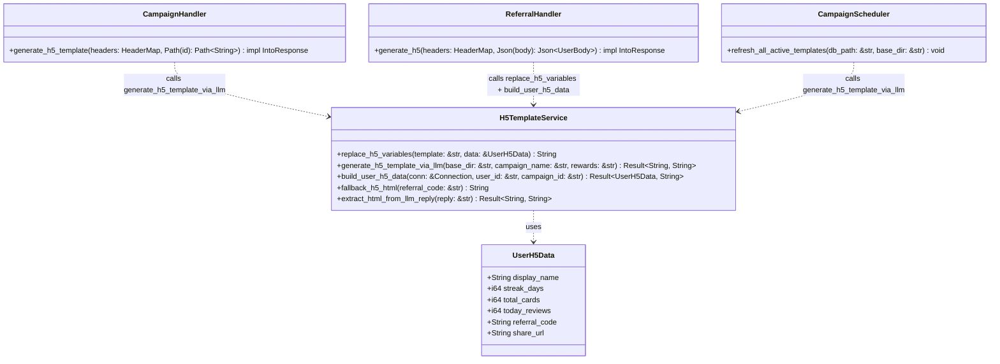
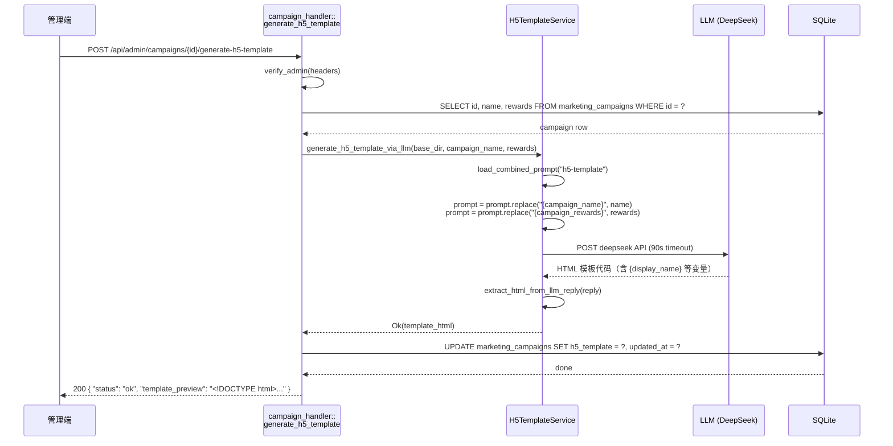
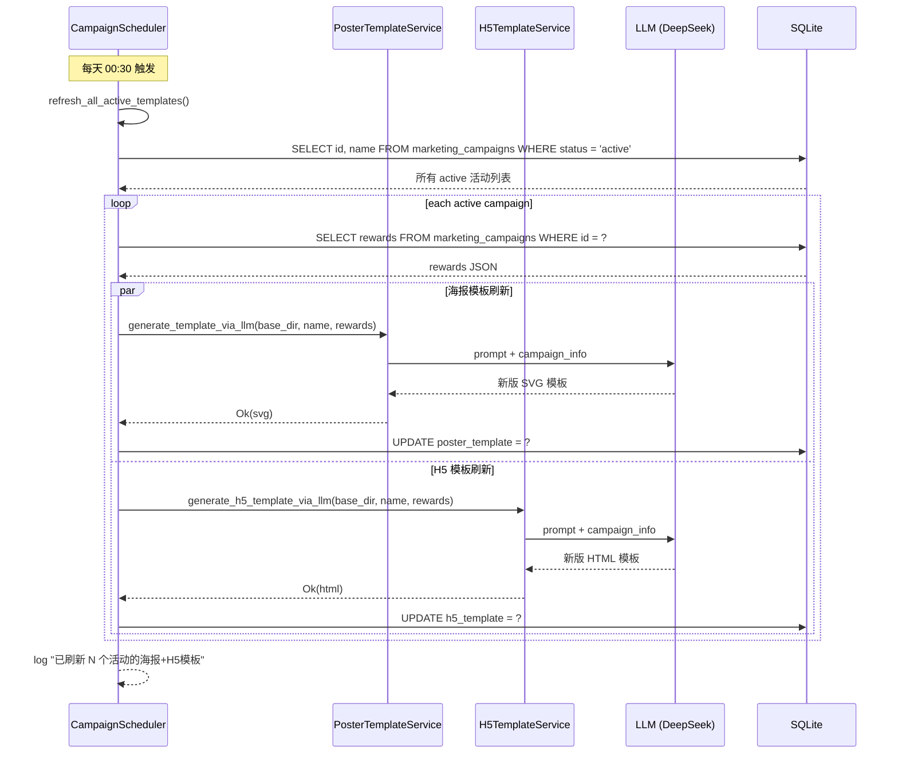
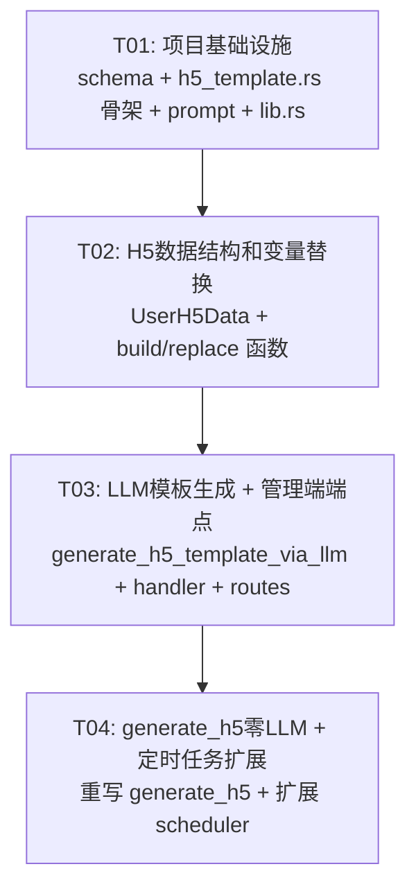

# H5 分享页模板架构 — 系统设计与任务分解

> 版本: v1.0 · 2026-06-19  
> 状态: 设计完成  
> 对应 PRD: 复用海报模板架构的 "LLM一次生成含{变量}的模板 → 运行时变量替换 → 零LLM成本" 模式

---

## 一、Implementation Approach

### 1.1 核心挑战

| # | 挑战 | 解决思路 |
|---|------|---------|
| 1 | 当前 `generate_h5` 每次调 LLM（10-30s），无法扩展 | LLM 只生成含 `{变量}` 的 HTML 模板，存 DB，用户查看时零 LLM 成本 |
| 2 | H5 模板是 HTML，需要保证安全（不能有脚本执行） | LLM prompt 禁止生成 `<script>` 标签，模板替换后验证 |
| 3 | H5 页面通过 URL 分享（非二维码），需要 `{share_url}` 变量 | 新增 `{share_url}` 变量，运行时替换为用户唯一分享链接 |
| 4 | 用户端 H5 页面之前是每次 LLM 生成 + 保存到磁盘 | 改为模板替换 + 直接返回 HTML，无需磁盘写入 |

### 1.2 架构模式

- **严格复制海报模板架构**：`poster_template.rs` 的完整模式直接移植到 `h5_template.rs`
- **模板引擎**：`String::replace()`（与海报相同）
- **LLM 调用**：复用 `chat_engine::llm_caller::LlmCaller`，但改为 DeepSeek 直接 HTTP 调用（与海报模板一致，使用 90 秒超时）
- **模板存储**：`marketing_campaigns.h5_template TEXT`（新增列）
- **管理端端点**：`POST /api/admin/campaigns/{id}/generate-h5-template`
- **用户端端点**：`POST /api/referral/generate-h5` → 改为模板替换流程，返回 HTML 内容

### 1.3 与海报模板的关键差异

| 维度 | 海报 (poster_template.rs) | H5 (h5_template.rs) |
|------|--------------------------|---------------------|
| **模板格式** | SVG | HTML（完整 DOCTYPE 文档） |
| **变量集** | 6 个变量 + QR_PLACEHOLDER | 7 个变量（含 `{share_url}`），无 QR 占位 |
| **返回格式** | `{"svg": "...", "copy": "..."}` | 直接返回 `text/html`（HTML 完整页面） |
| **存储方式** | DB `poster_template` 列 | DB `h5_template` 列 |
| **QR 码** | 需要 QR_PLACEHOLDER → 二维码替换 | 不需要；分享通过 URL 进行 |
| **fallback** | `fallback_poster_svg()`（在 poster_template.rs） | `fallback_h5_html()`（从 referral_handler.rs 迁移到 h5_template.rs） |
| **prompt 加载** | `load_combined_prompt("poster-template")` | `load_combined_prompt("h5-template")` |
| **安全要求** | SVG 无脚本风险 | HTML 需要禁止 `<script>`、`onclick` 等 |

---

## 二、File List

```
backend/
├── crates/
│   └── api_server/
│       ├── src/
│       │   ├── referral_handler.rs        ← [MODIFY] generate_h5() 改为模板替换流程；移除 fallback_h5_html() 到 h5_template.rs
│       │   ├── campaign_handler.rs         ← [MODIFY] 新增 generate_h5_template() handler；campaign update 支持 h5_prompt
│       │   ├── campaign_scheduler.rs       ← [MODIFY] 扩展 refresh_all_active_templates() 同时刷新 h5_template
│       │   ├── routes.rs                  ← [MODIFY] 注册新路由 POST /api/admin/campaigns/{id}/generate-h5-template
│       │   ├── schema.rs                  ← [MODIFY] 新增 h5_template + h5_prompt 列迁移
│       │   ├── lib.rs                     ← [MODIFY] 添加 pub mod h5_template;
│       │   └── h5_template.rs              ← [NEW] 模板变量替换逻辑 + 模板生成调用 + fallback
│       └── prompts/
│           └── share/
│               └── h5-template.md           ← [NEW] 指导 LLM 生成含 {变量} 的 HTML 模板
```

---

## 三、Data Structures and Interfaces



### 3.1 UserH5Data（变量替换数据）

| 字段 | 类型 | 来源 | 模板变量名 |
|------|------|------|-----------|
| `display_name` | `String` | `users.display_name` | `{display_name}` |
| `streak_days` | `i64` | `users.streak_days` | `{streak_days}` |
| `total_cards` | `i64` | `user_cards` COUNT | `{total_cards}` |
| `today_reviews` | `i64` | 今日 `review_log` COUNT | `{today_reviews}` |
| `referral_code` | `String` | `users.referral_code` | `{referral_code}` |
| `share_url` | `String` | 动态生成（分享落地页 URL） | `{share_url}` |

> **注意**：H5 不需要 `qr_code_url`（海报特有字段），新增 `share_url`（H5 特有字段）。
> `{share_url}` 示例值：`https://keyievolution.fun/share/ABC123`

### 3.2 H5TemplateService 核心函数签名

```rust
/// 替换 HTML 模板中的 {变量} 占位符为用户实际数据
/// 替换规则：
///   1. 遍历 UserH5Data 所有字段，做 String::replace()
///   2. {share_url} 替换为完整分享链接
///   3. 不解析嵌套变量、不支持条件逻辑
pub fn replace_h5_variables(template: &str, data: &UserH5Data) -> String;

/// 从 DB 构建用户 H5 变量替换数据
pub fn build_user_h5_data(
    conn: &rusqlite::Connection,
    user_id: &str,
    _campaign_id: &str,
) -> Result<UserH5Data, String>;

/// 调 LLM 生成含 {变量} 占位符的 HTML 模板
/// 逻辑与 generate_template_via_llm() 相同，但使用 "h5-template" prompt
pub async fn generate_h5_template_via_llm(
    base_dir: &str,
    campaign_name: &str,
    rewards: &str,
) -> Result<String, String>;

/// 从 LLM 原始回复中提取 HTML 代码
/// 去除 markdown 包裹（```html ... ```），验证不含 <script>
fn extract_html_from_llm_reply(reply: &str) -> Result<String, String>;

/// 静态 fallback H5 HTML（模板未生成时使用）
pub fn fallback_h5_html(referral_code: &str) -> String;
```

### 3.3 安全验证规则

`extract_html_from_llm_reply()` 必须在提取 HTML 后执行安全检查：

```
1. 去除 markdown 包裹（```html / ```）
2. trim()
3. 必须以 <!DOCTYPE html 或 <html 开头
4. 不得包含 <script> 标签
5. 不得包含 onload= / onclick= / onerror= / onsubmit= / onchange= 等事件处理器
6. 不得包含 javascript: 协议
7. 通过以上检查 → Ok(html)
8. 未通过 → Err("LLM returned HTML with prohibited elements")
```

---

## 四、Program Call Flow

### 4.1 管理端手动生成 H5 模板



### 4.2 用户查看 H5 分享页（零 LLM）

```mermaid
sequenceDiagram
    participant User as 用户端(Flutter)
    participant Handler as referral_handler::<br>generate_h5
    participant Service as H5TemplateService
    participant DB as SQLite

    User->>Handler: POST /api/referral/generate-h5 { user_id, campaign_id? }
    Handler->>Handler: verify_auth(user_id)
    Handler->>DB: SELECT h5_template FROM marketing_campaigns WHERE id = ?
    DB-->>Handler: HTML 模板（含 {display_name}, {share_url} 等）
    Note over Handler: 如果 h5_template IS NULL → 使用 fallback_h5_html()
    Handler->>Service: build_user_h5_data(conn, user_id, campaign_id)
    Service->>DB: SELECT display_name, streak_days FROM users WHERE id = ?
    Service->>DB: SELECT COUNT(*) FROM user_cards WHERE user_id = ?
    Service->>DB: SELECT COUNT(*) FROM review_log WHERE user_id = ? AND today
    Service->>Service: 构造 share_url = "https://keyievolution.fun/share/{referral_code}"
    Service-->>Handler: UserH5Data { ... }
    Handler->>Service: replace_h5_variables(template, &data)
    Service-->>Handler: 最终 HTML（含用户数据 + 分享链接）
    Handler-->>User: text/html; charset=utf-8 (完整 HTML 页面)
```

### 4.3 定时任务刷新 H5 模板



---

## 五、Variables Definition（变量集定义）

### 5.1 模板可用变量

| 变量名 | 类型 | 示例值 | 说明 |
|--------|------|--------|------|
| `{display_name}` | String | `"小明"` | 用户昵称，优先取 `display_name`，回退到 `username` |
| `{streak_days}` | i64 | `15` | 连续学习天数 |
| `{total_cards}` | i64 | `42` | 用户学习卡片总数 |
| `{today_reviews}` | i64 | `8` | 今日已复习卡片数 |
| `{referral_code}` | String | `"ABC123"` | 用户推广码 |
| `{share_url}` | String | `"https://keyievolution.fun/share/ABC123"` | 用户专属分享落地页 URL |

### 5.2 变量使用规则

1. **LLM 生成模板时必须使用变量占位符**，不得填入任何具体用户数据
2. **所有变量都是必需的** — 模板中应包含全部 6 个变量（LLM 可能遗漏，prompt 中需强调）
3. **变量格式统一**：`{变量名}`（花括号包裹，小写字母 + 下划线）
4. **`{share_url}` 在 HTML 中的典型用途**：
   - `<a href="{share_url}">立即加入</a>` — 号召按钮链接
   - `window.location.href = "{share_url}";` — JS 跳转（注意：生成后需验证不会引入 XSS）
   - 推荐仅用于 `<a>` 标签的 `href` 属性和页面中的 URL 文本展示

### 5.3 与海报模板变量对比

```
海报模板变量：{display_name}, {streak_days}, {total_cards}, {today_reviews}, {referral_code}, QR_PLACEHOLDER
H5 模板变量：  {display_name}, {streak_days}, {total_cards}, {today_reviews}, {referral_code}, {share_url}
                              ↑ 完全一致 ↑                                    ↑ 不同 ↑
```

---

## 六、Reuse Strategy（复用策略）

### 6.1 可直接复用的代码

| poster_template.rs 函数 | 复用方式 | 说明 |
|-------------------------|---------|------|
| `generate_template_via_llm()` | **直接复制**（改为 `generate_h5_template_via_llm()`） | 相同的 LLM 调用逻辑，只是 prompt 从 "poster-template" 改为 "h5-template" |
| `fallback_poster_svg()` 模式 | **模仿** `fallback_h5_html()` | 已有实现（在 referral_handler.rs），只需迁移到 h5_template.rs |
| 变量替换模式 | **模仿** `replace_template_variables()` | 相同的 `result.replace()` 循环，变量不同 |
| LLM 回复提取 | **提取为公共函数** | 去除 markdown 包裹的逻辑与海报完全相同，建议提取到 `h5_template.rs` 内部 |

### 6.2 需要新建的代码

| 模块 | 说明 |
|------|------|
| `UserH5Data` | 新结构体，用 `share_url` 替代海报的 `qr_code_url` |
| `build_user_h5_data()` | 基于 `build_user_poster_data()` 修改 |
| `replace_h5_variables()` | 基于 `replace_template_variables()` 修改，增加 `{share_url}` 替换 |
| `generate_h5_template_via_llm()` | 基于 `generate_template_via_llm()` 复制，使用 "h5-template" prompt |
| `extract_html_from_llm_reply()` | 新增函数，含安全验证 |
| `campaign_handler::generate_h5_template()` | 新的管理端 handler |
| `prompts/share/h5-template.md` | 新的 prompt 文件 |

### 6.3 需要扩展的现有代码

| 现有模块 | 扩展内容 |
|----------|---------|
| `campaign_scheduler::refresh_all_active_templates()` | 在现有循环中增加 H5 模板刷新 |
| `referral_handler::generate_h5()` | 重写为模板替换流程 |
| `schema.rs` | 新增 migration: `h5_template TEXT` + `h5_prompt TEXT` |
| `routes.rs` | 注册新路由 |
| `campaign_handler::update()` | 动态 UPDATE 字段列表增加 `h5_prompt` |
| `campaign_handler::map_campaign_row()` | 返回 JSON 增加 `h5_template` + `h5_prompt` 字段 |

---

## 七、Prompt Design（prompt 设计要点）

### 7.1 `h5-template.md` 应引导 LLM 的内容

```markdown
你是一个教育产品的 H5 页面设计师。请为以下营销活动生成一个 H5 分享页面 HTML 模板。

活动信息：
- 活动名称：{campaign_name}
- 活动奖励：{campaign_rewards}

### 要求

1. **输出完整 HTML 文档**（<!DOCTYPE html>），移动端友好的单页设计
2. **只用变量占位符**（不要填入任何具体用户数据）：
   - `{display_name}` — 用户昵称
   - `{streak_days}` — 连续学习天数
   - `{total_cards}` — 学习卡片总数
   - `{today_reviews}` — 今日复习数
   - `{referral_code}` — 用户推广码
   - `{share_url}` — H5 分享页 URL（用在按钮链接等位置）

3. **技术约束**：
   - 所有 CSS 内联在 `<style>` 中
   - 禁止使用 `<script>` 标签
   - 禁止使用任何事件处理器属性（onclick、onload 等）
   - 禁止使用 javascript: 协议
   - 使用 Viewport meta 适配移动端
   - 无需外部资源依赖（字体用系统字体 -apple-system）

4. **设计规范**：
   - 深蓝色渐变背景（#1A237E → #0D1457）
   - 文字浅色（#ffffff / #9DA0F0）
   - 圆角卡片分块展示数据（border-radius: 12px）
   - 品牌标识 "⟐ CoEvo" 放在底部
   - 风格克制干净，适合微信内分享
   - 数据卡片展示 {streak_days}、{total_cards}、{today_reviews} 三个数据点
   - 包含一个号召按钮，链接到 {share_url}

5. **输出要求**：
   - 只输出纯 HTML 代码，不要 markdown 包裹
   - 不要包含任何解释文字
```

### 7.2 与 `poster-template.md` 的关键差异

| 维度 | poster-template.md | h5-template.md |
|------|--------------------|---------------|
| 角色 | 海报设计师 | H5 页面设计师 |
| 输出格式 | `<svg>` | `<!DOCTYPE html>` |
| 变量 | 6 个 + QR_PLACEHOLDER | 6 个（含 `{share_url}`） |
| 技术约束 | 无特殊约束 | 禁止 `<script>`、事件处理器、外部资源 |
| 设计适配 | 600×900px 固定尺寸 | 移动端响应式 |

---

## 八、Key Implementation Details（关键实现细节）

### 8.1 `{share_url}` 变量的构建

```rust
// build_user_h5_data() 中构造 share_url
let share_url = format!(
    "https://keyievolution.fun/share/{}",
    referral_code
);
```

这个 URL 是用户在微信等渠道分享时，接收者点击后看到的落地页。用户点击→ `GET /share/{code}` → 渲染 H5 页面。

### 8.2 HTML 模板替换注意事项

1. **HTML 特殊字符**：`UserH5Data` 中的字符串字段（如 `display_name`）可能包含 HTML 特殊字符（如 `<`, `>`, `&`）。替换前不需要转义 — `String::replace()` 直接替换文本，HTML 浏览器会正确渲染。但如果 `display_name` 包含 `{` 或 `}` 则可能被误解析。**建议：LLM 生成的模板中变量名使用花括号，而用户数据中的花括号不会被处理（`replace()` 只做精确匹配）**。

2. **`{share_url}` 替换位置**：可能出现在多个地方：
   - `<a href="{share_url}">` 属性中
   - `<meta property="og:url" content="{share_url}">` 中（Open Graph）
   - 按钮或文本中展示 URL

3. **模板缓存**：`h5_template` 存储在 DB 中，每次用户请求时查询 + 替换。模板替换是纯 CPU 操作（毫秒级），无需额外缓存层。

### 8.3 与海报模板不同的错误处理

| 场景 | 海报处理 | H5 处理 |
|------|----------|---------|
| 模板未生成 | 返回错误 `poster_template_not_generated` | **使用 fallback_h5_html()**，不报错 |
| LLM 生成失败 | 返回错误给管理端 | 返回错误给管理端 |
| 用户数据查询失败 | 返回错误 | 返回错误 |

> **理由**：H5 分享页是用户直接通过 URL 访问的，如果 h5_template 为 NULL 就报错，会导致用户看到白页/错误页。因此降级为 fallback 更合理。

### 8.4 DB 迁移

```sql
-- 在 schema.rs 的 run_migrations_inner() 迁移数组中添加：
"ALTER TABLE marketing_campaigns ADD COLUMN h5_template TEXT DEFAULT NULL",
"ALTER TABLE marketing_campaigns ADD COLUMN h5_prompt TEXT DEFAULT NULL",
```

### 8.5 管理端 `campaign_handler::update()` 扩展

当前 update handler 使用动态字段构建，`updatable` 数组中添加 `"h5_prompt"` 即可自动支持。`map_campaign_row()` 也需要新增 `h5_template` 和 `h5_prompt` 字段的映射（索引注意：当前 `poster_prompt` 是第 20 列）。

### 8.6 路由注册

```rust
// routes.rs 中新增管理端路由
.route("/api/admin/campaigns/{id}/generate-h5-template",
    post(crate::campaign_handler::generate_h5_template))
```

---

## 九、Required Packages

**无新增依赖**。全部使用现有 crate：

| Crate | 已有用途 |
|-------|---------|
| `rusqlite` | DB 操作 |
| `chat_engine::llm_caller` | LLM 调用（但 H5 模板使用类似 poster_template 的直接 HTTP 调用） |
| `uuid` | ID 生成 |
| `chrono` | 时间处理 |
| `serde_json` | JSON 序列化 |
| `tokio` | 异步运行时 |
| `reqwest` | HTTP 客户端（调用 DeepSeek API） |

---

## 十、Task List（ordered by dependency）

### T01: 项目基础设施 — DB 迁移 + h5_template.rs 骨架 + prompt 文件

**任务描述**：
- 新增 `h5_template` 和 `h5_prompt` 列的迁移 SQL
- 新建 `h5_template.rs` 文件（含空结构体定义和函数签名 stub + fallback_h5_html 迁移）
- 新建 `prompts/share/h5-template.md` prompt 文件
- `lib.rs` 添加 `pub mod h5_template;`
- 确保编译通过

**Source Files**:

| 文件 | 动作 |
|------|------|
| `backend/crates/api_server/src/schema.rs` | MODIFY — 添加迁移: `ALTER TABLE marketing_campaigns ADD COLUMN h5_template TEXT DEFAULT NULL` + `h5_prompt` |
| `backend/crates/api_server/src/h5_template.rs` | CREATE — 新文件，定义 `UserH5Data` 结构体 + 函数签名 stub + 从 referral_handler.rs 迁移 `fallback_h5_html()` 并改为 `pub` |
| `backend/crates/api_server/src/lib.rs` | MODIFY — 添加 `pub mod h5_template;` |
| `backend/prompts/share/h5-template.md` | CREATE — H5 模板生成 prompt |
| `backend/crates/api_server/src/referral_handler.rs` | MODIFY — 移除 `fallback_h5_html()` 函数，改为 `use crate::h5_template::fallback_h5_html` |

**Dependencies**: 无  
**Priority**: P0

---

### T02: H5 数据结构和变量替换逻辑

**任务描述**：
- 实现 `UserH5Data` 完整结构体
- 实现 `build_user_h5_data()`：从 DB 查询用户数据（复用 `build_user_poster_data` 模式 + 新增 `share_url` 构建）
- 实现 `replace_h5_variables()`：`{变量}` → 实际值，含 `{share_url}` 替换
- 实现 `extract_html_from_llm_reply()`：提取 HTML + 安全检查（禁止 `<script>`、事件处理器）
- 单元测试覆盖

**Source Files**:

| 文件 | 动作 |
|------|------|
| `backend/crates/api_server/src/h5_template.rs` | MODIFY — 实现完整数据结构和所有函数 |
| `backend/crates/api_server/src/referral_handler.rs` | MODIFY — 导入 `UserH5Data` + `build_user_h5_data` ，后续使用 |
| `backend/crates/api_server/src/campaign_handler.rs` | MODIFY — 导入 `replace_h5_variables`、`generate_h5_template_via_llm` 等 |

**Dependencies**: T01  
**Priority**: P0

---

### T03: LLM 模板生成 + 管理端端点 + 路由

**任务描述**：
- 实现 `generate_h5_template_via_llm()` 函数（复制 poster_template 的相同逻辑，改 prompt 名为 "h5-template"）
- 实现 `campaign_handler::generate_h5_template()` handler（复制 `generate_poster_template` 模式）
- 注册路由 `POST /api/admin/campaigns/{id}/generate-h5-template`
- LLM 返回的 HTML 直接写入 `marketing_campaigns.h5_template`
- 扩展 `map_campaign_row()` 返回 `h5_template` + `h5_prompt`
- 扩展 campaign update `updatable` 数组支持 `h5_prompt`

**Source Files**:

| 文件 | 动作 |
|------|------|
| `backend/crates/api_server/src/h5_template.rs` | MODIFY — 实现 `generate_h5_template_via_llm()` |
| `backend/crates/api_server/src/campaign_handler.rs` | MODIFY — 实现 `generate_h5_template()` handler + 扩展 `map_campaign_row()` + 扩展 `updatable` 数组 |
| `backend/crates/api_server/src/routes.rs` | MODIFY — 注册新路由 |

**Dependencies**: T02  
**Priority**: P0

---

### T04: 修改 `generate_h5` 为用户端零 LLM 流程 + 定时任务扩展

**任务描述**：
- 修改 `referral_handler::generate_h5()`：
  1. 查 `campaign.h5_template`（如果传了 `campaign_id`）或使用 fallback
  2. 如果 h5_template IS NULL → 使用 fallback_h5_html()
  3. 调 `build_user_h5_data()` + `replace_h5_variables()`
  4. 返回 `text/html; charset=utf-8` 完整 HTML
  5. 移除旧版 LLM 调用逻辑
- 扩展 `campaign_scheduler::refresh_all_active_templates()`：
  1. 在每个 active campaign 循环中，在刷新 poster_template 之后/同时刷新 h5_template
  2. 异常处理：单个活动 H5 模板刷新失败不影响其他活动
- 用户端 `POST /api/referral/generate-h5` 不再写磁盘（模板替换是实时的）

**Source Files**:

| 文件 | 动作 |
|------|------|
| `backend/crates/api_server/src/referral_handler.rs` | MODIFY — 重写 `generate_h5()` 函数体 |
| `backend/crates/api_server/src/h5_template.rs` | MODIFY — 确保 `build_user_h5_data` + `replace_h5_variables` 完整导出 |
| `backend/crates/api_server/src/campaign_scheduler.rs` | MODIFY — 扩展 `refresh_all_active_templates()` 新增 H5 模板刷新 |

**Dependencies**: T03  
**Priority**: P1

---

## 十一、Task Dependency Graph



---

## 十二、Shared Knowledge

1. **DB 迁移规则**：所有 `ALTER TABLE` 使用 `run_migrations_inner()` 中的迁移数组，并容错 `duplicate column`
2. **环境变量**：`COEVO_PROMPTS_DIR` 默认值为 `"prompts"`（相对于 `backend/` 目录）；实际 prompt 文件位于 `{COEVO_PROMPTS_DIR}/share/`
3. **LLM 配置**：使用 DeepSeek V4 Flash 的直接 HTTP 调用（与 poster_template 一致），90 秒超时，`max_tokens=4096`，`temperature=0.7`
4. **prompt 加载**：`h5-template.md` 通过现有的 `load_combined_prompt(base_dir, "h5-template")` 加载，自动合并 signal/format 子目录文件（如存在）
5. **模板格式**：HTML 模板中的 `{变量}` 格式保持简单字符串替换，不做嵌套或条件解析
6. **HTML 安全**：所有 LLM 生成的 HTML 必须经过安全检查：无 `<script>`、无事件处理器、无 `javascript:` 协议
7. **fallback 策略**：如果 `h5_template` 为 NULL，`generate_h5` 使用 `fallback_h5_html()`（与当前行为一致，不报错）
8. **无磁盘写入**：改造后 `POST /api/referral/generate-h5` 不再保存 HTML 到 `data/share/{code}/index.html`，改为实时模板替换返回。`GET /share/{code}` 继续从磁盘读取旧版文件（兼容旧数据）。
9. **兼容性**：旧版 `data/share/{code}/index.html` 文件仍然有效，`share_landing()` 优先读取磁盘文件。
10. **限流**：`POST /api/referral/generate-h5` 保持现有每用户 5 次/分钟限流（模板替换很快但防止前端疯狂请求）

---

## 十三、Anything UNCLEAR

1. **`campaign_id` 传递**：当前 `generate_h5` 的 `UserBody` 包含 `campaign_id: Option<String>`。当 `campaign_id` 为 None 时，无法查 `h5_template`。建议：传了 `campaign_id` 才尝试模板替换，否则直接返回 fallback（或使用默认模板）。
2. **管理端自定义 prompt**：海报支持自定义 `poster_prompt`。H5 同理新增 `h5_prompt` 列。管理端创建/更新活动时传入即可。
3. **旧版数据清理**：`data/share/{code}/index.html` 文件是旧版 LLM 每次生成的产物。新架构不再写入，但旧文件仍需保留（`share_landing` 的兼容读取）。是否需要后台清理任务？
4. **H5 模板质量**：首次生成的 H5 模板可能不完美。管理端可多次点击"生成 H5 模板"直到满意。
5. **用户端 response 格式变化**：当前 `generate_h5` 返回 `{"url": "/share/ABC"}`（JSON），改造后直接返回 `text/html`。需要确认前端（Flutter）是否兼容这种变化。如果 Flutter 端期望 JSON，可改为返回 `{"html": "<!DOCTYPE html>..."}` 让前端渲染。
