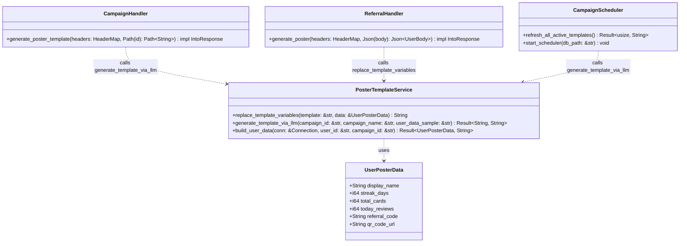
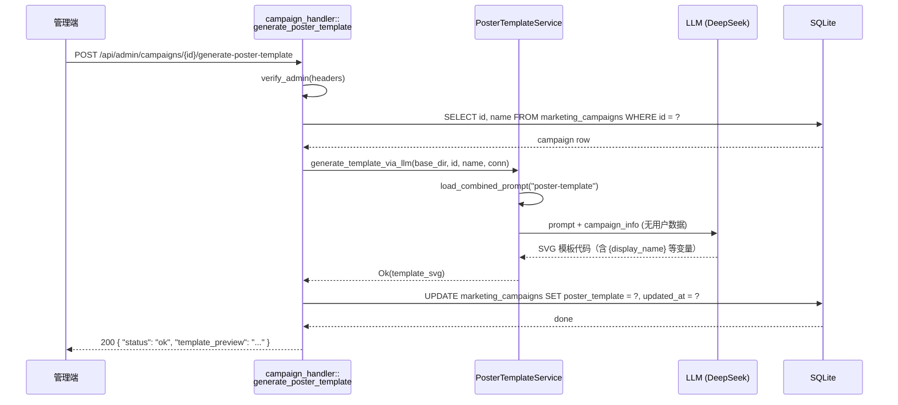
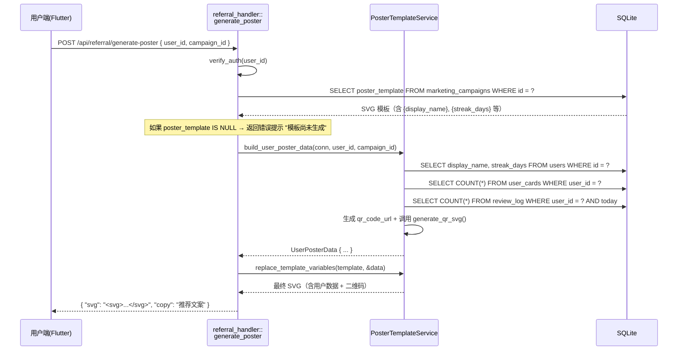
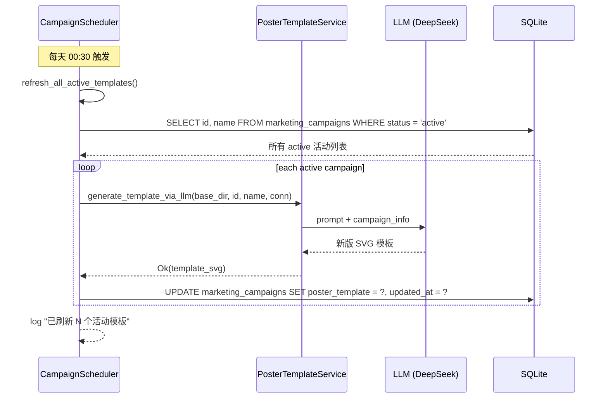
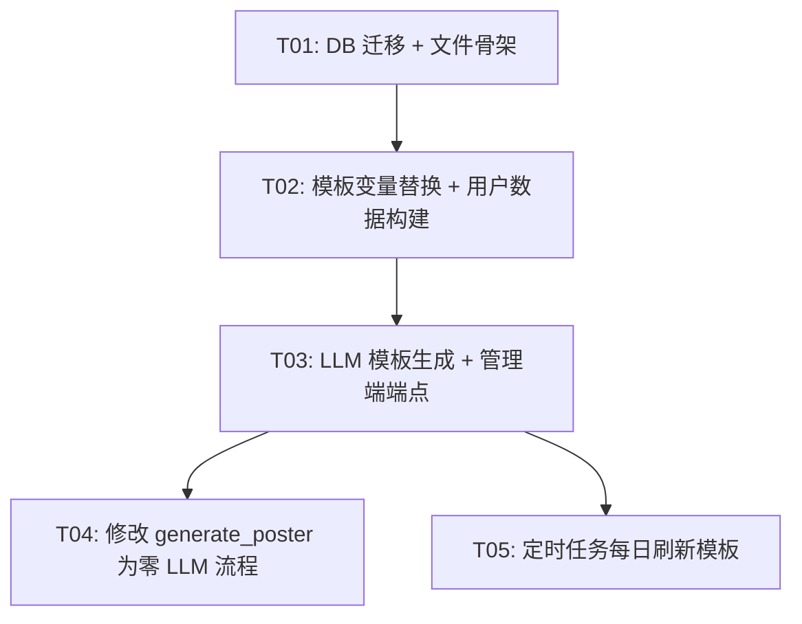

# 海报模板架构 — 系统设计与任务分解

> 版本: v1.0 · 2026-06-19  
> 状态: 设计完成  
> 对应 PRD: `distribution-marketing-design.md` §9.3

---

## 一、Implementation Approach

### 1.1 核心挑战

| # | 挑战 | 解决思路 |
|---|------|---------|
| 1 | 当前 `generate_poster` 每次调 LLM（10-30s），无法扩展 | LLM 只生成含 `{变量}` 的 SVG 模板，存 DB，用户查看时零 LLM 成本 |
| 2 | 模板需要适配不同用户的数据 | 定义 `UserPosterData` 结构体，运行时 `replace()` 函数替换 |
| 3 | 模板需要定期刷新（活动图文内容更新） | 定时任务每天凌晨 00:30 重新生成 |
| 4 | 管理端需要手动触发模板生成 | 新增 `POST /api/admin/campaigns/{id}/generate-poster-template` |

### 1.2 架构模式

- **后端**：继续使用现有 Rust (axum + rusqlite) 架构
- **模板引擎**：不用第三方模板引擎，用简单的 `String::replace()` 替换变量（模板格式简单、可控）
- **SVG→PNG**：保持现有方案（前端 `flutter_svg` 渲染 + `RepaintBoundary` 截图）
- **LLM 调用**：复用 `chat_engine::llm_caller::LlmCaller`

### 1.3 技术选型

| 组件 | 选型 | 理由 |
|------|------|------|
| 模板引擎 | 原生 `String::replace()` | 模板变量格式简单（`{变量名}`），无需引入 Handlebars/Tera |
| QR 生成 | 现有 `qrcode` crate | 已在 `referral_handler.rs` 中使用的 `generate_qr_svg()` |
| LLM 调用 | 现有 `chat_engine::llm_caller` | 复用现有 DeepSeek V4 Flash 调用链 |
| SVG 模板存储 | `marketing_campaigns.poster_template TEXT` | 一行新列，不新增表 |
| 定时任务 | 现有 `campaign_scheduler.rs` 线程 | 扩展现有调度器，新增 `refresh_all_poster_templates()` |

---

## 二、File List

```
backend/
├── crates/
│   └── api_server/
│       ├── src/
│       │   ├── referral_handler.rs        ← [MODIFY] generate_poster() 改为模板替换流程
│       │   ├── campaign_handler.rs         ← [MODIFY] 新增 generate_poster_template() handler
│       │   ├── campaign_scheduler.rs       ← [MODIFY] 新增每日模板刷新任务
│       │   ├── routes.rs                  ← [MODIFY] 注册新路由
│       │   ├── schema.rs                  ← [MODIFY] 新增 poster_template 列迁移
│       │   └── poster_template.rs          ← [NEW] 模板变量替换逻辑 + 模板生成调用
│       └── prompts/
│           └── share/
│               └── poster-template.md       ← [NEW] 指导 LLM 生成含 {变量} 的 SVG 模板
```

---

## 三、Data Structures and Interfaces



### 3.1 UserPosterData（变量替换数据）

| 字段 | 类型 | 来源 | 模板变量名 |
|------|------|------|-----------|
| `display_name` | `String` | `users.display_name` | `{display_name}` |
| `streak_days` | `i64` | `users.streak_days` | `{streak_days}` |
| `total_cards` | `i64` | `user_cards` COUNT | `{total_cards}` |
| `today_reviews` | `i64` | 今日 `review_log` COUNT | `{today_reviews}` |
| `referral_code` | `String` | `users.referral_code` | `{referral_code}` |
| `qr_code_url` | `String` | 动态生成（推广落地页 URL） | `{qr_code_url}` |

### 3.2 PosterTemplateService 核心函数签名

```rust
/// 替换模板中的 {变量} 占位符为用户实际数据
/// 替换规则：
///   1. 遍历 UserPosterData 所有字段，做 String::replace()
///   2. QR_CODE_PLACEHOLDER → 动态生成的二维码 SVG
///   3. 不支持嵌套变量、不支持条件逻辑
pub fn replace_template_variables(template: &str, data: &UserPosterData) -> String {
    let mut result = template.to_string();
    result = result.replace("{display_name}", &data.display_name);
    result = result.replace("{streak_days}", &data.streak_days.to_string());
    result = result.replace("{total_cards}", &data.total_cards.to_string());
    result = result.replace("{today_reviews}", &data.today_reviews.to_string());
    result = result.replace("{referral_code}", &data.referral_code);
    // QR 码特殊处理：将 QR_PLACEHOLDER 占位矩形替换为实际二维码 SVG
    let qr_svg = generate_qr_svg(&data.qr_code_url, "#1A237E", "#FFFFFF");
    result = result.replace("QR_PLACEHOLDER", &qr_svg);
    result
}

/// 构建用户变量替换数据
pub fn build_user_poster_data(
    conn: &rusqlite::Connection,
    user_id: &str,
    campaign_id: &str,
) -> Result<UserPosterData, String>;

/// 调 LLM 生成模板
/// 加载 poster-template.md prompt，注入 campaign 信息
/// 返回含 {变量} 占位符的 SVG 模板字符串
pub async fn generate_template_via_llm(
    base_dir: &str,
    campaign_id: &str,
    campaign_name: &str,
    conn: &rusqlite::Connection,
) -> Result<String, String>;
```

---

## 四、Program Call Flow

### 4.1 管理端手动生成模板



### 4.2 用户查看海报（零 LLM）



### 4.3 定时任务刷新模板



---

## 五、New Prompt 内容

### 5.1 `poster-template.md`（模板生成 prompt）

```markdown
你是一个教育产品的海报设计师。请为以下营销活动生成一张 SVG 分享海报模板。

活动信息：
- 活动名称：{campaign_name}
- 活动奖励：{campaign_rewards}

### 要求

1. **SVG 尺寸**：600×900px
2. **只用变量占位符**（不要填入任何具体用户数据）：
   - `{display_name}` — 用户昵称
   - `{streak_days}` — 连续学习天数
   - `{total_cards}` — 学习卡片总数
   - `{today_reviews}` — 今日复习数
   - `{referral_code}` — 用户推广码
   - `QR_PLACEHOLDER` — 二维码占位矩形（180×180px，白色背景）

3. **设计规范**：
   - 深蓝色渐变背景（#1A237E → #0D1457）
   - 文字浅色（#ffffff / #9DA0F0）
   - 推广码区域亮色高亮
   - 圆角卡片分块展示数据（border-radius: 12px）
   - 品牌标识 "⟐ CoEvo" 放在底部
   - 风格克制干净，适合微信朋友圈
   - 使用现代排版布局，数据卡片至少展示 {streak_days}、{total_cards}、{today_reviews} 三个数据点

4. **输出要求**：
   - 只输出纯 SVG 代码，不要 markdown 包裹
   - 不要包含任何解释文字
```

### 5.2 现有 prompt 文件变更

| 文件 | 动作 | 说明 |
|------|------|------|
| `share/poster.md` | **保留不变** | 旧版完整海报 prompt，作为 fallback（当模板未生成时）|
| `share/signal/poster.md` | **保留不变** | JSON 输出格式指令 |
| `share/format/poster.md` | **保留不变** | 输出格式约束 |
| `share/poster-template.md` | **新增** | 模板生成专用 prompt |

---

## 六、Required Packages

**无新增依赖**。全部使用现有 crate：

| Crate | 已有用途 |
|-------|---------|
| `rusqlite` | DB 操作 |
| `chat_engine::llm_caller` | LLM 调用（DeepSeek V4 Flash）|
| `qrcode` | 二维码 SVG 生成（已在 `referral_handler.rs` 中使用）|
| `uuid` | ID 生成 |
| `chrono` | 时间处理 |
| `serde_json` | JSON 序列化 |
| `tokio` | 异步运行时 |

---

## 七、Task List（ordered by dependency）

### T01: 项目基础设施 — DB 迁移 + 新文件骨架

**任务描述**：
- 新增 `poster_template` 列的迁移 SQL
- 新建 `poster_template.rs` 文件（含空函数签名）
- 导出 `pub use` 声明
- 确保编译通过

**Source Files**:
| 文件 | 动作 |
|------|------|
| `backend/crates/api_server/src/schema.rs` | MODIFY — 添加迁移: `ALTER TABLE marketing_campaigns ADD COLUMN poster_template TEXT DEFAULT NULL` |
| `backend/crates/api_server/src/poster_template.rs` | CREATE — 新文件，定义 `UserPosterData` 结构体 + 函数签名 stub |
| `backend/crates/api_server/src/lib.rs`（或 mod.rs） | MODIFY — 添加 `pub mod poster_template;` 声明 |

**Dependencies**: 无  
**Priority**: P0

### T02: 模板变量替换 + 用户数据构建

**任务描述**：
- 实现 `UserPosterData` 结构体定义（含 `#[derive(Deserialize)]`）
- 实现 `build_user_poster_data()` 函数：从 DB 查询用户数据
- 实现 `replace_template_variables()` 函数：`{变量}` → 实际值 + QR_PLACEHOLDER → 二维码 SVG
- 单元测试覆盖

**Source Files**:
| 文件 | 动作 |
|------|------|
| `backend/crates/api_server/src/poster_template.rs` | MODIFY — 实现完整数据结构和函数 |
| `backend/crates/api_server/src/referral_handler.rs` | MODIFY — 导入 `UserPosterData`，提取 `get_user_portrait_data()` 为复用函数 |
| `backend/crates/api_server/src/campaign_handler.rs` | MODIFY — 导入 `replace_template_variables`（后续步骤使用）|

**Dependencies**: T01  
**Priority**: P0

### T03: LLM 模板生成 + 管理端端点

**任务描述**：
- 新建 `poster-template.md` prompt 文件
- 实现 `generate_template_via_llm()` 函数
- 实现 `campaign_handler::generate_poster_template()` handler
- 注册路由 `POST /api/admin/campaigns/{id}/generate-poster-template`
- LLM 返回的 SVG 直接写入 `marketing_campaigns.poster_template`

**Source Files**:
| 文件 | 动作 |
|------|------|
| `backend/prompts/share/poster-template.md` | CREATE — 模板生成 prompt（含 `{变量}` 占位符指令）|
| `backend/crates/api_server/src/poster_template.rs` | MODIFY — 实现 `generate_template_via_llm()` |
| `backend/crates/api_server/src/campaign_handler.rs` | MODIFY — 实现 `generate_poster_template()` handler |
| `backend/crates/api_server/src/routes.rs` | MODIFY — 注册新路由 |
| `backend/crates/api_server/src/referral_handler.rs` | MODIFY — 复用 `load_combined_prompt()` 加载 `poster-template` |

**Dependencies**: T02  
**Priority**: P0

### T04: 修改 `generate_poster` 为用户端零 LLM 流程

**任务描述**：
- 修改 `referral_handler::generate_poster()`：
  1. 查 `campaign.poster_template`
  2. 如果为 NULL → 返回错误提示（引导管理端先生成模板）
  3. 否则调 `build_user_poster_data()` + `replace_template_variables()`
  4. 返回最终 SVG + copy 文案（copy 文案改为固定模板 "一起扫码学习吧"）
- 移除旧版 LLM 调用逻辑（保留 fallback 兜底）

**Source Files**:
| 文件 | 动作 |
|------|------|
| `backend/crates/api_server/src/referral_handler.rs` | MODIFY — 重写 `generate_poster()` 函数体 |
| `backend/crates/api_server/src/poster_template.rs` | MODIFY — 添加 `fallback_poster_svg()` 和 `fallback_copy()` |

**Dependencies**: T03  
**Priority**: P1

### T05: 定时任务每日刷新模板

**任务描述**：
- 在 `campaign_scheduler.rs` 中新增 `refresh_all_active_templates()` 函数
- 修改 `start_scheduler()`：新增一个独立的 24 小时循环线程（每天 00:30 执行）
- 遍历所有 `status='active'` 的活动，逐个调 `generate_template_via_llm()` 刷新 `poster_template`
- 异常处理：单个活动刷新失败不影响其他活动

**Source Files**:
| 文件 | 动作 |
|------|------|
| `backend/crates/api_server/src/campaign_scheduler.rs` | MODIFY — 新增 `refresh_all_active_templates()` + 调度线程 |
| `backend/crates/api_server/src/poster_template.rs` | MODIFY — 导出 `generate_template_via_llm()`（若尚未导出）|
| `backend/crates/api_server/src/main.rs`（或启动入口）| MODIFY — 确保 `start_scheduler()` 在启动时被调用（通常已调用）|

**Dependencies**: T03  
**Priority**: P1

---

## 八、Task Dependency Graph



---

## 九、Shared Knowledge

1. **DB 迁移规则**：所有 `ALTER TABLE` 使用 `run_migrations_inner()` 中的迁移数组，并容错 `duplicate column`
2. **环境变量**：`COEVO_PROMPTS_DIR` 默认值为 `"prompts"`（相对于 `backend/` 目录）；实际 prompt 文件位于 `{COEVO_PROMPTS_DIR}/share/`
3. **LLM 配置**：使用 `chat_engine::llm_caller::LlmConfig::deepseek_v4_flash`，45 秒超时
4. **QR 码生成**：复用 `referral_handler.rs` 中已有的 `generate_qr_svg(content, color, bg_color)` 函数
5. **模板格式**：SVG 模板中的 `{变量}` 格式保持简单字符串替换，不做嵌套或条件解析
6. **fallback 策略**：如果 `poster_template` 为 NULL，`generate_poster` 返回明确错误 `{"error": "poster_template_not_generated"}`，引导管理端先生成模板
7. **限流**：`POST /api/referral/generate-poster` 保持现有每用户 5 次/分钟限流（模板替换很快但防止前端疯狂请求）
8. **prompt 加载**：`poster-template.md` 通过现有的 `load_combined_prompt(base_dir, "poster-template")` 加载，自动合并 signal/format 子目录文件（如存在）

---

## 十、Anything UNCLEAR

1. **copy 文案**：当前 LLM 生成海报时同步生成个性化文案。模板架构下文案不再个性化。建议改为固定文案如"一起扫码学习吧！{referral_code}"。需要确认是否接受此折衷。
2. **用户画像数据**：`get_user_portrait_data()` 目前返回丰富的学习数据（含 `overall_mastery`, `subject_mastery` 等）。模板变量只定义 6 个基础字段。如果后续需要模板展示更多个性化数据（如"最近掌握的单词"），需要扩展现有变量集。**建议预留扩展：模板中允许使用 `{extra_data_json}` 作为可选变量**。
3. **LLM 模板质量**：第一次生成的模板可能不完美（布局、配色等）。管理端"生成模板"是手动触发的，管理员可以多次点击直到满意。定时任务自动覆盖。
4. **定时任务时间精度**：当前调度器使用 `std::thread::sleep`（5 分钟间隔），每天 00:30 需要精确时间触发。建议计算到 00:30 的剩余秒数作为初始 sleep，然后进入 24 小时循环。
