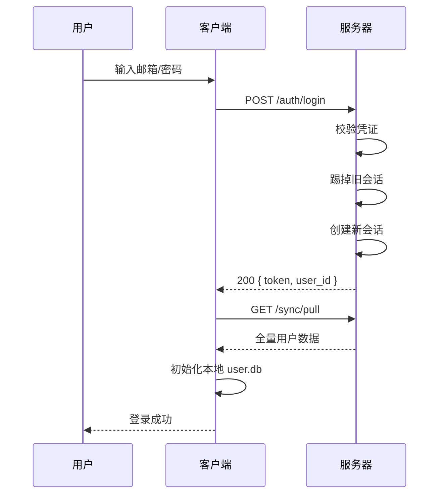
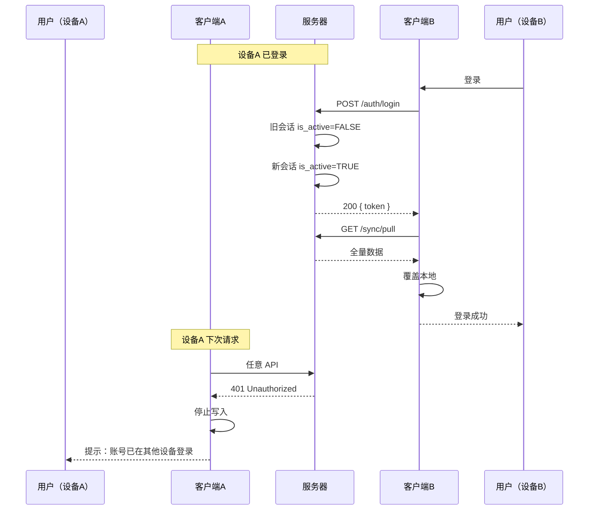
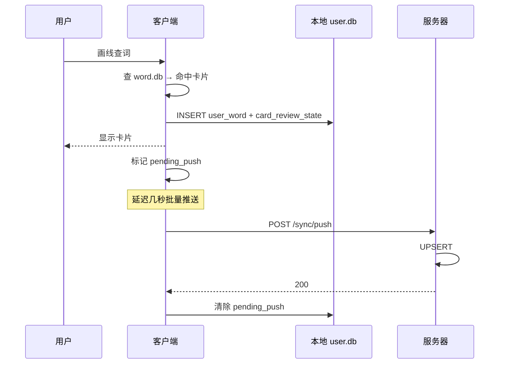
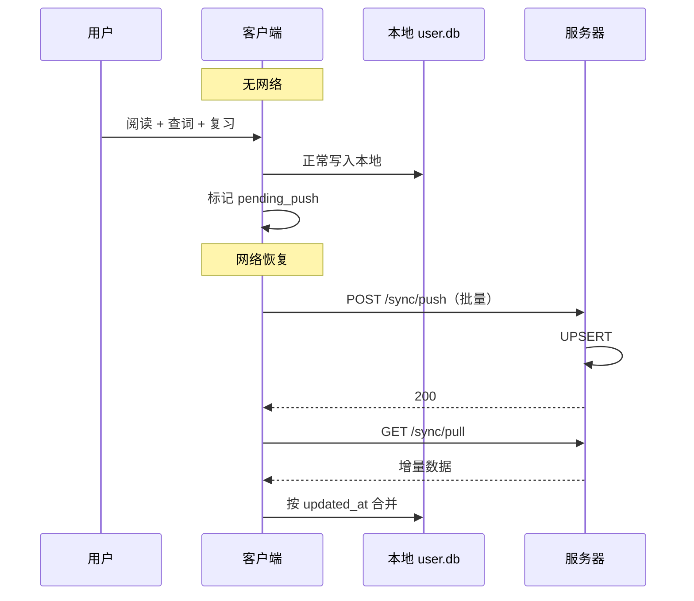
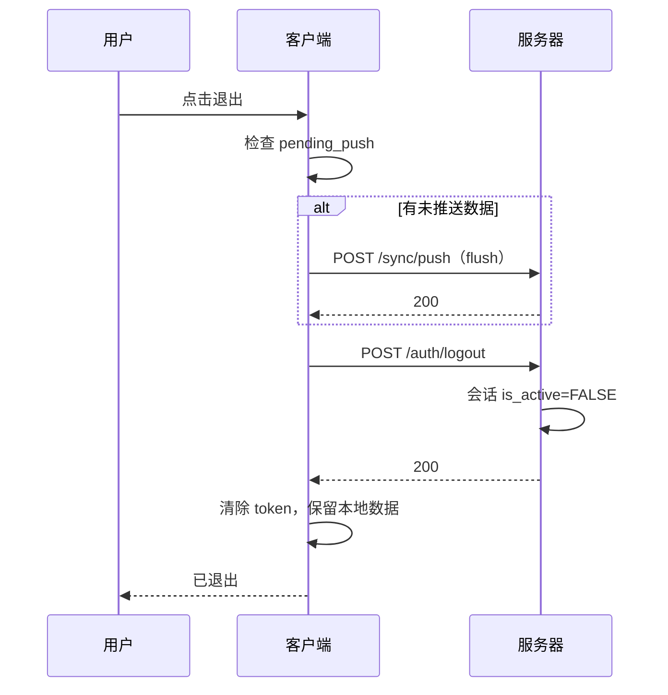
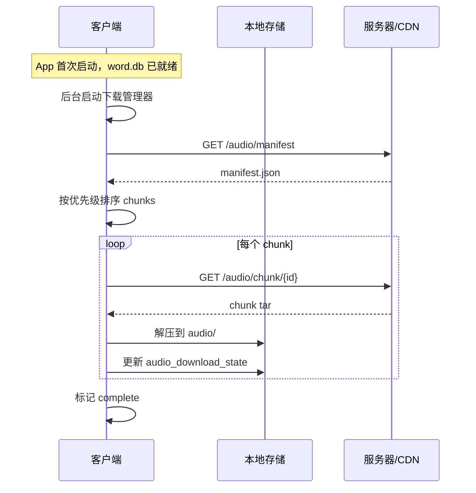

# 阅读器 + 单词学习 App 完整技术方案（最终版）

> # 🔴 本文档是**最高权威**
> - **来源**：白哥原文，2026-09-25
> - **地位**：所有设计判断的**唯一依据**。任何实现与本文件冲突 → **以本文件为准**
> - **为什么单独立档**：此前本文只在二手文档里被**转述**（评审报告、对照表），
>   导致反复出现「按二手解读做实现 → 偏离原文」的问题。
>   **引用设计时必须回到本文件，不得引用转述。**
> - **改动规则**：本文件为白哥原文，**助手不得自行修改**。若发现需要变更，先请示。

---

## 一、产品概述

### 1.1 核心定位

一款**离线优先**的英文阅读 + 单词学习工具。用户在阅读文章时画线查词，查询过的单词自动进入生词本，按记忆曲线安排复习。每个单词的卡片在制卡时根据记忆法优先级组合生成，内容固化，用户无需选择记忆法。

### 1.2 核心流程

```
阅读文章 → 画线查词 → 生词本 → 间隔重复复习
                ↓
        预制卡片直接展示
                ↓
        词库外生词 → LLM 兜底制卡
```

### 1.3 关键设计决策

| 决策 | 结论 |
|---|---|
| 词库规模 | CEFR 全量，约 1.5–2 万词族 / 3–5 万词形 |
| 卡片生成 | 全部预生成，离线批处理 |
| 一词一卡 | UI 层原则，一页有容量上限 |
| 聚合页 | 只读查询页，不进复习队列，无容量上限 |
| 卡片升级 | 按 id 直接覆盖，全用户同步新版本 |
| 词库分发 | 不分档，全量打包进 App |
| 多设备 | 不支持同步，单端登录，踢旧 |
| 联网场景 | 登录/同步 + 词库外生词制卡 + 语音包下载 |
| 记忆法 | 制卡时按优先级组合，内容固化 |
| 语音包 | 不打包进初装，安装后异步下载 |

---

## 二、整体架构

```
┌──────────────────────────────────────────────┐
│              用户设备（离线优先）               │
│                                              │
│  阅读器                                       │
│  预制库 word.db（只读，随 App 更新）            │
│  语音包 audio/（异步下载，本地缓存）             │
│  用户库 user.db（读写，本地工作副本）             │
│  FSRS 调度（本地计算）                         │
│  同步模块（登录 / 拉取 / 推送）                  │
│  下载管理器（语音包 / 更新）                    │
│                                              │
└──────────────────┬───────────────────────────┘
                   │
                   │ 联网场景：
                   │ 1. 登录 / 同步用户表
                   │ 2. 语音包异步下载
                   │ 3. 词库外生词 → LLM 制卡
                   │
                   ▼
┌──────────────────────────────────────────────┐
│                云端服务                       │
│                                              │
│  认证 + 单端会话管理                           │
│  用户表（权威副本）                            │
│  语音包分发服务                                │
│  LLM 制卡服务 + 全局缓存                       │
│                                              │
└──────────────────────────────────────────────┘
```

### 2.1 离线与在线边界

| 功能 | 离线 | 在线 |
|---|---|---|
| 阅读 | ✅ | — |
| 查词（词库内） | ✅ | — |
| 查词（词库外） | 排队 | ✅ LLM 制卡 |
| 复习 | ✅ 本地 FSRS | — |
| 生词本 | ✅ 本地 | — |
| 单词/例句发音 | ✅（已下载） | 下载中不可用 |
| 登录/同步 | — | ✅ |
| 语音包下载 | — | ✅ |

### 2.2 初装与首次启动

```
安装 App
  ├── app 代码
  └── word.db（~50 MB）
       ↓
首次启动
  ├── 立即可用：阅读、查词、复习
  └── 后台异步：下载语音包
```

初装体积约 **50–80 MB**，语音包后台下载，不阻塞使用。

---

## 三、数据层设计

### 3.1 预制库 `word.db`（只读，随 App 更新）

#### 3.1.1 词典主表

```sql
CREATE TABLE word (
  id              INTEGER PRIMARY KEY,
  spelling        TEXT NOT NULL,
  lemma           TEXT NOT NULL,
  frequency_rank  INTEGER,
  cefr_level      TEXT,          -- A1-C2
  etymology_text  TEXT,
  UNIQUE (lemma)
);

CREATE INDEX idx_word_spelling ON word (spelling);
CREATE INDEX idx_word_lemma ON word (lemma);
```

> **关键约束**：`word_id` 一旦分配，永久不变。预制库升级时新词追加，旧词不删不改 id。

#### 3.1.2 卡片表（一词一卡，内容固化）

```sql
CREATE TABLE card (
  id            INTEGER PRIMARY KEY,
  word_id       INTEGER NOT NULL REFERENCES word(id),
  template_code TEXT NOT NULL,      -- root / cognate / collocation / mixed
  content       TEXT NOT NULL,      -- JSON，一页内容
  content_hash  TEXT UNIQUE,
  updated_at    TEXT DEFAULT (datetime('now')),
  created_at    TEXT DEFAULT (datetime('now'))
);

CREATE INDEX idx_card_word ON card (word_id);
```

#### 3.1.3 词根与词缀

```sql
CREATE TABLE word_root (
  id      INTEGER PRIMARY KEY,
  form    TEXT NOT NULL,       -- cred / in- / -ible
  type    TEXT NOT NULL,       -- root / prefix / suffix
  meaning TEXT,
  origin  TEXT
);

CREATE TABLE word_root_link (
  word_id  INTEGER REFERENCES word(id),
  root_id  INTEGER REFERENCES word_root(id),
  position INTEGER,
  PRIMARY KEY (word_id, root_id, position)
);
```

#### 3.1.4 同源词群

```sql
CREATE TABLE cognate_group (
  id          INTEGER PRIMARY KEY,
  name        TEXT,
  root_id     INTEGER REFERENCES word_root(id),
  description TEXT
);

CREATE TABLE cognate_group_member (
  group_id INTEGER REFERENCES cognate_group(id),
  word_id  INTEGER REFERENCES word(id),
  PRIMARY KEY (group_id, word_id)
);
```

#### 3.1.5 搭配

```sql
CREATE TABLE collocation (
  id        INTEGER PRIMARY KEY,
  phrase    TEXT NOT NULL,
  frequency INTEGER
);

CREATE TABLE word_collocation (
  word_id        INTEGER REFERENCES word(id),
  collocation_id INTEGER REFERENCES collocation(id),
  PRIMARY KEY (word_id, collocation_id)
);
```

#### 3.1.6 聚合查询页

```sql
CREATE TABLE aggregate_page (
  id         INTEGER PRIMARY KEY,
  page_type  TEXT NOT NULL,      -- cognate / root_family / collocation_group
  title      TEXT,
  content    TEXT NOT NULL,      -- JSON，无容量上限
  updated_at TEXT DEFAULT (datetime('now'))
);

CREATE TABLE aggregate_page_word (
  page_id  INTEGER REFERENCES aggregate_page(id),
  word_id  INTEGER REFERENCES word(id),
  position INTEGER,
  PRIMARY KEY (page_id, word_id)
);
```

> 聚合页**不进复习队列**，不需要 `card_review_state`，无容量约束。

#### 3.1.7 记忆法分析结果

```sql
CREATE TABLE mnemonic_type (
  id       INTEGER PRIMARY KEY,
  code     TEXT UNIQUE,
  name     TEXT,
  priority INTEGER
);

CREATE TABLE word_mnemonic_profile (
  word_id           INTEGER PRIMARY KEY REFERENCES word(id),
  primary_type_id   INTEGER REFERENCES mnemonic_type(id),
  secondary_type_id INTEGER REFERENCES mnemonic_type(id),
  confidence        REAL,
  analysis          TEXT,
  analyzed_at       TEXT DEFAULT (datetime('now'))
);
```

记忆法优先级：

| priority | code | name |
|---|---|---|
| 1 | root | 词根词缀 |
| ~~2~~ | ~~cognate~~ | ~~同源串记~~ —— 🔴 **聚合页，非卡上记忆法**（2026-09-28 摘除，见 §4.1 标注） |
| 3 | collocation | 搭配整记 |
| 4 | etymology | 词源故事 |
| 5 | imagery | 联想图像 |
| 6 | context | 语境原句 |

> ⚠️ 两处小差异（都是历史残留，**不改**：本文是白哥原文，动它就不再是权威原件）：
> · `imagery` 实际落库为 **`image`**（`mnemonic_type.code` 实测值）
> · `cognate` 已于 2026-09-28 整层摘除（见 §4.1 标注）
> · 🔄 **`collocation` 与 `etymology` 的 3/4 级与本表相反**：
>   实际生效 `etymology 3` / `collocation 4`（白哥 2026-09-28 19:3x 定）→ 理由见 §4.1 标注

#### 3.1.8 语音元数据表

```sql
CREATE TABLE card_audio (
  id            INTEGER PRIMARY KEY,
  word_id       INTEGER NOT NULL REFERENCES word(id),
  card_id       INTEGER NOT NULL REFERENCES card(id),
  audio_type    TEXT NOT NULL,      -- 'word' | 'sentence' | 'collocation'
  section_index INTEGER,            -- 对应 content.sections 下标，word 为 NULL
  text          TEXT NOT NULL,      -- 朗读的英文原文
  file_name     TEXT NOT NULL,      -- 如 '00001_w.opus'
  duration_ms   INTEGER,
  file_size     INTEGER,
  content_hash  TEXT,
  UNIQUE (word_id, audio_type, section_index)
);

CREATE INDEX idx_card_audio_word ON card_audio (word_id);
```

> 这张表只存**元数据**，音频文件本身在语音包中，下载后落到本地 `audio/` 目录。

---

### 3.2 用户库 `user.db`（读写，本地工作副本）

```sql
-- 生词本
CREATE TABLE user_word (
  id                INTEGER PRIMARY KEY AUTOINCREMENT,
  word_id           INTEGER NOT NULL,
  source_article_id INTEGER,
  source_sentence   TEXT,
  added_at          TEXT DEFAULT (datetime('now')),
  updated_at        TEXT DEFAULT (datetime('now')),
  deleted           INTEGER DEFAULT 0,
  pending_push      INTEGER DEFAULT 1,
  UNIQUE (word_id)
);

-- 复习状态
CREATE TABLE card_review_state (
  id                  INTEGER PRIMARY KEY AUTOINCREMENT,
  card_id             INTEGER NOT NULL,
  status              TEXT DEFAULT 'new',
  fsrs_stability      REAL,
  fsrs_difficulty     REAL,
  fsrs_elapsed_days   INTEGER,
  fsrs_scheduled_days INTEGER,
  reps                INTEGER DEFAULT 0,
  lapses              INTEGER DEFAULT 0,
  last_review_at      TEXT,
  next_review_at      TEXT,
  updated_at          TEXT DEFAULT (datetime('now')),
  pending_push        INTEGER DEFAULT 1,
  UNIQUE (card_id)
);

CREATE INDEX idx_review_due ON card_review_state (next_review_at);
CREATE INDEX idx_pending ON card_review_state (pending_push);

-- 复习日志
CREATE TABLE review_log (
  id           INTEGER PRIMARY KEY AUTOINCREMENT,
  card_id      INTEGER NOT NULL,
  rating       INTEGER,
  duration_ms  INTEGER,
  error_type   TEXT,
  reviewed_at  TEXT DEFAULT (datetime('now')),
  pending_push INTEGER DEFAULT 1
);

-- 查词记录
CREATE TABLE lookup_event (
  id           INTEGER PRIMARY KEY AUTOINCREMENT,
  word_id      INTEGER,
  article_id   INTEGER,
  sentence     TEXT,
  position     INTEGER,
  looked_up_at TEXT DEFAULT (datetime('now'))
);

-- 阅读文章
CREATE TABLE article (
  id           INTEGER PRIMARY KEY AUTOINCREMENT,
  title        TEXT,
  content      TEXT,
  source_url   TEXT,
  created_at   TEXT DEFAULT (datetime('now')),
  updated_at   TEXT DEFAULT (datetime('now')),
  deleted      INTEGER DEFAULT 0,
  pending_push INTEGER DEFAULT 1
);

-- 词库外生词缓存
CREATE TABLE external_word_cache (
  id           INTEGER PRIMARY KEY AUTOINCREMENT,
  spelling     TEXT UNIQUE,
  card_content TEXT NOT NULL,
  fetched_at   TEXT DEFAULT (datetime('now')),
  pending_push INTEGER DEFAULT 1
);

-- 词库外生词语音缓存
CREATE TABLE external_word_audio (
  id         INTEGER PRIMARY KEY AUTOINCREMENT,
  spelling   TEXT NOT NULL,
  audio_type TEXT NOT NULL,
  text       TEXT NOT NULL,
  file_name  TEXT NOT NULL,
  fetched_at TEXT DEFAULT (datetime('now')),
  UNIQUE (spelling, audio_type)
);

-- 语音包下载状态
CREATE TABLE audio_download_state (
  id              INTEGER PRIMARY KEY CHECK (id = 1),
  package_version TEXT,
  status          TEXT DEFAULT 'none',   -- none / downloading / partial / complete
  downloaded_files INTEGER DEFAULT 0,
  total_files     INTEGER DEFAULT 0,
  downloaded_bytes INTEGER DEFAULT 0,
  total_bytes     INTEGER DEFAULT 0,
  last_error      TEXT,
  updated_at      TEXT DEFAULT (datetime('now'))
);

-- 同步元信息
CREATE TABLE sync_meta (
  id             INTEGER PRIMARY KEY CHECK (id = 1),
  last_pull_at   TEXT,
  last_push_at   TEXT,
  server_user_id INTEGER,
  device_id      TEXT,
  token          TEXT
);
```

---

### 3.3 服务端表（PostgreSQL）

```sql
-- 用户
CREATE TABLE app_user (
  id            BIGSERIAL PRIMARY KEY,
  email         VARCHAR(255) UNIQUE,
  password_hash VARCHAR(255),
  created_at    TIMESTAMPTZ DEFAULT now()
);

-- 单端会话
CREATE TABLE user_session (
  id           BIGSERIAL PRIMARY KEY,
  user_id      BIGINT REFERENCES app_user(id),
  device_id    VARCHAR(128) NOT NULL,
  token_hash   VARCHAR(255) NOT NULL,
  is_active    BOOLEAN DEFAULT TRUE,
  created_at   TIMESTAMPTZ DEFAULT now(),
  last_seen_at TIMESTAMPTZ DEFAULT now()
);

CREATE INDEX idx_session_user_active ON user_session (user_id, is_active);

-- 用户数据（权威副本）
CREATE TABLE user_word (
  user_id           BIGINT REFERENCES app_user(id),
  word_id           BIGINT NOT NULL,
  source_article_id BIGINT,
  source_sentence   TEXT,
  added_at          TIMESTAMPTZ,
  updated_at        TIMESTAMPTZ DEFAULT now(),
  deleted           BOOLEAN DEFAULT FALSE,
  PRIMARY KEY (user_id, word_id)
);

CREATE TABLE card_review_state (
  user_id             BIGINT REFERENCES app_user(id),
  card_id             BIGINT NOT NULL,
  status              TEXT DEFAULT 'new',
  fsrs_stability      REAL,
  fsrs_difficulty     REAL,
  fsrs_elapsed_days   INTEGER,
  fsrs_scheduled_days INTEGER,
  reps                INTEGER DEFAULT 0,
  lapses              INTEGER DEFAULT 0,
  last_review_at      TIMESTAMPTZ,
  next_review_at      TIMESTAMPTZ,
  updated_at          TIMESTAMPTZ DEFAULT now(),
  PRIMARY KEY (user_id, card_id)
);

CREATE TABLE review_log (
  id          BIGSERIAL PRIMARY KEY,
  user_id     BIGINT REFERENCES app_user(id),
  card_id     BIGINT NOT NULL,
  rating      SMALLINT,
  duration_ms INTEGER,
  error_type  TEXT,
  reviewed_at TIMESTAMPTZ
);

CREATE TABLE article (
  id         BIGSERIAL PRIMARY KEY,
  user_id    BIGINT REFERENCES app_user(id),
  title      TEXT,
  content    TEXT,
  source_url TEXT,
  created_at TIMESTAMPTZ DEFAULT now(),
  updated_at TIMESTAMPTZ DEFAULT now(),
  deleted    BOOLEAN DEFAULT FALSE
);

CREATE TABLE external_word_cache (
  user_id      BIGINT REFERENCES app_user(id),
  spelling     VARCHAR(128),
  card_content JSONB NOT NULL,
  fetched_at   TIMESTAMPTZ DEFAULT now(),
  PRIMARY KEY (user_id, spelling)
);

-- LLM 制卡全局缓存
CREATE TABLE generated_card_cache (
  spelling     VARCHAR(128) PRIMARY KEY,
  card_content JSONB NOT NULL,
  source       VARCHAR(16),
  hit_count    INTEGER DEFAULT 0,
  created_at   TIMESTAMPTZ DEFAULT now()
);

-- 语音包版本
CREATE TABLE audio_package_version (
  id            BIGSERIAL PRIMARY KEY,
  version       VARCHAR(32) UNIQUE,
  word_db_version VARCHAR(32),
  total_files   INTEGER,
  total_bytes   BIGINT,
  manifest_url  TEXT,
  created_at    TIMESTAMPTZ DEFAULT now()
);
```

---

## 四、记忆法与制卡

### 4.1 记忆法优先级

制卡时按 `mnemonic_type.priority` 选主记忆法和次记忆法，组合成一页。

| 优先级 | 记忆法 | 适用词 |
|---|---|---|
| 1 | 词根词缀 | 可分解词 |
| ~~2~~ | ~~同源串记~~ | 🔴 **不是卡上记忆法，是聚合页** —— 见下方标注 |
| 3 | 搭配整记 | 固定搭配强的词 |
| 4 | 词源故事 | 外来整体词 |
| 5 | 联想图像 | 抽象词 |
| 6 | 语境原句 | 默认附加 |

> 🔴 **2026-09-28 标注（白哥）**：「**同源串记是聚合页，现在还总是把这个放在记忆法里**」
> —— 第 2 级的 `cognate` **不是卡上记忆法**：它的卡片段 100% 无文本（只有族标签）、
> 且与同词 `root` 段**指向同一个 `aggregate_page`**（实测 2,988 段全部如此）。
> 已**整层摘除**（`mnemonic_type` 行 · `profile` · 卡片段 · 代码渲染分支）。
> 记忆法层现为 **5 类**（本表余下 5 行）。📄 详见 `docs/design/word-card-note-and-aggregate-refine-2026-09-28.html` §1.10。
>
> 🔄 **本表 3/4 级与实际生效值相反（白哥 2026-09-28 19:3x 定）—— 两处表都要读**：
> · **本表（＝ v1 §4.1 原文）写 `搭配整记 3` > `词源故事 4`**
> · ✅ **实际生效值相反：`词源故事 3` / `搭配整记 4`**（＝ 2026-09-27 那次交换的方案）
>
> 🔑 **为什么最终选了「词源优先」（一条判据修正）**：
> 当初反对它的理由是「`collocation` 条件**几乎恒真**（99.3%）→ 排在前会吃掉槽位①」。
> 但 09-28 实测 **`etymology` 同样几乎恒真** —— 有该段的词 **11,407 / 11,523 = 99.0%**。
> → ⚠️ **那条论据对两者等效，不能用来裁决谁在前**（谁排 3 谁就吃掉 ①）。
> → 3/4 级只能靠**产品判断**：卡片第二段给「**怎么用它**」（搭配）还是「**它从哪来**」（词源）。
> 白哥定：**词源优先**。
>
> ⚠️ **本表数字不改** —— 本文是白哥原文（L0 权威原件），改写它就不再是权威原件。
> 实际生效值以 `mnemonic_type.priority`（库表）为准，代码 `CardSlots.order` 与断言均守护它。
> 📄 论证：`docs/review/mnemonic-slot-priority-conflict-2026-09-27.md`（含 09-28 两次改口）
> ｜决策过程：`docs/design/card-aggregate-plan-2026-09-28.html` §四
> · 🔄 09-28 白哥**在知悉上述后果后**仍定「以 v1 为准」→ 已改回本表顺序；
>   实测会回到 `collocation` 51.7% / `etymology` 0.5%（**这是已知并接受的代价**）。

### 4.2 卡片内容结构

```json
{
  "front": "incredible",
  "sections": [
    {
      "type": "root",
      "text": "in-（不）+ cred（相信）+ -ible（能…的）",
      "payload": {
        "parts": [
          {"form": "in-", "type": "prefix", "meaning": "不"},
          {"form": "cred", "type": "root", "meaning": "相信"},
          {"form": "-ible", "type": "suffix", "meaning": "能…的"}
        ]
      }
    },
    {"type": "definition", "text": "难以置信的"},
    {"type": "context", "text": "The story is incredible."}
  ]
}
```

### 4.3 聚合页内容结构

```json
{
  "front": "-ceive 词源族",
  "sections": [
    {
      "type": "cognate_list",
      "items": [
        {"word": "receive", "gloss": "拿回来 → 接收"},
        {"word": "perceive", "gloss": "完全拿到 → 察觉"},
        {"word": "conceive", "gloss": "一起拿 → 构想"},
        {"word": "deceive", "gloss": "拿走 → 欺骗"}
      ]
    }
  ]
}
```

### 4.4 单词卡与聚合页的关联

```json
{
  "type": "aggregate_link",
  "page_id": 123,
  "label": "-ceive 词源族（4 个词）"
}
```

点击跳转到 `aggregate_page`，纯查询，不入复习。

---

## 五、一页容量控制

### 5.1 容量上限

| 维度 | 上限 |
|---|---|
| section 数 | 4 |
| 总字数 | 200–300 |
| 单 section 字数 | 80–100 |
| 聚合页条目数 | 5–7 |

### 5.2 超限处理

1. 按优先级裁剪：priority 小的先保留
2. 超出部分转 `card_extra`：作为可展开内容
3. 聚合内容单独成页：单词页只放入口
4. 语境只留一条

```sql
CREATE TABLE card_extra (
  id       INTEGER PRIMARY KEY,
  card_id  INTEGER REFERENCES card(id),
  type     TEXT,
  content  TEXT,
  position INTEGER
);
```

---

## 六、语音包设计

### 6.1 语音包定位

| 项 | 结论 |
|---|---|
| 内容 | 单词朗读 + 英文例句朗读 + 英文搭配朗读 |
| 不包含 | 中文释义、词根分析、词源故事 |
| 生成时机 | 与卡片一同离线批处理 |
| 存储 | 独立语音包，**初装不打包** |
| 分发 | 用户安装完成后，后端异步下载 |
| 播放 | 下载后完全离线 |
| 格式 | Opus（体积小，音质够） |

### 6.2 需要朗读的文本

| section type | 是否朗读 | 朗读内容 |
|---|---|---|
| `front`（单词） | ✅ | 单词本身 |
| `context` | ✅ | 英文例句 |
| `collocation` | ✅ | 英文搭配 |
| `definition` | ❌ | 中文 |
| `root` | ❌ | 含中文 |
| `etymology` | ❌ | 含中文 |
| `cognate` | ❌ | 混合中文，跳过 |
| `aggregate_link` | ❌ | 入口 |

**原则：只朗读纯英文文本。**

```python
def is_english_only(text):
    return not any('\u4e00' <= c <= '\u9fff' for c in text)
```

### 6.3 文件命名与目录

```
audio/
  ├── 00001_w.opus        # word_id=1 的单词音频
  ├── 00001_s0.opus       # word_id=1 的第 0 个例句
  ├── 00001_s1.opus
  ├── 00001_c2.opus       # word_id=1 的第 2 个搭配
  └── ...
```

命名规则：

| 类型 | 命名 |
|---|---|
| 单词 | `{word_id}_w.opus` |
| 例句 | `{word_id}_s{section_index}.opus` |
| 搭配 | `{word_id}_c{section_index}.opus` |

### 6.4 容量估算

以 Opus 24 kbps 单声道：

| 项 | 单文件 | 数量 | 小计 |
|---|---|---|---|
| 单词音频 | ~3 KB | 2 万 | 60 MB |
| 例句音频 | ~12 KB | 2 万 | 240 MB |
| 搭配音频 | ~6 KB | 1 万 | 60 MB |
| **合计** | | | **~360 MB** |

### 6.5 语音包分发机制

#### 6.5.1 包结构

语音包按**分片**组织，支持断点续传和优先下载：

```
audio_package_v1/
  ├── manifest.json          # 文件清单 + 校验和
  ├── chunk_0000.tar         # 按 word_id 分片，如 1–2000
  ├── chunk_0001.tar         # 2001–4000
  ├── chunk_0002.tar
  └── ...
```

`manifest.json` 示例：

```json
{
  "version": "v1",
  "word_db_version": "2026.09",
  "total_files": 50000,
  "total_bytes": 377487360,
  "chunks": [
    {
      "id": "chunk_0000",
      "word_id_range": [1, 2000],
      "file_count": 5000,
      "bytes": 37748736,
      "sha256": "...",
      "url": "https://cdn.example.com/audio/v1/chunk_0000.tar"
    }
  ]
}
```

#### 6.5.2 下载策略

```
首次启动后：
  1. 请求 manifest.json
  2. 按优先级下载：
     - 优先下载用户生词本中已有的词
     - 其次下载高频词（CEFR A1-B2）
     - 最后下载剩余
  3. 支持断点续传
  4. 支持 Wi-Fi only 选项
  5. 下载完成的 chunk 解压到 audio/ 目录
  6. 更新 audio_download_state
```

#### 6.5.3 客户端下载管理器

```python
class AudioDownloadManager:
    def start(self):
        manifest = fetch_manifest()
        chunks = prioritize(manifest.chunks, user_vocab)

        for chunk in chunks:
            if self.is_downloaded(chunk):
                continue
            self.download_chunk(chunk)
            self.extract_to_audio_dir(chunk)
            self.update_state()

    def prioritize(self, chunks, user_vocab):
        # 用户已查过的词所在 chunk 优先
        return sorted(chunks, key=lambda c: -overlap(c, user_vocab))
```

#### 6.5.4 播放时的降级

```
用户点击 🔊
  → 查本地 audio/ 是否有文件
  ├── 有 → 本地播放
  └── 无 → 提示"语音包下载中"
        → 可选：触发优先下载该词
```

### 6.6 语音包更新

- 语音包版本与 `word.db` 版本绑定
- `word.db` 升级后，若语音包有变化，重新下载
- 客户端对比 `audio_download_state.package_version` 与服务器 manifest
- 只下载差异 chunk

### 6.7 词库外生词的语音

```
用户点击词库外生词 🔊
  → 查 external_word_audio
  ├── 命中 → 本地播放
  └── 未命中 → 联网 TTS 生成
        → 写入本地
        → 播放
```

---

## 七、离线优先与同步

### 7.1 同步模型：单写者 + 服务器权威

```
本地 user.db  ←→  服务器 user 表
     ↑                    ↑
  工作副本            权威副本
```

### 7.2 单端登录机制

```sql
-- 登录时踢掉所有旧会话
UPDATE user_session
SET is_active = FALSE
WHERE user_id = $1 AND is_active = TRUE;

-- 插入新会话
INSERT INTO user_session (user_id, device_id, token_hash)
VALUES ($1, $2, $3);
```

旧设备下次请求 → 401 → 停止写入 → 提示用户。

### 7.3 同步时机

| 时机 | 动作 |
|---|---|
| 登录成功 | 立即 pull 全量 |
| 添加生词 | 本地写 + 延迟批量 push |
| 复习完成 | 本地写 + 延迟批量 push |
| 退出登录 | 先 flush 再 logout |
| 被踢出 | 停止写入，提示 |
| 定时（可选） | 每 N 分钟 push 一次 |

### 7.4 同步 API

```
POST /auth/register
POST /auth/login
POST /auth/logout

GET  /sync/pull
POST /sync/push

POST /generate-card         # 词库外生词兜底
GET  /audio/manifest        # 语音包清单
GET  /audio/chunk/{id}      # 语音包分片
```

### 7.5 关键时序

#### 首次登录



#### 新设备踢掉旧设备



#### 正常操作 + 异步推送



#### 离线操作恢复后同步



#### 退出登录



#### 语音包异步下载



### 7.6 服务端鉴权中间件

```python
def auth_middleware(request):
    token = request.headers.get("Authorization")
    session = db.query(
        "SELECT * FROM user_session WHERE token_hash=? AND is_active=TRUE",
        hash(token)
    )
    if not session:
        return 401, {"error": "session_invalid", "reason": "kicked_or_expired"}
    db.execute(
        "UPDATE user_session SET last_seen_at=now() WHERE id=?",
        session.id
    )
    request.user_id = session.user_id
    request.device_id = session.device_id
```

---

## 八、制卡与语音生成流程

### 8.1 离线批处理

```
遍历 word 表：
  1. 分析构词 → word_root_link
  2. 分析同源 → cognate_group_member
  3. 分析搭配 → word_collocation
  4. 汇总 → word_mnemonic_profile
  5. 按 profile 选模板，组合 section
  6. 生成 card.content，写入 card
  7. content_hash 去重
  8. 提取英文文本 → 生成音频 → 写入 card_audio
  9. 打包音频 → 生成 manifest + chunks
```

### 8.2 制卡伪代码

```python
def build_cards_for_word(word):
    profile = get_or_build_profile(word)
    sections = []

    for mtype in [profile.primary_type, profile.secondary_type]:
        if mtype == 'root':
            sections.append(build_root_section(word))
        elif mtype == 'cognate':
            sections.append(build_cognate_section(word))
        elif mtype == 'collocation':
            sections.append(build_collocation_section(word))
        elif mtype == 'etymology':
            sections.append(build_etymology_section(word))
        elif mtype == 'imagery':
            sections.append(build_imagery_section(word))

    sections = apply_capacity_limit(sections, max_sections=4, max_chars=300)
    content = {"front": word.spelling, "sections": sections}

    card = Card(
        word_id=word.id,
        template_code=profile.primary_type,
        content=content,
        content_hash=hash(content)
    )
    upsert_card(card)
    return card
```

### 8.3 语音生成伪代码

```python
def generate_audio_for_card(card):
    content = json.loads(card.content)
    word = content["front"]

    # 单词音频
    word_file = f"{card.word_id:05d}_w.opus"
    tts.synthesize(word, f"audio/{word_file}")
    save_card_audio(card.word_id, card.id, "word", None, word, word_file)

    # 例句 / 搭配音频
    for idx, section in enumerate(content["sections"]):
        if section["type"] == "context" and is_english_only(section["text"]):
            fname = f"{card.word_id:05d}_s{idx}.opus"
            tts.synthesize(section["text"], f"audio/{fname}")
            save_card_audio(card.word_id, card.id, "sentence", idx,
                            section["text"], fname)

        elif section["type"] == "collocation" and is_english_only(section["text"]):
            fname = f"{card.word_id:05d}_c{idx}.opus"
            tts.synthesize(section["text"], f"audio/{fname}")
            save_card_audio(card.word_id, card.id, "collocation", idx,
                            section["text"], fname)
```

### 8.4 卡片覆盖更新

```sql
INSERT INTO card (word_id, template_code, content, content_hash)
VALUES ($1, $2, $3, $4)
ON CONFLICT (word_id)
DO UPDATE SET
  content = EXCLUDED.content,
  content_hash = EXCLUDED.content_hash,
  template_code = EXCLUDED.template_code,
  updated_at = datetime('now');
```

卡片更新时，用 `content_hash` 对比，决定是否重新生成音频。

### 8.5 聚合页生成

- 触发条件：某词根/词源族成员数 ≥ N（如 3）
- 生成后挂到 `aggregate_page_word`
- 单词卡加入口 section
- 聚合页无容量上限

---

## 九、用户查词流程

```
1. 用户画线
2. 查本地 word 表
   ├── 命中 → 取 card → 显示
   │          → 写入 user_word + card_review_state
   │          → 标记 pending_push
   │          → 点击 🔊 → 查 audio/ → 播放
   │
   └── 未命中 → 查 external_word_cache
         ├── 命中 → 显示缓存卡片
         └── 未命中 → 联网 LLM 制卡
               → 写入 external_word_cache
               → 显示
               → 点击 🔊 → 联网 TTS → 缓存 → 播放
```

---

## 十、FSRS 复习调度

### 10.1 本地计算

```python
def review(card_id, rating):
    state = get_review_state(card_id)
    new_state = fsrs.update(
        stability=state.fsrs_stability,
        difficulty=state.fsrs_difficulty,
        elapsed_days=state.fsrs_elapsed_days,
        rating=rating
    )
    save_review_state(card_id, new_state)
    log_review(card_id, rating)
    mark_pending_push(card_id)
```

### 10.2 复习队列排序

综合考虑：
- FSRS 到期时间
- 单词在阅读中的出现频率
- 错误类型权重

---

## 十一、技术选型

| 层 | 选型 |
|---|---|
| 客户端本地库 | SQLite |
| 服务端数据库 | PostgreSQL |
| 间隔重复算法 | FSRS（开源） |
| 词频数据 | COCA / BNC / CEFR |
| 构词分析 | WordNet / MorphoLex |
| 词源数据 | Etymonline / Wiktionary |
| NLP | spaCy |
| 音频格式 | Opus |
| 音频分发 | CDN + manifest 分片 |

---

## 十二、边界情况

| 情况 | 处理 |
|---|---|
| 离线时被踢出 | 恢复网络后 401，提示用户，保留本地数据 |
| 推送失败 | 标记 pending_push，下次启动重试 |
| 首次登录本地已有数据 | 提示用户选择：上传到云端 / 以云端为准 |
| 预制库更新 | word_id 稳定，用户数据不受影响 |
| 卡片内容更新 | 直接覆盖，复习状态保留 |
| 语音包未下载完 | 播放提示"下载中"，可触发优先下载 |
| 语音包版本不匹配 | 对比 manifest，只下载差异 chunk |
| LLM 制卡失败 | 返回降级卡片（仅释义），标记可重试 |
| 词库外生词 | 先查本地缓存，再查服务端全局缓存，最后 LLM |

---

## 十三、实施路线

### Phase 1：MVP

1. 阅读器 + 画线查词
2. 预制库 `word.db`（CEFR 全量，卡片预生成）
3. 本地生词本 + FSRS 复习
4. 单机可用，无联网
5. 语音包元数据 + 本地播放骨架

### Phase 2：云端

1. 认证 + 单端会话管理
2. 用户表同步（pull/push）
3. 踢出机制
4. 语音包异步下载 + 断点续传

### Phase 3：兜底与增强

1. LLM 制卡服务 + 全局缓存
2. 词库外生词 TTS 兜底
3. 聚合页预生成
4. 卡片覆盖更新机制

### Phase 4：优化

1. 阅读-复习联动推荐
2. 难度自适应
3. 错误类型分析
4. 语音包按需优先下载

---

## 十四、关键约束汇总

1. **`word_id` / `card_id` 永久稳定**，预制库升级不变
2. **卡片内容固化**，制卡后不随分析变化（除非主动覆盖）
3. **聚合页不进复习队列**，无容量上限
4. **一页容量上限**：4 sections / 300 字 / 单 section 100 字
5. **单端登录**：新登录踢旧，旧设备 401
6. **服务器权威**：本地是工作副本，服务器是权威副本
7. **离线优先**：所有核心功能离线可用，联网仅登录/同步/兜底/语音包
8. **不分档下载**：全量词库打包进 App
9. **语音只朗读英文**：单词 + 英文例句 + 英文搭配，不朗读中文
10. **语音包异步下载**：初装不含音频，安装后后台下载，支持断点续传和优先下载
11. **音频命名基于 word_id**：`{word_id}_w.opus` / `{word_id}_s{index}.opus`
12. **卡片覆盖时音频同步更新**：用 `content_hash` 判断

---

这份最终版方案覆盖了产品定位、数据层、记忆法、容量控制、语音包、同步机制、制卡流程、实施路线的完整设计。核心原则是：**离线优先、预制为主、联网兜底、单端同步、卡片固化、语音异步**。
