# CoEvo · 英语学习场景专项审查报告

> 日期：2026-05-21 · V3（管线架构 + 双层路线）
> 范围：从概念提取 → 制卡 → 复习验证 → 客观内化，全链路英语场景分析
> 审查依据：DevPlan V3.0 + 当前代码实现 + 竞品对比心智 + 管线架构设计

---



```mermaid
flowchart LR
    subgraph 基础["🔧 基础能力层"]
        TTS["TTS 朗读品质"]
        STT["STT 语音识别"]
        IPA["IPA 音标数据"]
        CEFR["CEFR 词库等级"]
    end

    subgraph 管线["🏗️ 管线架构层"]
        ROOT["管线路由<br/>(plan→domain)"]
        PROMPT["英语专用 prompt 目录"]
        STRAT["验证策略模式"]
        SCHEMA["卡片 Schema 扩展"]
    end

    subgraph 功能["📦 英语管线功能"]
        V1["拼写验证<br/>(正向+反向+听写)"]
        V2["语法练习<br/>(填空/改错/时态)"]
        V3["听力理解<br/>(听后写/听后答)"]
        V4["口语练习<br/>(跟读/发音评测)"]
        V5["词汇仪表盘<br/>(CEFR可视化)"]
    end

    基础 --> 管线
    管线 --> 功能

    style 基础 fill:#e6f1fb,stroke:#185fa5
    style 管线 fill:#f1efe8,stroke:#5f5e5a
    style 功能 fill:#e1f5ee,stroke:#0f6e56
```

## TL;DR

CoEvo 当前英语学习支持仅覆盖约 30%。改进路径分**两层**：先铺基础能力（TTS/STT/音标/CEFR 词库），再搭管线架构（prompt 隔离 + 验证策略 + 路由），最后装载英语管线功能。**但 P0 的拼写验证是独立 bug，不受管线进度影响，可以随时修。**

---

## 一、当前英语能力全景

| 维度 | 当前支持 | 详细 | 实现位置 |
|------|---------|------|----------|
| 词汇提取 | ✅ | 词库匹配 (41,574词) + LLM 释义生成 | `word_bank.rs` / `concept_extractor.rs` |
| 词汇分类 | ✅ | `card_type: "vocabulary"` 标记 | `review_screen.dart:330` |
| 拼写验证 | ⚠️ | 仅看词写释义，且验证宽松 | `review_screen.dart:744-746` |
| AI 快问快答 | ✅ | 通用概念类卡片的验证 | `review_screen.dart:248-307` |
| TTS 朗读 | ⚠️ | 复习/对话中均有，语言检测偏保守 | `tts_service.dart` / `chat_message_bubble.dart:55` |
| STT 语音输入 | ⚠️ | 已有科大讯飞 API，未用于学习流程 | `backend/src/stt.rs` |
| 语法学习 | ❌ | 无专项处理 | — |
| 听力训练 | ❌ | 无听后写/听后答 | — |
| 口语训练 | ❌ | 有 STT 能力但未集成 | — |
| 写作训练 | ❌ | 无专项 | — |
| 音标/发音 | ❌ | CEFR 词库无 IPA 字段 | `cefr_catalog.json` |
| CEFR 等级适配 | ❌ | 词库有等级字段，从未用于路由 | `word_bank.rs` |

### 根本原因

```
当前架构 = 一套 prompt 打天下
   ↓
英语卡片的"特殊性"只在运行时 card_type 分支体现
   ↓
prompt 越塞越臃肿，验证越加越乱的根因
   ↓
需要：从学习计划开始就明确"这是一条英语管线"
```

---

## 二、P0 — 唯一必须立即修复的缺陷

### 拼写验证极度宽松，形同虚设

**当前代码** (`review_screen.dart:744-746`)：

```dart
final minLen = (card.back.length * 0.3).ceil().clamp(3, card.back.length);
final sub = card.back.toLowerCase().substring(0, minLen);
final correct = _answerController.text.trim().toLowerCase().contains(sub);
```

**问题**：
- 只检查输入**包含**释义的前 30% 字符（最少 3 个字符）
- 卡片 back="苹果是常见水果"，输入"苹果"就能通过
- **没有反向验证**：看中文→写英文
- **没有听写验证**：听发音→写单词

> **这是个 bug，不是功能缺失。** 不需要等管线改造，2 小时内可独立修复。

**涉及文件**：
- `app/lib/screens/review_screen.dart:744-746`

---

## 三、分层路线图

### 第〇层：P0 Bug 修复（独立，可随时开工）

| # | 修复 | 估计 | 管线依赖 |
|:-:|------|:----:|:--------:|
| **P0** | 拼写验证改为精确匹配（Levenshtein 或关键词全匹配） | 2h | 无 |

---

### 第一层：基础能力（Foundational Capabilities）

英语管线的基础设施，非英语场景也用得到。

| # | 能力 | 现状 | 说明 | 管线依赖 |
|:-:|------|:----:|------|:--------:|
| **F1** | **TTS 品质提升** | ⚠️ 语言硬编码 | 去掉固定 language，启用自动检测 | 听写/听力/口语的前置 |
| **F2** | **TTS 发音评测** | ❌ | 朗读单词后可评测发音准确度 | 口语跟读的前置 |
| **F3** | **STT 学习场景集成** | ⚠️ 已有 API 但未接入 | 将语音输入嵌入复习验证流程（听后写、跟读） | 听后写/口语的前置 |
| **F4** | **IPA 音标词库** | ❌ | 为 cefr_catalog.json 补充 IPA 音标字段 | 卡片详情展示的前置 |
| **F5** | **CEFR 等级数据清洗** | ⚠️ 有等级但未用 | 清洗 difficulty_level→A1/A2/B1/B2/C1/C2 可读映射 | CEFR 适配/仪表盘的前置 |

**依赖关系**：

```
F1(TTS品质) ← F2(发音评测) ← 口语/听力
F3(STT集成) ← 听后写 / 跟读
F4(音标数据) ← 卡片展示音标
F5(CEFR清洗) ← 等级展示 / 词汇仪表盘
```

---

### 第二层：管线架构（Pipeline Architecture）

让英语场景有自己的"管道"，而不是在大 prompt 里塞分支。

| # | 改造 | 说明 |
|:-:|------|------|
| **P1** | **prompt_loader 增强** | 支持按 `(domain, mode)` 双键加载 prompt，找不到的文件回退通用 |
| **P2** | **英语 prompt 目录** | 创建 `pipelines/english/prompts/`，编写英语专用概念提取和教学 prompt |
| **P3** | **管线路由** | 从学习计划 N8 阶段确定 domain，传给 prompt_loader |
| **P4** | **前端验证策略模式** | 抽象 `VerificationStrategy` 接口，从 `review_screen.dart` 中抽离硬编码分支 |
| **P5** | **卡片 Schema 扩展** | 支持音标、CEFR 等级、语法结构的可选元数据字段 |

**设计文档**：`docs/pipeline-architecture.md`

---

### 第三层：英语管线功能（English Pipeline Features）

基础能力和管线架构到位后，英语管线可以启动的功能。

| # | 功能 | 前置依赖 | 说明 |
|:-:|------|:--------:|------|
| **F1→V1** | **多方向拼写验证** | F1(TTS) | 正向(英→中) + 反向(中→英) + 听写(听→写) |
| **F1→V2** | **听写模式** | F1(TTS) | TTS 自动朗读 front → 用户打字写出 → 自动评分 |
| **F2→V2** | **语法专项练习** | P2(prompt) + P4(策略) | 语法填空、时态判断、句式改写 |
| **F2→V3** | **听力理解** | F3(STT) | 听后选择/听后回答（先用打字，再用语音） |
| **F2→V4** | **跟读/口语** | F2(发音评测) + F3(STT) | 朗读评分 + 发音纠正 |
| **F5→V5** | **CEFR 词汇仪表盘** | F5(等级清洗) | 按等级统计词汇量，追踪掌握度 |
| **F1→V6** | **每日推词** | F1(TTS) + F5(CEFR) | 每日一词/一句，按 CEFR 等级推送 |

**依赖链完整示意**：

```
TTS品质(F1) ─┬──→ 多方向验证(V1)
              ├──→ 听写模式(V2)
              └──→ 每日推词(V6)

STT集成(F3) ───→ 听力理解(V3) ──→ 跟读口语(V4)
发音评测(F2) ──┘                    ↑
                                  需要: F2→F3→V3→V4
                                    (两层的依赖)

CEFR清洗(F5) ─┬──→ 词汇仪表盘(V5)
              └──→ 每日推词(V6)

IPA音标(F4) ────→ 卡片音标展示

管线架构(P1-P5) ─→ 所有V功能的结构容器
```

---

## 四、实施顺序建议

### Phase 0: 立即可做（0-2天）

```
P0 Bug 修复 ← 不受任何管线影响，先修了再说
  └── 拼写验证精确化
```

### Phase 1: 基础能力铺垫（1周）

```
F1 TTS品质提升     ← 简单改动，影响大
F4 IPA音标数据     ← 数据扩充，可逐步来
F5 CEFR等级清洗    ← 数据清洗，可并行
F3 STT集成         ← 需要较多前端改造
```

### Phase 2: 管线架构改造（1-2周）

```
P1 prompt_loader 增强
P2 英语 prompt 目录
P3 管线路由
P4 前端验证策略模式
P5 卡片 Schema 扩展

注：P1-P5 有顺序依赖，需要串行
```

### Phase 3: 英语管线功能启动（2-4周，依赖 Phase 1+2）

```
依赖就绪后可并行的功能：
  V1 多方向验证     ← 依赖 F1
  V2 听写模式        ← 依赖 F1
  V3 听力理解        ← 依赖 F1+F3
  V5 词汇仪表盘      ← 依赖 F5

需要 F2(发音评测) 的：
  V4 跟读口语       ← 依赖 F2+F3
```

---

## 五、与竞品对比

| 能力 | CoEvo 当前 | CoEvo 目标 | 百词斩 | 多邻国 | Anki |
|------|:---------:|:---------:|:------:|:------:|:----:|
| AI 对话教学 | ✅ | ✅ | ❌ | ❌ | ❌ |
| 词汇提取 | ✅ | ✅ | ❌ | ❌ | ❌ |
| 音标/发音 | ❌ | ✅ (F4) | ✅ | ✅ | ⚠️ |
| 听写 | ❌ | ✅ (V2) | ✅ | ✅ | ⚠️ |
| 跟读评分 | ❌ | ✅ (V4) | ✅ | ✅ | ❌ |
| 语法练习 | ❌ | ✅ (V2) | ❌ | ✅ | ❌ |
| CEFR 分级 | ❌ | ✅ (V5) | ✅ | ✅ | ⚠️ |
| 多方向验证 | ❌ | ✅ (V1) | ✅ | ✅ | ⚠️ |
| FSRS 调度 | ✅ | ✅ | ❌ | ❌ | ✅ |
| 客观验证 | ✅ | ✅ | ❌ | ❌ | ❌ |

> **结论**：补齐 F1-F5 + V1-V5 后，CoEvo 在英语学习维度将拥有"AI 对话教学 + 多维度验证 + FSRS"的独特组合，和现有竞品拉开本质差距。

---

## 六、代码修改点汇总

### P0 Bug（独立，无依赖性）

| 文件 | 行号 | 问题 | 修复方向 |
|------|:----:|------|----------|
| `app/lib/screens/review_screen.dart` | 744-746 | 拼写验证仅检查包含前30% | 改用 Levenshtein 距离或关键词全匹配 |

### 基础能力层（F1-F5）

| 文件 | 行号 | 问题 | 修复方向 |
|------|:----:|------|----------|
| `app/lib/screens/chat/chat_message_bubble.dart` | 55 | TTS 语言固定 zh-CN | 不传 language 参数(F1) |
| `app/lib/screens/review_screen.dart` | 695 | TTS 语言固定 zh-CN | 同上(F1) |
| `app/lib/services/tts_service.dart` | 186-211 | speak() 已有 _detectLanguage 但调用方覆盖 | 去除调用方的固定参数(F1) |
| `backend/crates/chat_engine/src/word_bank.rs` | 13-17 | CefrEntry 缺音标字段 | 增加 phonetic/ipa 字段(F4) |
| `backend/cefr_catalog.json` | — | 无音标、CEFR 等级不可读 | 扩充数据(F4/F5) |
| `backend/src/main.rs` | — | STT 端点和学习流程未集成 | 嵌入验证流程(F3) |

### 管线架构层（P1-P5）

| 文件 | 行号 | 改造 |
|------|:----:|------|
| `backend/crates/chat_engine/src/prompt_loader.rs` | 全部 | 支持按 (domain, mode) 双键加载，回退通用(P1) |
| `backend/crates/chat_engine/src/` | 新增 | pipeline_router.rs 注册表(P3) |
| `backend/prompts/` | 结构 | 保持通用管线，新增 pipelines/english/prompts/(P2) |
| `app/lib/screens/review_screen.dart` | 全部 | 提取验证逻辑到策略模式(P4) |
| `app/lib/pipelines/` | 新增 | 管线注册表 + 验证策略接口(P4) |
| `backend/src/main.rs` | 52 | cards 表 card_type 枚举扩展 | 可增加 grammar 子类型(P5) |

---

## 七、与管线架构的协作关系

本报告的 Phase 2 与 `docs/pipeline-architecture.md` 的 Phase 1 是**顺序依赖**：

```
Pipeline Phase 1（整体拆分，3天）
  ├── 三条管线：math / language / general
  ├── prompt_loader 增强 + 管线路由
  ├── 前端验证策略接口
  └── 清理通用 prompt，提取数学分支
        │
        ▼
English Phase 2（英语深化，持续）
  ├── P0 拼写验证（可独立于 Phase 1 提前修）
  ├── F1-F5 基础能力
  └── V1-V6 管线功能
```

**P0 拼写验证不受影响**——它是独立 bug，可以不等 Phase 1 直接修。

---

*报告版本：V3（含管线架构协作关系）*
