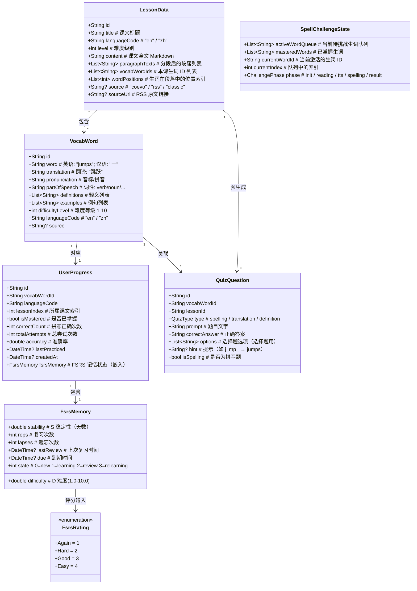
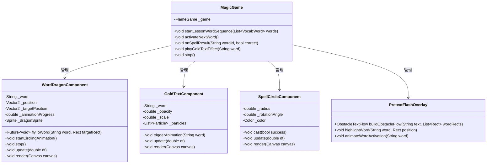
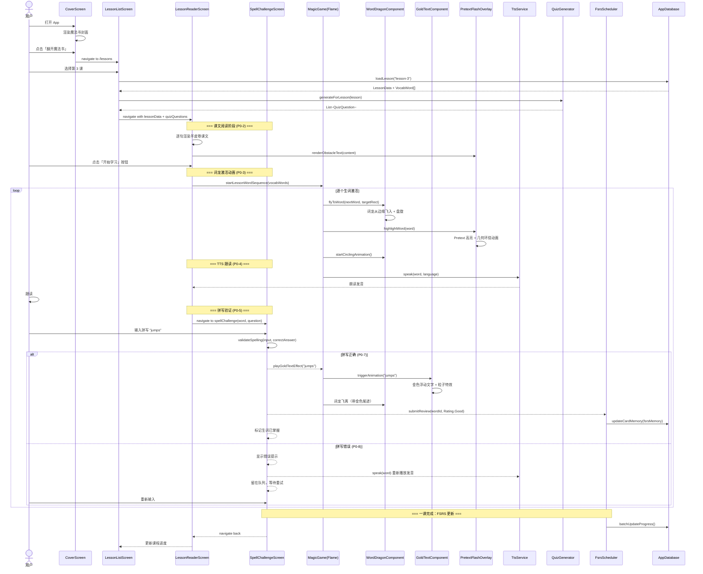
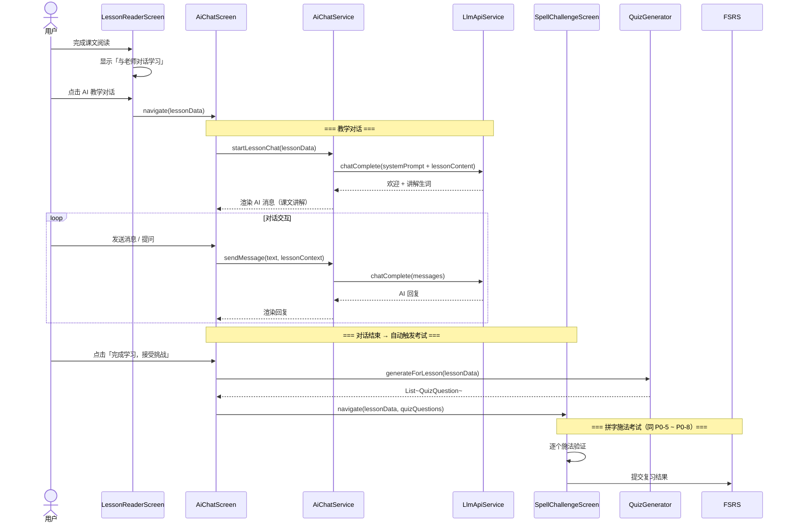
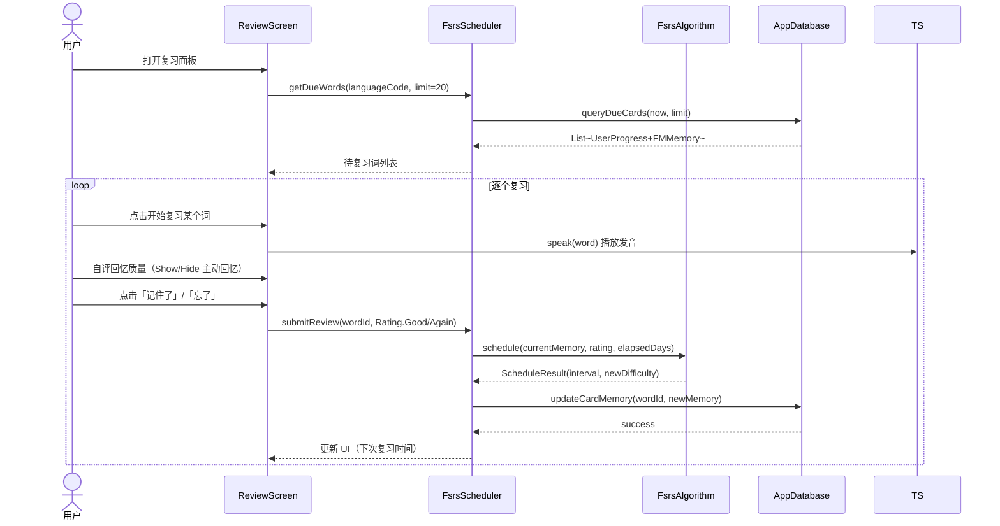
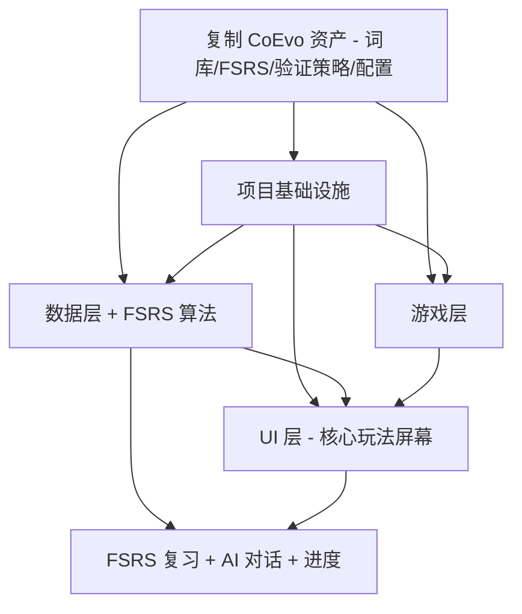

# 魔法书语言学习 App — 系统架构设计 + 任务分解

> **文档版本**: v1.1 · **架构师**: 高见远 · **更新日期**: 2026-07-19

---

## 目录

1. [实现方案 + 框架选型](#1-实现方案--框架选型)
2. [CoEvo 资产复用清单](#2-coevo-资产复用清单)
3. [文件列表及相对路径](#3-文件列表及相对路径)
4. [数据结构和接口（类图）](#4-数据结构和接口类图)
5. [程序调用流程（时序图）](#5-程序调用流程时序图)
6. [任务列表（有序 + 依赖关系）](#6-任务列表有序--依赖关系)
7. [依赖包列表](#7-依赖包列表)
8. [共享知识](#8-共享知识)
9. [待明确事项](#9-待明确事项)

---

## 1. 实现方案 + 框架选型

### 1.1 整体架构模式：**Model-View-Game (MVG)**

选择 MVG 而非传统 Clean Architecture 的理由：

| 层次 | 职责 | 说明 |
|------|------|------|
| **Data Layer** (Model) | 数据持久化、FSRS 算法、词库加载 | sqflite + JSON assets |
| **Game Layer** (Game) | 词龙动画、Pretext 文本环绕、金色特效 | Flame 引擎 + flutter_pretext |
| **UI Layer** (View) | 魔法书封面、课文阅读、拼写面板、复习界面 | Flutter Widgets + Riverpod |
| **Services Layer** (Cross) | TTS、AI 对话、RSS 订阅 | 抽象接口 + 多实现 |

Magic Book 的核心体验是 **"拼字即施法"的动画游戏化学习**，Flame 游戏引擎主导动画和特效，Flutter Widget 主导页面结构。MVG 模式让游戏逻辑与 UI 逻辑解耦，同时保持数据层的统一。

### 1.3 部署架构

```
魔法书 Flutter App (iOS + Android)
  ├── 本地: SQLite + JSON 词库 ✅ 离线可用
  ├── 腾讯云 TTS       ← 从 CoEvo .env 复用密钥
  ├── DeepSeek LLM     ← 从 CoEvo .env 复用 API Key
  └── 腾讯云 SCF (Serverless) 或 VPS 代理 ← 与 CoEvo 共享 VPS (<OLD_VPS_IP>)
       └── 额外端口给魔法书 proxy 服务
```

---

## 2. CoEvo 资产复用清单

| # | CoEvo 资产 | 魔法书复用方式 | 文件来源 |
|---|-----------|--------------|---------|
| **A1** | FSRS-5 算法 | **纯 Dart 直译** (143行，零外部依赖) | `backend/crates/card_engine/src/fsrs5.rs` |
| **A2** | FSRS 调度器 | **Dart 移植** get_due_cards + submit_review (779行) | `backend/crates/card_engine/src/fsrs_scheduler.rs` |
| **A3** | 语言验证策略 | **直接移植** forward/reverse/dictation 三模式（204行） | `app/lib/pipelines/language/verification_strategy.dart` |
| **A4** | 拼写验证 | **精确匹配** reverse 模式：_judgeReverse (trims + lowercase + exact) | `app/lib/pipelines/language/verification_strategy.dart:189-193` |
| **A5** | 预置词库 | **JSON 数据文件直接复用** — prebuilt_cards.json (~3.5MB) + prebuilt_language_cards.json (~10.9MB) | `data/curriculum/v4/cards/language/` |
| **A6** | 词库激活逻辑 | **Dart 移植** activate_from_ai_reply / activate_single_word | `backend/crates/api_server/src/ws.rs:52-159` |
| **A7** | 课程计划数据 | **JSON 直接复用** — english.json (80任务) + chinese.json (681任务) | `data/curriculum/v4/plans/` |
| **A8** | 数据库表设计 | **sqflite 建表**复用 user_cards/card_memory/review_log schema | `backend/crates/api_server/src/schema.rs` |
| **A9** | 腾讯云 TTS 密钥 | **复用 .env** 中的 TENCENT_SECRET_ID / TENCENT_SECRET_KEY / TENCENT_APP_ID | `backend/.env` |
| **A10** | DeepSeek LLM | **复用 API Key** — DEEPSEEK_API_KEY = "sk-b266987d..." | `backend/.env` |
| **A11** | VPS 部署 | **共享同一 VPS** — <OLD_VPS_IP>, 新开端口给魔法书 proxy | `docs/deploy/deployment-guide.md` |
| **A12** | 概念提取 prompt | **参考** concept/language/extract 的字段定义 | `backend/prompts/concept/language/` |
| **A13** | quiz prompt | **参考** verify/general/ (usage + translation) 的格式 | `backend/prompts/verify/general/` |
| **A14** | 快问快答 API | **参考** POST /api/review/verify 的问题生成 + 评判逻辑 | `backend/crates/api_server/src/routes.rs:528-559` |
| **A15** | 水平测试 | **参考** CoEvo 的 placement_test / k12 水平适配逻辑（初版可做简化） | `app/lib/screens/` 中无独立水平测试页，需新实现 |

### 2.1 复习考核机制（从 CoEvo 继承的核心逻辑）

CoEvo 的语言验证策略分三档，按复习次数自动升级：

| 复习次数 (reps) | 模式 | 做法 | 在魔法书中的变形 |
|:---:|:------:|------|:--------------:|
| 0-2 | **forward** 正向理解 | LLM 判断用户中文翻译是否正确 | → 快问快答选择题（翻译/释义） |
| 3 | **reverse** 反向默写 | 精确匹配用户输入是否等于 `card.front` | → **拼写施法**（精确匹配） |
| 4+ | **dictation** 听写 | TTS 朗读后精确匹配 | → TTS 跟读 + 拼写 |

FSRS 评分映射（已在 CoEvo 验证）：
```
拼写正确 (pass)   → Rating::Good (3) → stability 增长
拼写正确 + 轻松   → Rating::Easy (4) → stability 大幅增长
拼写错误 (fail)   → Rating::Again (1) → stability 回流 + lapses++
```

### 2.2 词库示例结构（复用 CoEvo）

```json
{
  "id": "uuid-from-coevo",
  "front": "jumps",
  "domain": "language",
  "subject": "english",
  "card_type": "vocabulary",
  "pronunciation": "/dʒʌmps/",
  "pos": "verb",
  "definitions": "[\"跳\", \"跃过\"]",
  "related_phrases": "jump over",
  "level": "A1"
}
```

### 1.2 技术栈选型

| 组件 | 选型 | 版本 | 理由 |
|------|------|------|------|
| **游戏引擎** | `flame` | ^1.37.0 | 成熟的 Flutter 2D 游戏引擎，组件系统（FCS）适合管理词龙、特效、动画 |
| **文本动态引擎** | `flutter_pretext` | ^1.0.2 | 实现"词龙环绕"文本动画的核心依赖，60FPS 几何文本环绕（ObstacleTextFlow）|
| **状态管理** | `flutter_riverpod` | ^2.6.1 | 与现有 CoEvo 一致，`flame_riverpod` 可桥接 Flame 组件与 Riverpod |
| **本地存储** | `sqflite` | ^2.3.0 | 离线优先，单词学习状态、FSRS 数据持久化 |
| **FSRS 算法** | 纯 Dart 重写 | — | 从 Rust 版 FSRS-5 移植，零外部依赖 |
| **TTS（主）** | 腾讯云 TTS Flutter SDK | ^0.0.6 | 高质量语音合成，支持英语 + 汉语 |
| **TTS（fallback）** | `flutter_tts` | ^4.2.2 | 系统原生 TTS，离线/弱网降级 |
| **AI 对话** | 直接 HTTP 调用 LLM API | — | 不依赖 CoEvo 后端，直接调腾讯云/通用 LLM |
| **RSS 解析** | `webfeed` + `http` | ^0.9.0 | 解析 RSS 新闻作为课文素材 |
| **数据库加密** | `sqflite_common_ffi` + 加密扩展 | — | GDPR/COPPA 合规，本地数据加密 |
| **路由** | `go_router` | ^14.8.1 | 与 CoEvo 一致，声明式路由 |
| **HTTP** | `http` | ^1.3.0 | AI API 调用、RSS 抓取 |

### 1.3 核心难点与解决思路

| 难点 | 解决思路 |
|------|----------|
| **词龙环绕动画** | flutter_pretext 的 `ObstacleTextFlow` + 动态移动 `Rect` 障碍物 → 文字实时环绕 |
| **金色浮动文字特效** | flutter_pretext 的几何文字 + Flame 粒子系统叠加 |
| **TTS 离线降级** | 腾讯云 TTS（在线）→ flutter_tts（离线）双实现，`TtsService` 抽象接口自动切换 |
| **FSRS 移植** | 纯 Dart 实现，与 Rust 版算法参数一致（W[0..16] 默认参数），单元测试覆盖 |
| **预生成题库** | 学习前运行 `QuizGenerator` 批量生成拼写/问答数据，存入 SQLite，零运行时 AI 延迟 |
| **双 App 复用** | 通过 language code + 词库 JSON 区分，90%+ 代码共享 |

---

## 3. 文件列表及相对路径

```
magic_book/
├── lib/
│   ├── main.dart                              # App 入口，初始化数据库 + Riverpod ProviderScope
│   ├── app.dart                               # MaterialApp.router + 主题注入
│   │
│   ├── core/                                  # ← 核心基础设施
│   │   ├── theme/
│   │   │   ├── app_theme.dart                 # 羊皮卷配色系统 + 中世纪主题
│   │   │   └── magic_text_styles.dart         # 手写字体 + 魔法装饰文字样式
│   │   ├── constants/
│   │   │   ├── app_constants.dart             # App 全局常量（语言代码、版本、API URL）
│   │   │   └── asset_paths.dart               # 资源文件路径常量
│   │   ├── errors/
│   │   │   └── app_exceptions.dart            # 自定义异常类
│   │   ├── routing/
│   │   │   └── app_router.dart                # go_router 路由定义
│   │   └── extensions/
│   │       └── context_extensions.dart        # BuildContext 便捷扩展
│   │
│   ├── data/                                  # ← 数据层
│   │   ├── models/
│   │   │   ├── vocab_word.dart                # 生词数据模型
│   │   │   ├── lesson_data.dart               # 课文数据模型
│   │   │   ├── user_progress.dart             # 用户学习进度模型
│   │   │   └── quiz_question.dart             # 预生成题库模型
│   │   ├── database/
│   │   │   ├── app_database.dart              # SQLite 数据库初始化 + 迁移
│   │   │   ├── lesson_dao.dart                # 课文表 DAO
│   │   │   ├── vocab_dao.dart                 # 词库表 DAO
│   │   │   └── progress_dao.dart              # 用户进度表 DAO
│   │   ├── repositories/
│   │   │   ├── lesson_repository.dart         # 课文数据仓库
│   │   │   ├── vocab_repository.dart          # 词库数据仓库
│   │   │   └── progress_repository.dart       # 进度数据仓库
│   │   └── assets/
│   │       ├── vocab_loader.dart              # JSON 词库 -> SQLite 导入器
│   │       └── lesson_loader.dart             # JSON 课文 -> SQLite 导入器
│   │
│   ├── services/                              # ← 服务层
│   │   ├── tts/
│   │   │   ├── tts_service.dart               # TTS 抽象接口
│   │   │   ├── tencent_tts_service.dart       # 腾讯云 TTS 实现
│   │   │   └── system_tts_service.dart        # flutter_tts 原生 fallback 实现
│   │   ├── ai/
│   │   │   ├── ai_chat_service.dart           # AI 教学对话接口
│   │   │   └── llm_api_service.dart            # LLM API 调用（腾讯云/OpenAI 兼容）
│   │   ├── fsrs/
│   │   │   ├── fsrs_types.dart                # FSRS 数据类型（Rating, FsrsMemory, ScheduleResult）
│   │   │   ├── fsrs_algorithm.dart            # 纯 Dart FSRS-5 算法实现
│   │   │   └── fsrs_scheduler.dart            # 复习调度器（查到期卡片 + 更新状态）
│   │   ├── rss/
│   │   │   └── rss_service.dart               # RSS 新闻抓取 + 水平适配
│   │   └── quiz/
│   │       └── quiz_generator.dart             # 预生成题库引擎
│   │
│   ├── game/                                  # ← 游戏层 (Flame + Pretext)
│   │   ├── magic_game.dart                    # 主 FlameGame 实例（game loop 入口）
│   │   ├── magic_game_widget.dart             # GameWidget 封装，嵌入 UI 层
│   │   ├── components/
│   │   │   ├── word_dragon_component.dart     # 词龙动画组件（Flame Component）
│   │   │   ├── gold_text_component.dart       # 金色浮动文字特效组件
│   │   │   ├── spell_circle_component.dart    # 施法圈动画组件
│   │   │   └── parchment_bg_component.dart    # 羊皮卷背景组件
│   │   └── overlays/
│   │       ├── word_flash_overlay.dart        # Pretext 文字高亮环绕 overlay
│   │       └── spell_effect_overlay.dart      # 施法成功/失败特效 overlay
│   │
│   ├── screens/                               # ← UI 页面层
│   │   ├── cover_screen.dart                  # 魔法书封面页（P0-1）
│   │   ├── lesson_list_screen.dart             # 课文列表选择页
│   │   ├── lesson_reader_screen.dart           # 羊皮卷课文阅读页（P0-2 + P0-3）
│   │   ├── spell_challenge_screen.dart         # 拼写/问答施法页（P0-5 + P0-6 + P0-7 + P0-8）
│   │   ├── review_screen.dart                  # FSRS 复习面板（P1-1）
│   │   ├── progress_screen.dart                # 学习统计仪表盘（P1-2）
│   │   ├── placement_test_screen.dart           # 水平测试页（P1-4）
│   │   └── ai_chat_screen.dart                 # AI 教学对话页（P1-5）
│   │
│   ├── widgets/                               # ← 共享 UI 组件
│   │   ├── parchment_container.dart            # 羊皮卷风格容器
│   │   ├── magic_button.dart                  # 魔法风格按钮
│   │   ├── rune_decoration.dart               # 符文装饰组件
│   │   ├── progress_bar_widget.dart            # 魔法风格进度条
│   │   ├── lesson_card.dart                   # 课文选择卡片
│   │   └── stat_display.dart                  # 统计数据展示组件
│   │
│   └── state/                                 # ← 状态管理 (Riverpod)
│       ├── app_state_provider.dart             # App 级状态（语言切换、用户设置）
│       ├── lesson_state_provider.dart          # 当前课文状态
│       ├── game_state_provider.dart            # 游戏循环状态（当前词索引、队列）
│       └── progress_state_provider.dart        # 学习进度状态
│
├── assets/
│   ├── vocab/
│   │   ├── en_vocab.json                      # 英语词库（12,839 词）
│   │   └── zh_vocab.json                      # 汉语词库（2,714 词）
│   ├── lessons/
│   │   ├── en/                                # 英语课文目录
│   │   └── zh/                                # 汉语课文目录
│   ├── fonts/
│   │   ├── MedievalSharp-Regular.ttf          # 中世纪手写字体
│   │   ├── UncialAntiqua-Regular.ttf          # 安色尔字体（装饰用）
│   │   └── SourceHanSerifSC-Regular.otf       # 思源宋体（汉语课文用）
│   ├── images/
│   │   ├── cover_bg.png                       # 魔法书封面背景
│   │   ├── parchment_bg.png                   # 羊皮卷纹理
│   │   ├── dragon_sprites/                    # 词龙精灵图
│   │   ├── runes/                             # 符文装饰图
│   │   └── icons/                             # 图标
│   └── sounds/
│       ├── spell_success.mp3                  # 施法成功音效
│       ├── spell_fail.mp3                     # 施法失败音效
│       └── page_turn.mp3                      # 翻页音效
│
├── test/
│   ├── data/
│   │   ├── models_test.dart
│   │   └── database_test.dart
│   ├── services/
│   │   ├── fsrs_algorithm_test.dart           # FSRS 算法单元测试（关键！）
│   │   └── quiz_generator_test.dart
│   ├── game/
│   │   └── components_test.dart
│   └── screens/
│       └── screens_test.dart
│
├── pubspec.yaml                               # 依赖声明
├── analysis_options.yaml                      # Lint 规则
└── README.md
```

---

## 4. 数据结构和接口（类图）

### 4.1 核心数据模型



### 4.2 服务层接口

```mermaid
classDiagram
    class TtsService {
        <<abstract>>
        +Future~void~ init()
        +Future~void~ speak(String text, {String? language})
        +Future~void~ stop()
        +Future~void~ dispose()
        +Stream~TtsState~ get onStateChanged
        +bool get isSpeaking
    }

    class TencentTtsService {
        -String _secretId
        -String _secretKey
        -TTSController _controller
        +Future~void~ init()
        +Future~void~ speak(String text, {String? language})
        +Future~void~ stop()
        +Future~void~ dispose()
        +Stream~TtsState~ get onStateChanged
        +bool get isSpeaking
    }

    class SystemTtsService {
        -FlutterTts _flutterTts
        +Future~void~ init()
        +Future~void~ speak(String text, {String? language})
        +Future~void~ stop()
        +Future~void~ dispose()
        +Stream~TtsState~ get onStateChanged
        +bool get isSpeaking
    }

    class AiChatService {
        +Future~AiChatResponse~ sendMessage(String message, {String? lessonContext})
        +Future~void~ startLessonChat(LessonData lesson)
        +Stream~AiChatResponse~ get onResponse
        +void dispose()
    }

    class LlmApiService {
        -String _apiKey
        -String _apiEndpoint
        +Future~String~ chatComplete(List~ChatMessage~ messages)
        +Future~Stream~String~~ chatCompleteStream(List~ChatMessage~ messages)
    }

    class FsrsAlgorithm {
        +ScheduleResult schedule(FsrsMemory memory, FsrsRating rating, double elapsedDays)
        +double getRetrievability(FsrsMemory memory, double elapsedDays)
        #double nextDifficulty(double currentD, double rating)
        #double nextStability(double difficulty, double stability, double rating, double elapsedDays)
        #double firstStability(double rating)
        #double initDifficulty(double rating)
        #double stabilityAfterFailure(double difficulty, double stability, double elapsedDays)
        #double stabilityAfterSuccess(double difficulty, double stability, double rating, double elapsedDays)
    }

    class FsrsScheduler {
        +List~VocabWord~ getDueWords(String languageCode, int limit)
        +void submitReview(String wordId, FsrsRating rating)
        +int getReviewCountToday()
        +List~VocabWord~ getOverdueWords()
    }

    class QuizGenerator {
        +List~QuizQuestion~ generateForLesson(LessonData lesson)
        +QuizQuestion generateSpellingQuestion(VocabWord word)
        +QuizQuestion generateTranslationQuestion(VocabWord word)
        +QuizQuestion generateDefinitionQuestion(VocabWord word)
        +String generateHint(String word)
    }

    TtsService <|-- TencentTtsService : 实现
    TtsService <|-- SystemTtsService : 实现
    AiChatService --> LlmApiService : 委托 HTTP 调用
    FsrsAlgorithm --> FsrsScheduler : 算法提供者
    QuizGenerator --> VocabWord : 依赖词数据
```

### 4.3 游戏层组件



---

## 5. 程序调用流程（时序图）

### 5.1 核心玩法循环：打开 App → 选课 → 读课文 → 词龙激活 → TTS → 拼写 → 金色特效 → FSRS



### 5.2 AI 教学对话时序图（P1-5）



### 5.3 FSRS 复习调度时序图（P1-1）



---

## 6. 任务列表（有序 + 依赖关系）

### 6.0 从 CoEvo 复制资产（前置任务，无代码编写）

### 任务依赖图



### 6.1 T00 — 从 CoEvo 复制资产（P0，主理人执行）

| 字段 | 内容 |
|------|------|
| **Task ID** | T00 |
| **Task Name** | 从 CoEvo 复制可复用资产 |
| **Priority** | P0 |
| **Dependencies** | 无（前置任务） |

**操作清单（复制 / 引用 / 起草移植计划）：**

| # | 操作 | 源路径（CoEvo） | 目标用途 |
|---|------|---------------|---------|
| 1 | 复制 JSON | `data/curriculum/v4/cards/language/prebuilt_cards.json` | → `assets/vocab/en_vocab.json`（英语魔法书） |
| 2 | 复制 JSON | `data/curriculum/v4/cards/language/prebuilt_language_cards.json` | → 合并入 vocab JSON（发音/释义/level） |
| 3 | 复制 JSON | `data/curriculum/v4/plans/english.json` | → `assets/lessons/en/` 课文结构参考 |
| 4 | 复制 JSON | `data/curriculum/v4/plans/chinese.json` | → `assets/lessons/zh/` 课文结构参考 |
| 5 | 引用 .env | `backend/.env` → DEEPSEEK_API_KEY, TENCENT_SECRET_* | → `magic_book/.env`（新项目） |
| 6 | 起草移植 | `backend/crates/card_engine/src/fsrs5.rs` (143行) | → Dart 版 fsrs_algorithm.dart 设计参考 |
| 7 | 起草移植 | `app/lib/pipelines/language/verification_strategy.dart` (204行) | → 魔法书验证策略设计参考 |
| 8 | 起草移植 | `backend/crates/card_engine/src/fsrs_scheduler.rs` (779行) | → Dart 版 fsrs_scheduler.dart 设计参考 |
| 9 | 起草移植 | `backend/crates/api_server/src/ws.rs:52-159` (词汇激活) | → 词库激活逻辑参考 |
| 10 | 起草移植 | `backend/crates/api_server/src/schema.rs` (language 表) | → sqflite 建表参考 |

### T01 — 项目基础设施（P0）

| 字段 | 内容 |
|------|------|
| **Task ID** | T01 |
| **Task Name** | 项目基础设施搭建 |
| **Priority** | P0 |
| **Dependencies** | 无（起始任务） |

**源文件清单（6 个文件）：**
- `magic_book/pubspec.yaml` — 全部依赖声明 + assets + fonts 注册
- `magic_book/analysis_options.yaml` — Lint 规则
- `magic_book/lib/main.dart` — App 入口，初始化 Riverpod ProviderScope + 数据库
- `magic_book/lib/app.dart` — MaterialApp.router + 主题注入
- `magic_book/lib/core/theme/app_theme.dart` — 羊皮卷配色系统
- `magic_book/lib/core/constants/app_constants.dart` — 全局常量

**具体内容：**
1. `pubspec.yaml`：声明 flame、flutter_pretext、flutter_riverpod、go_router、sqflite、flutter_tts、http、webfeed、intl 等全部依赖
2. 注册 assets（fonts/、images/、vocab/、sounds/）
3. 注册 Google Fonts 中世纪手写字体
4. `main.dart`：runApp + ProviderScope + initial database loading
5. `app.dart`：MaterialApp.router + GoRouter + ThemeData（parchment 配色：米黄 #F5E6C8、深棕 #3E2723、金色 #FFD700）
6. `app_constants.dart`：语言代码、API endpoints、默认 FSRS 参数
7. `analysis_options.yaml`：代码规范

---

### 6.2 T02 — 数据层 + FSRS 算法（P0）

| 字段 | 内容 |
|------|------|
| **Task ID** | T02 |
| **Task Name** | 数据层（模型 + 数据库 + 词库导入 + FSRS 算法） |
| **Priority** | P0 |
| **Dependencies** | T01（需 pubspec.yaml 中的依赖声明） |

**源文件清单（14 个文件）：**
- `magic_book/lib/data/models/vocab_word.dart` — VocabWord 模型
- `magic_book/lib/data/models/lesson_data.dart` — LessonData 模型
- `magic_book/lib/data/models/user_progress.dart` — UserProgress + FsrsMemory 模型
- `magic_book/lib/data/models/quiz_question.dart` — QuizQuestion 模型
- `magic_book/lib/data/database/app_database.dart` — SQLite 初始化 + 建表迁移
- `magic_book/lib/data/database/lesson_dao.dart` — Lesson CRUD
- `magic_book/lib/data/database/vocab_dao.dart` — Vocab CRUD
- `magic_book/lib/data/database/progress_dao.dart` — Progress CRUD
- `magic_book/lib/data/repositories/lesson_repository.dart` — 课文仓库
- `magic_book/lib/data/repositories/vocab_repository.dart` — 词库仓库
- `magic_book/lib/data/repositories/progress_repository.dart` — 进度仓库
- `magic_book/lib/data/assets/vocab_loader.dart` — JSON→SQLite 词库导入器
- `magic_book/lib/services/fsrs/fsrs_types.dart` — FSRS 类型定义
- `magic_book/lib/services/fsrs/fsrs_algorithm.dart` — 纯 Dart FSRS-5 实现

**具体内容：**
1. 建立 SQLite 四张表：`lessons`, `vocab_words`, `user_progress`, `quiz_questions`
2. VocabWord 从 JSON 导入 SQLite（支持 en/zh 双词库）
3. FSRS-5 算法纯 Dart 实现（与 Rust 版参数一致，包含完整单元测试）
4. LessonData 支持课文内容的分段 + 生词位置标记
5. QuizQuestion 数据结构支持 spelling / translation / definition 三种类型

---

### 6.3 T03 — 游戏层：词龙 + Pretext 动画 + 特效（P0）

| 字段 | 内容 |
|------|------|
| **Task ID** | T03 |
| **Task Name** | 游戏层（Flame 词龙动画 + Pretext 文本环绕 + 金色特效） |
| **Priority** | P0 |
| **Dependencies** | T01（需 pubspec.yaml 中的 flame + flutter_pretext） |

**源文件清单（7 个文件）：**
- `magic_book/lib/game/magic_game.dart` — 主 FlameGame 实例
- `magic_book/lib/game/magic_game_widget.dart` — GameWidget 封装
- `magic_book/lib/game/components/word_dragon_component.dart` — 词龙动画
- `magic_book/lib/game/components/gold_text_component.dart` — 金色浮动文字
- `magic_book/lib/game/components/spell_circle_component.dart` — 施法圈
- `magic_book/lib/game/components/parchment_bg_component.dart` — 羊皮卷背景
- `magic_book/lib/game/overlays/pretext_flash_overlay.dart` — Pretext 文字高亮环绕

**具体内容：**
1. FlameGame 实例管理词龙队列 + 动画循环
2. WordDragonComponent：词龙从边缘飞入 → 盘旋 → 环绕 → 飞离，使用 flame 的 Sprite 动画
3. PretextFlashOverlay：使用 flutter_pretext 的 ObstacleTextFlow，在课文段落中实时高亮生词位置，文字环绕词龙飞行路径
4. GoldTextComponent：拼写正确时触发金色浮动文字 + 粒子特效
5. SpellCircleComponent：施法圈旋转动画（正确时金色、错误时红色闪烁）
6. ParchmentBgComponent：羊皮卷纹理背景渲染

---

### 6.4 T04 — UI 核心玩法屏幕 + TTS + 题库（P0）

| 字段 | 内容 |
|------|------|
| **Task ID** | T04 |
| **Task Name** | UI 核心玩法屏幕（封面 + 课文阅读 + 拼写挑战 + 题库 + TTS） |
| **Priority** | P0 |
| **Dependencies** | T02, T03（数据层提供模型，游戏层提供动画组件） |

**源文件清单（14 个文件）：**
- `magic_book/lib/screens/cover_screen.dart` — 魔法书封面页
- `magic_book/lib/screens/lesson_list_screen.dart` — 课文列表页
- `magic_book/lib/screens/lesson_reader_screen.dart` — 羊皮卷课文阅读页（含词龙激活渲染）
- `magic_book/lib/screens/spell_challenge_screen.dart` — 拼写/问答施法页
- `magic_book/lib/services/tts/tts_service.dart` — TTS 抽象接口
- `magic_book/lib/services/tts/tencent_tts_service.dart` — 腾讯云 TTS
- `magic_book/lib/services/tts/system_tts_service.dart` — flutter_tts fallback
- `magic_book/lib/services/quiz/quiz_generator.dart` — 预生成题库引擎
- `magic_book/lib/widgets/parchment_container.dart` — 羊皮卷容器组件
- `magic_book/lib/widgets/magic_button.dart` — 魔法风格按钮
- `magic_book/lib/widgets/progress_bar_widget.dart` — 魔法风格进度条
- `magic_book/lib/widgets/lesson_card.dart` — 课文卡片
- `magic_book/lib/core/theme/magic_text_styles.dart` — 手写字体样式
- `magic_book/lib/core/routing/app_router.dart` — 路由定义更新

**具体内容：**
1. **CoverScreen**（P0-1）：魔法书封面，皮革纹理背景 + 符文装饰，点击「翻开魔法书」导航到课文列表
2. **LessonListScreen**：按难度分组的课文列表
3. **LessonReaderScreen**（P0-2 + P0-3）：羊皮卷风格课文阅读，嵌入 GameWidget 显示词龙、Pretext 动画
4. **SpellChallengeScreen**（P0-5 + P0-6 + P0-7 + P0-8）：拼写输入框 + 验证逻辑（大小写/标点容错）+ 选择题快问快答 + 失败循环
5. **TtsService 三件套**：抽象接口 + 腾讯云实现 + flutter_tts fallback，自动检测网络状态切换
6. **QuizGenerator**：学习前批量生成拼写题（含 hint 如 `j_mp_`）+ 翻译选择题 + 释义选择题
7. **通用 widgets**：parchment_container、magic_button、progress_bar

---

### 6.5 T05 — FSRS 复习 + 进度 + AI 对话 + 水平测试（P1）

| 字段 | 内容 |
|------|------|
| **Task ID** | T05 |
| **Task Name** | FSRS 复习 + 进度追踪 + AI 对话 + 水平测试 |
| **Priority** | P1 |
| **Dependencies** | T02（FSRS 算法 + 模型）, T04（UI 组件 + TTS + 题库） |

**源文件清单（10 个文件）：**
- `magic_book/lib/services/fsrs/fsrs_scheduler.dart` — 复习调度器
- `magic_book/lib/screens/review_screen.dart` — FSRS 复习面板
- `magic_book/lib/screens/progress_screen.dart` — 学习统计仪表盘
- `magic_book/lib/screens/placement_test_screen.dart` — 水平测试
- `magic_book/lib/screens/ai_chat_screen.dart` — AI 教学对话页
- `magic_book/lib/services/ai/ai_chat_service.dart` — AI 对话服务
- `magic_book/lib/services/ai/llm_api_service.dart` — LLM API HTTP 调用
- `magic_book/lib/services/rss/rss_service.dart` — RSS 新闻抓取
- `magic_book/lib/widgets/stat_display.dart` — 统计数据展示组件
- `magic_book/lib/state/*.dart` — Riverpod 状态管理（4 个 provider 文件）

**具体内容：**
1. **FsrsScheduler**（P1-1）：查询到期词 + 提交复习结果 + 更新 FSRS 状态
2. **ReviewScreen**（P1-1）：待复习列表面板，一键复习全部
3. **ProgressScreen**（P1-2）：统计图表（已学词数、连续天数、学习时长）
4. **PlacementTestScreen**（P1-4）：首次水平测试（从预置题库抽题），推荐起始课文
5. **AiChatScreen**（P1-5）：围绕课文的 AI 教学对话，对话完触发考试
6. **AiChatService + LlmApiService**：教学对话（带课文上下文），stream 流式渲染
7. **RssService**：解析 RSS 新闻，自动按水平适配生成课文
8. **Riverpod 状态管理**：4 个 provider（app_state、lesson_state、game_state、progress_state）

---

## 7. 依赖包列表

### 生产依赖

```yaml
dependencies:
  flutter:
    sdk: flutter

  # 游戏引擎
  flame: ^1.37.0                  # 2D 游戏引擎，词龙动画 + 特效
  flame_riverpod: ^5.5.4          # Flame ↔ Riverpod 桥接

  # 文本动态引擎
  flutter_pretext: ^1.0.2         # 文本几何环绕动画（词龙高亮 + 金色浮动文字）

  # 状态管理
  flutter_riverpod: ^2.6.1        # 全局状态管理
  riverpod_annotation: ^2.3.0     # Riverpod 代码生成

  # 路由
  go_router: ^14.8.1              # 声明式导航

  # 本地存储
  sqflite: ^2.3.0                 # SQLite 数据库
  path_provider: ^2.1.0           # 文件路径
  sqflite_common_ffi: ^2.3.0     # SQLite FFI（加密扩展用）

  # TTS
  flutter_tts: ^4.2.2             # 系统原生 TTS（fallback）
  # 腾讯云 TTS Flutter SDK: 手动集成（见 pubspec.yaml 本地引用说明）

  # 网络
  http: ^1.3.0                    # HTTP 客户端（AI API + RSS 抓取）
  web_socket_channel: ^3.0.2      # WebSocket（流式 AI 对话用）

  # RSS
  webfeed: ^0.9.0                 # RSS/Atom 解析

  # 音频
  audioplayers: ^6.1.0            # 音效（施法成功/失败、翻页）

  # 序列化
  freezed_annotation: ^2.4.0      # 不可变数据模型
  json_annotation: ^4.9.0         # JSON 序列化

  # 工具
  intl: ^0.19.0                   # 国际化/日期格式化
  shared_preferences: ^2.5.3      # 简单键值存储（设置）
  equatable: ^2.0.5               # 值对象相等性
  logger: ^2.0.0                  # 日志
```

### 开发依赖

```yaml
dev_dependencies:
  flutter_test:
    sdk: flutter
  flutter_lints: ^5.0.0
  build_runner: ^2.4.0
  freezed: ^2.5.0
  json_serializable: ^6.8.0
  mockito: ^5.4.0                  # 单元测试 mock
  sqflite_common_ffi: ^2.3.0      # 测试中 SQLite 支持
```

### 腾讯云 TTS SDK 集成说明

腾讯云 TTS Flutter SDK（v0.0.6）需要手动下载 AAR 包，在 `android/libs/` 和 `ios/` 中配置。建议：

```
magic_book/
├── android/
│   └── app/libs/
│       └── qcloud-tts.aar          # 腾讯云 TTS AAR
└── ios/
    └── Frameworks/
        └── QCloudTTS.framework     # 腾讯云 TTS framework
```

---

## 8. 共享知识

### 7.1 状态管理方案：Riverpod

```
项目采用 flutter_riverpod + flame_riverpod 作为状态管理方案。

状态分层：
├── app_state_provider          ← App 级：语言选择(en/zh)、用户设置、年龄门控
├── lesson_state_provider       ← 课文级：当前课文、段落索引、生词列表
├── game_state_provider         ← 游戏级：当前词索引、激活队列、挑战阶段
└── progress_state_provider     ← 进度级：FSRS 状态、统计数据、连续天数

数据流约定：
- UI 层通过 ref.watch(provider) 监听状态变化
- Game 层通过 flame_riverpod 的 GameComponent 订阅 providers
- Service 层不直接依赖 providers，通过回调或返回值通信
- 数据库操作在 Repository 层完成，Provider 通过 Repository 读写数据
```

### 7.2 数据流约定

```
1. 所有 API 调用结果使用 Result<T> 包装模式：
   sealed class Result<T> {
     final T? data;
     final String? error;
   }
   class Success<T> extends Result<T> { ... }
   class Failure<T> extends Result<T> { ... }

2. 词库数据格式（JSON 结构）：
   {
     "id": "uuid",
     "word": "jumps",          // 目标语言词
     "translation": "跳跃",     // 母语翻译
     "pronunciation": "/dʒʌmps/",  // 音标/拼音
     "partOfSpeech": "verb",
     "definitions": ["跳", "跃过"],
     "examples": ["The cat jumps over the fence."],
     "difficultyLevel": 3,
     "languageCode": "en"
   }

3. 所有日期时间存储为 ISO 8601 UTC String
4. 拼写验证规则：去除首尾空格 -> 小写比较 -> 去除标点后比较
5. FSRS 参数 W[0..16] 与 Rust 版一致（见 fsrs_algorithm.dart 的常量数组）
```

### 7.3 命名规范

```
文件名：小写蛇形（snake_case），如 word_dragon_component.dart
类名：PascalCase，如 WordDragonComponent
方法名：camelCase，如 flyToWord()
常量：SCREAMING_SNAKE_CASE，如 DEFAULT_W_COEFFICIENTS
Provider：camelCase + Provider 后缀，如 lessonStateProvider
CSS 类/主题色：--magic-xxxx 前缀（若有 Web 部分）
数据库表：蛇形复数，如 vocab_words, user_progress
```


### 7.4 重要架构决策记录

| # | 决策 | 理由 |
|---|------|------|
| ADR-1 | 不使用 BLoC，使用 Riverpod | 团队熟悉 CoEvo 的 Riverpod 生态；flame_riverpod 桥接成熟 |
| ADR-2 | 词库直接打包 assets JSON，不通过 API | 零后端依赖，离线可用，启动时一次性导入 SQLite |
| ADR-3 | Pretext 动画跑在 Flame overlay 而非纯 Widget | 60FPS 动画需要 Flame 的游戏循环更新率，Pretext 仅做几何计算 |
| ADR-4 | AI 对话非流式 + 流式双模式 | 流式（SSE）提供打字机效果体验，非流式作为 fallback |
| ADR-5 | 课文分段存储在 SQLite 而非运行时 split | 避免每次打开课文时重新解析，支持段落级进度追踪 |
| ADR-6 | TTS 自动检测网络：在线→腾讯云，离线→flutter_tts | 网络状态变化时无缝切换，用户无感知 |

---

## 9. 待明确事项

以下为 PRD 中未明确或存在歧义的问题，需要产品经理（Alice）确认：

| # | 问题 | 建议 | 影响范围 |
|---|------|------|----------|
| Q1 | **腾讯云 TTS SDK 的账号配置方式**：腾讯云 SecretId/SecretKey 放在客户端是否安全？是否需要自建签名代理？ | 建议在腾讯云控制台开启「临时密钥」模式，客户端通过短期 Token 调用；或配置签名代理服务。**如果纯客户端端到端签名，Secret 有泄露风险** | TTS 服务实现 |
| Q2 | **英语魔法书和 Chinese Magic Book 是两个独立 App 还是同一 App 内切换？** | 建议：同一 Flutter 工程，通过 launch parameter 或 AppConfig 区分，代码 90% 复用。两个独立 App 则需两套 App ID / 签名 / Store 配置 | 项目结构/构建配置 |
| Q3 | **AI 对话使用的 LLM 具体是什么？** 腾讯云混元？OpenAI GPT？还是其他？API endpoint 和 key 管理方式？ | PRD 说「腾讯云或通用 LLM API」，需要确定具体 provider | AI 服务实现 |
| Q4 | **词库中 12,839（英语）和 2,714（汉语）词的数据源从哪里来？** CoEvo 现有词库是否可直接复用？还是需要从零整理？ | 如果复用 CoEvo 的 prebuilt_cards.json，格式需要做转换映射 | 词库导入器 |
| Q5 | **RSS 新闻订阅的具体实现细节**：RSS 源列表是谁维护？手动配置还是自动发现？抓取频率？水平如何自动适配？ | 建议：预置 10-20 个知名 RSS 源，水平适配通过 NLP 分析词汇难度初步实现 | RSS 服务 |
| Q6 | **公版经典文章的版权确认**：是否已经确认具体的文章清单和版权状态？ | 建议列出一个初始清单（如安徒生童话、格林童话、爱丽丝梦游仙境等公版作品）| 课文内容 |
| Q7 | **水平测试的具体形式**：需要多少题目？测试维度（词汇量？语法？阅读？）？测试结果如何映射到课文难度？ | 建议：30 道词汇难度递增题 + 阅读理解题，结果映射到 1-10 级 | 水平测试实现 |
| Q8 | **多语言扩展的「母语-目标语言」架构**：英语魔法书的母语是中文还是可配置？Chinese Magic Book 的母语是英语还是可配置？ | 建议：母语跟随系统语言或用户设置，目标语言为 App 选择的语言 | 数据模型 + UI |

---

> **本文档版本**: v1.0 · **架构师**: 高见远 (Bob) · **更新日期**: 2026-07-19
