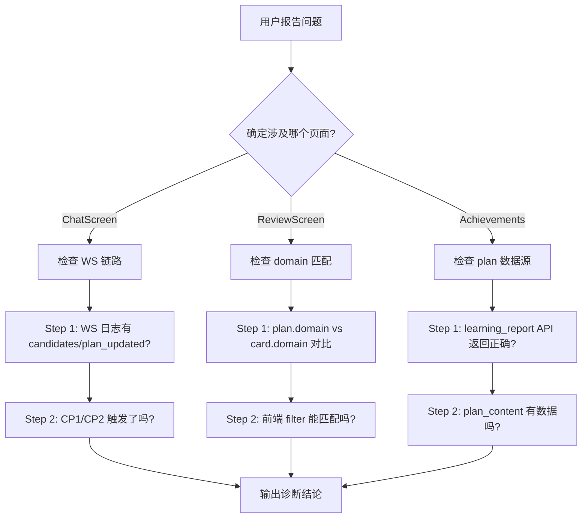
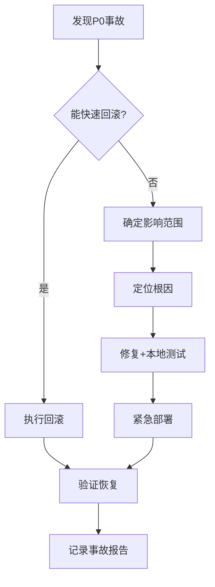

# CoEvo 生产环境维护规范

> 版本: v1.0 · 生效日期: 2026-05-31
> 适用对象: CoEvo 项目维护人员
> 严重级别: **本规范为强制要求，违反可能导致生产事故**

---

## 目录

1. [基本原则](#1-基本原则)
2. [部署 SOP](#2-部署-sop)
3. [数据安全](#3-数据安全)
4. [监控与告警](#4-监控与告警)
5. [备份策略](#5-备份策略)
6. [回滚流程](#6-回滚流程)
7. [应急响应](#7-应急响应)
8. [DB 维护](#8-db-维护)
9. [日志管理](#9-日志管理)
10. [安全维护](#10-安全维护)
11. [发布流程](#11-发布流程)
12. [附录: 故障案例库](#12-附录-故障案例库)

---

## 1. 基本原则

### 1.1 红线规则（违反即事故）

| # | 规则 | 说明 |
|:-:|:----|:-----|
| R1 | **禁止直接修改生产 DB** | 任何时候不得在 VPS 上直接执行 `sqlite3 /opt/coevo/data/coevo.db` 做 DML/DDL 操作。诊断查询（SELECT）除外 |
| R2 | **禁止跳过备份** | 任何涉及二进制替换、数据变更的操作前必须创建备份 |
| R3 | **禁止在高峰时段部署** | 部署窗口：工作日 22:00-08:00，周末全天。紧急修复例外，但需记录 |
| R4 | **禁止跳过本地编译检查** | 任何 Rust 代码变更必须先 `cargo check --package api_server` 通过 |
| R5 | **禁止无回滚方案上线** | 部署前必须确认旧版本二进制或前端有备份可回滚 |
| R6 | **禁止多人同时操作生产环境** | 同时只有一人可执行部署/运维操作。操作前在群里声明 |

### 1.2 生产环境信息

| 项目 | 值 |
|:----|:----|
| 域名 | `https://keyievolution.fun` |
| VPS IP | `<OLD_VPS_IP>` |
| 操作系统 | Ubuntu 22.04 LTS (x86_64) |
| 规格 | 2C / 1GB RAM / 2GB swap / 40GB SSD |
| 磁盘使用 | 14G / 40G (35%) — 监控阈值 80% |
| 备案号 | 粤ICP备2026061557号-1 |
| SSL 证书 | Let's Encrypt，自动续期，下次到期约 2026-08-28 |

### 1.3 核心服务

| 服务 | 类型 | 端口 | 管理命令 |
|:----|:-----|:----|:---------|
| Nginx (入口) | HTTPS 443 / HTTP 80 | 443/80 | `systemctl [status\|reload\|restart] nginx` |
| Nginx (管理后台) | 内部 | 3000 | 同上（同进程） |
| coevo (Rust 后端) | systemd service | 8080 | `systemctl [status\|stop\|start\|restart] coevo` |

### 1.4 关键路径

| 路径 | 用途 | 重要程度 |
|:----|:-----|:--------:|
| `/opt/coevo/coevo_server` | 后端二进制 | ⭐⭐⭐ |
| `/opt/coevo/admin-web/` | 前端静态文件 | ⭐⭐⭐ |
| `/opt/coevo/data/coevo.db` | SQLite 数据库 | ⭐⭐⭐ |
| `/opt/coevo/prompts/*.md` | 所有管道 prompt 文件 | ⭐⭐⭐ |
| `/opt/coevo/.env` | 环境变量（PII 密钥等） | ⭐⭐⭐ |
| `/opt/coevo/data/curriculum/prebuilt/` | 课程数据 | ⭐⭐ |
| `/opt/coevo/data/logs/coevo.log.*` | trace 日志 | ⭐⭐ |
| `/etc/nginx/sites-available/coevo` | Nginx 入口配置 | ⭐⭐⭐ |
| `/etc/letsencrypt/live/keyievolution.fun/` | SSL 证书 | ⭐⭐⭐ |

---

## 2. 部署 SOP

### 2.1 前端部署


**步骤**：

```bash
# Step 1: 本地构建（务必传 API_HOST 域名）
cd /e/CoEvo/app
/d/flutter_flutter/bin/flutter build web --base-href /app/ \
  --dart-define=API_HOST=keyievolution.fun

# Step 2: 备份旧版本
ssh -i ~/.ssh/coevo_key ubuntu@<OLD_VPS_IP> "
  sudo rm -rf /opt/coevo/admin-web.bak.$(date +%Y%m%d-%H%M%S).old &&
  sudo cp -r /opt/coevo/admin-web /opt/coevo/admin-web.bak.$(date +%Y%m%d-%H%M%S)
"

# Step 3: 打包上传
cd /e/CoEvo/app/build/web
tar czf /tmp/coevo-web.tar.gz .
cat /tmp/coevo-web.tar.gz | ssh -i ~/.ssh/coevo_key ubuntu@<OLD_VPS_IP> '
  sudo tar xzf - -C /opt/coevo/admin-web/ &&
  sudo chown -R www-data:www-data /opt/coevo/admin-web/ &&
  sudo nginx -s reload
'

# Step 4: 验证
curl -sI https://keyievolution.fun/app/ | grep "200"
grep -o 'keyievolution.fun' /opt/coevo/admin-web/main.dart.js | head -1
```

### 2.2 后端部署


**步骤**：

```bash
# Step 1: 本地确保编译通过
cd /e/CoEvo/backend
cargo check --package api_server --package chat_engine --package card_engine 2>&1 | grep "^error"

# Step 2: 推送源码到 VPS 编译
cat "E:\CoEvo\backend\crates\api_server\src\routes.rs" | \
  ssh -i ~/.ssh/coevo_key ubuntu@<OLD_VPS_IP> 'cat > /tmp/backend/crates/api_server/src/routes.rs'

# （或者整体推送）
cd /e/CoEvo/backend
tar cz --exclude=target --exclude='.git' . | \
  ssh -i ~/.ssh/coevo_key ubuntu@<OLD_VPS_IP> '
    mkdir -p /tmp/build_tmp && tar xzf - -C /tmp/build_tmp &&
    cp -r /tmp/build_tmp/* /tmp/backend/
  '

# Step 3: VPS 编译（限制单线程，防 OOM）
ssh -i ~/.ssh/coevo_key ubuntu@<OLD_VPS_IP> '
  export PATH=$HOME/.cargo/bin:$PATH &&
  cd /tmp/backend &&
  cargo build --release --bin coevo_backend -j 1
'

# Step 4: 备份 + 替换 + 重启
ssh -i ~/.ssh/coevo_key ubuntu@<OLD_VPS_IP> "
  sudo systemctl stop coevo &&
  cp /opt/coevo/coevo_server /opt/coevo/coevo_server.bak.$(date +%Y%m%d-%H%M%S) &&
  cp /tmp/backend/target/release/coevo_backend /opt/coevo/coevo_server &&
  sudo systemctl start coevo &&
  sleep 2 &&
  sudo systemctl is-active coevo
"

# Step 5: 验证
curl -s https://keyievolution.fun/api/health
sudo journalctl -u coevo -n 10 --no-pager | grep -E "K12|READING|ERROR|panic"
```

### 2.3 Prompt 部署

> ❗ **常见陷阱**：prompt 文件不随二进制编译，修改后必须**单独上传**。忘记上传会导致系统使用过期 prompt。

```bash
# 上传单个 prompt
cat "E:\CoEvo\backend\prompts\chat_system_reading_primary.md" | \
  ssh -i ~/.ssh/coevo_key ubuntu@<OLD_VPS_IP> '
    sudo tee /opt/coevo/prompts/chat_system_reading_primary.md > /dev/null
  '

# 批量上传所有 prompt
cd /e/CoEvo/backend
tar cz prompts/ | \
  ssh -i ~/.ssh/coevo_key ubuntu@<OLD_VPS_IP> '
    sudo tar xzf - -C /opt/coevo/ && sudo systemctl restart coevo
  '
```

> ⚠️ **提示词热更新说明**：后端在进程启动时加载 prompt 到内存。修改 prompt 文件后**必须重启 coevo 服务**才能生效。做不到热加载。

---

## 3. 数据安全

### 3.1 PII 加密

所有用户敏感字段（`real_name`、`phone`、`id_number`、`guardian_declaration`）**必须**使用 AES-256-GCM 加密存储。

| 检查项 | 命令 |
|:------|:-----|
| 密钥存在 | `sudo systemctl show coevo --property=Environment \| grep COEVO_PII_KEY` |
| 密钥格式 | 64 位十六进制字符串（`openssl rand -hex 32` 生成） |
| 密钥变更 | **禁止变更**——更换后所有现有加密数据不可读。如需更换需批量重新加密 |

### 3.2 API 鉴权

| API | 鉴权要求 | 限流 |
|:----|:---------|:----|
| `/api/cards/batch-create` | Token 必须 | 无特殊限流 |
| `/api/cards/skip-delete` | Token + 用户归属 | 需检查 |
| `/api/admin/*` | Admin Token 必须 | 30/min |
| `/api/bind-lookup` | Token 必须 | 5/min |
| `/api/reveal-phone` | Token + 二次确认 | 20/min |

> ⚠️ **安全注意**（2026-05-16 代码审查发现）：`batch-create` 和 `skip-delete` 曾确认缺鉴权（已修复）。新加 API 端点必须默认加鉴权。

### 3.3 SQL 注入防御

所有 SQL 查询必须使用参数化查询（`rusqlite::params!` 或 `?N` 占位符），**禁止字符串拼接 SQL**。

---

## 4. 监控与告警

### 4.1 健康检查端点

| 端点 | 期望响应 |
|:-----|:---------|
| `GET /api/health` | `CoEvo API — OK` (200) |
| `GET /` | 落地页 HTML (200) |
| `GET /app/` | Flutter Web index.html (200) |

### 4.2 需监控的核心指标

| 指标 | 阈值 | 告警动作 |
|:----|:-----|:---------|
| 磁盘使用率 | >80% (32GB) | 清理日志 / 扩容 |
| 内存使用率 | >85% (800MB) | 检查内存泄漏，重启服务 |
| Swap 使用率 | >50% (1GB) | 同上 |
| coevo 进程状态 | 非 active | 立即排查重启 |
| Nginx 进程状态 | 非 active | 立即排查重启 |
| 后端日志 ERROR | 出现 panic | 查看 journalctl，定位修复 |
| 证书到期 | <30 天 | 手动运行 `certbot renew` |
| 磁盘 inode | >90% | 清理临时文件 |

### 4.3 手动巡检命令（建议每日执行）

```bash
echo "=== 服务状态 ==="
sudo systemctl is-active coevo nginx

echo "=== 磁盘 ==="
df -h / | awk 'NR==2 {print $5, $3"/"$2}'

echo "=== 内存 ==="
free -h | grep Mem

echo "=== 最新日志 ==="
sudo journalctl -u coevo -n 5 --no-pager --no-hostname | grep -E 'ERROR|panic|K12|READING'

echo "=== 证书 ==="
sudo openssl x509 -enddate -noout -in /etc/letsencrypt/live/keyievolution.fun/fullchain.pem

echo "=== DB 大小 ==="
ls -lh /opt/coevo/data/coevo.db
```

### 4.4 自动维护架构 v2.0（含契约验证）

> 以下为**当前应实现**的自动维护体系。基于 2026-05-31 全链路分析得出的关键检查点。

#### 分层设计

```
┌─────────────────────────────────────────────────────────────────┐
│  Layer 1: VPS crontab (24/7 无人值守)                           │
│  ├─ backup-db.sh     每日03:00 ✅ 已部署                        │
│  ├─ health-check.sh  每5分钟  检查 coevo/nginx/disk/mem        │
│  └─ log-cleanup.sh   每日06:00 清理 journal + 磁盘告警          │
├─────────────────────────────────────────────────────────────────┤
│  Layer 2: WorkBuddy 定时巡检 (用户在线时触发)                     │
│  ├─ coevo-inspection skill    可复用的巡检步骤集                │
│  └─ coevo-daily-inspection    每日09:00 自动化                   │
│       ├─ 服务级检查 (同 Layer 1)                                 │
│       ├─ DB 一致性检查 (新增！)                                   │
│       │   ├─ domain 对齐: plan.domain vs card.domain            │
│       │   ├─ plan 双轨一致性: plan_content + plan_json          │
│       │   └─ tab 合法性: 无 UUID domain tab                     │
│       └─ 业务级检查 (新增！)                                     │
│           ├─ 自由对话 plan 状态                                  │
│           ├─ WS 协议完整性 (CP1/CP2 日志)                       │
│           └─ 最近一次 plan 更新时间                              │
├─────────────────────────────────────────────────────────────────┤
│  Layer 3: WorkBuddy 自愈 Agent (按需调用)                        │
│  └─ 面向"用户看到X不正常"的交互式诊断                             │
│       ├─ Step 1: 用户描述问题 → 确定涉及哪个 Flow (A/B/C/D)     │
│       ├─ Step 2: 三层追溯 (GUI → API → DB)                     │
│       └─ Step 3: 输出诊断结论 + 修复建议                        │
└─────────────────────────────────────────────────────────────────┘
```

#### Layer 2 巡检的 DB 一致性检查项

这些是基于今天两本文档交叉验证得出的**关键检查点**：

| 检查项 | 验证命令 | 异常时的意义 |
|:-------|:---------|:------------|
| **Domain 对齐** | `SELECT domain FROM learning_plans` vs `SELECT domain FROM cards` | 如果 card domain 没有对应的 plan domain，该 domain 的卡不在任何 tab 中 |
| **Plan 双轨一致性** | `plan_content` 的 stages 数量 vs `plan_json` 的 task_status 数量 | 不一致说明 `apply_plan_mutations` 可能漏合并 |
| **UUID tab 泄露** | `SELECT domain FROM learning_plans WHERE domain LIKE '%-%'` | 自由对话的 plan 生成了无意义的 tab，前端应该过滤 |
| **plan_updated 沉默** | `SELECT updated_at FROM learning_plans WHERE ... > 7天` | plan 超过 7 天未更新，CP2 可能未正常工作 |
| **CP1 空转率** | `journalctl \| grep "candidates"` vs `grep "CP1 skipped"` | CP1 频繁跑但无输出，可能是 prompt 问题 |
| **卡 due 堆积** | `SELECT count(*) FROM cards JOIN card_memory WHERE due < now()` | 大量到期卡长期未复习，可能是 FSRS 算法问题 |

#### Layer 2 定时自动化 prompt 设计

```yaml
Name: coevo-daily-inspection
Schedule: RRULE:FREQ=DAILY;BYHOUR=9
Prompt: |
  执行 CoEvo 生产环境每日巡检：
  
  1. 执行 service_check: systemctl status, disk, memory, SSL
  2. 执行 db_consistency_check:
     - plan domain vs card domain 对比
     - plan 双轨一致性
     - UUID tab 泄露检查
  3. 执行 business_check:
     - 近24小时 plan 更新记录
     - 近24小时 CP2 完成检测记录
     - 近24小时 ERROR/panic 日志
  4. 汇总报告:
     - 如果全部正常 → 输出一行摘要
     - 如果有异常 → 输出详细巡检报告 + 建议操作
     - 如果 P0 问题 → 标红提醒立即处理
```

#### Layer 3 自愈 Agent 诊断流程



#### 当前进度

| 层级 | 组件 | 状态 |
|:-----|:------|:-----|
| Layer 1 | backup-db.sh | ✅ 已部署 |
| Layer 1 | health-check.sh | ❌ 待创建 |
| Layer 1 | log-cleanup.sh | ❌ 待创建 |
| Layer 2 | coevo-inspection skill | ❌ 待创建 |
| Layer 2 | coevo-daily-inspection | ❌ 待创建 |
| Layer 3 | 自愈 Agent | ❌ 待创建 |

---

## 5. 备份策略

### 5.1 需要备份的内容

| 内容 | 路径 | 备份频率 | 保留策略 |
|:----|:-----|:--------|:---------|
| **SQLite 数据库** | `/opt/coevo/data/coevo.db` | **每日** | 保留最近 7 天 |
| **后端二进制** | `/opt/coevo/coevo_server` | 每次部署前自动备份 | 保留最近 5 个版本 |
| **前端静态文件** | `/opt/coevo/admin-web/` | 每次部署前自动备份 | 保留最近 3 个版本 |
| **配置文件** | `/opt/coevo/.env` | 首次部署后备份至本地 | 永久保存 |
| **Prompt 文件** | `/opt/coevo/prompts/*.md` | 随源码管理（Git） | 版本控制 |
| **课程数据** | `/opt/coevo/data/curriculum/` | 随源码管理（Git） | 版本控制 |

### 5.2 SQLite 数据库备份（推荐实现）

```bash
#!/bin/bash
# /opt/coevo/scripts/backup-db.sh — 建议加入 crontab 每日执行
# crontab: 0 3 * * * /opt/coevo/scripts/backup-db.sh

BACKUP_DIR=/opt/coevo/backups/db
DB=/opt/coevo/data/coevo.db
RETENTION=7

mkdir -p "$BACKUP_DIR"

# 使用 sqlite3 的 .backup 命令（安全方式，不锁库）
sqlite3 "$DB" ".backup '$BACKUP_DIR/coevo.$(date +%Y%m%d).db'"

# 压缩备份
gzip "$BACKUP_DIR/coevo.$(date +%Y%m%d).db"

# 清理 7 天前的备份
find "$BACKUP_DIR" -name "coevo.*.db.gz" -mtime +$RETENTION -delete
```

> **注意**：`sqlite3 .backup` 命令在备份过程中获取读锁，不会阻塞写操作，适合生产环境使用。

### 5.3 关键配置备份（一次性）

```bash
# 将以下配置备份到本地安全位置（不要提交到公开仓库）
scp -i ~/.ssh/coevo_key ubuntu@<OLD_VPS_IP>:/opt/coevo/.env ./
scp -i ~/.ssh/coevo_key ubuntu@<OLD_VPS_IP>:/etc/nginx/sites-available/coevo ./
scp -i ~/.ssh/coevo_key ubuntu@<OLD_VPS_IP>:/etc/systemd/system/coevo.service ./
```

---

## 6. 回滚流程

### 6.1 前端回滚

```bash
# 查看可用备份
ssh -i ~/.ssh/coevo_key ubuntu@<OLD_VPS_IP> "
  ls -d /opt/coevo/admin-web.bak.* 2>/dev/null | sort
"

# 回滚到指定版本
ssh -i ~/.ssh/coevo_key ubuntu@<OLD_VPS_IP> "
  sudo rm -rf /opt/coevo/admin-web.bak.current &&
  sudo mv /opt/coevo/admin-web /opt/coevo/admin-web.bak.current &&
  sudo cp -r /opt/coevo/admin-web.bak.20260531-120000 /opt/coevo/admin-web &&
  sudo nginx -s reload
"
```

### 6.2 后端回滚

```bash
# 查看可用备份
ssh -i ~/.ssh/coevo_key ubuntu@<OLD_VPS_IP> "
  ls -la /opt/coevo/coevo_server.bak.* | sort -k9,9
"

# 注意：回滚时也要同时回滚 prompts/ 目录（prompt 变更也需匹配旧版本）
# 回滚到指定版本
ssh -i ~/.ssh/coevo_key ubuntu@<OLD_VPS_IP> "
  # 停服
  sudo systemctl stop coevo

  # 回滚二进制
  sudo cp /opt/coevo/coevo_server.bak.20260530-111727 /opt/coevo/coevo_server

  # 回滚 prompt（如果在旧版本之后改过 prompt）
  # git checkout 对应版本的 prompts/ 并上传

  # 启动
  sudo systemctl start coevo
  sleep 2

  # 验证
  curl -s http://127.0.0.1:8080/health
  sudo journalctl -u coevo -n 10 --no-pager | grep -E 'K12|READING|ERROR|panic'
"
```

### 6.3 数据库回滚（灾难恢复）

```bash
# 从备份恢复
BACKUP=/opt/coevo/backups/db/coevo.20260530.db.gz

# 停服
sudo systemctl stop coevo

# 解压并替换
gunzip -c "$BACKUP" > /tmp/coevo_restored.db

# 备份当前版本
cp /opt/coevo/data/coevo.db /opt/coevo/data/coevo.db.corrupted.$(date +%Y%m%d-%H%M%S)

# 替换
cp /tmp/coevo_restored.db /opt/coevo/data/coevo.db

# 启动
sudo systemctl start coevo
```

> ⚠️ **数据库回滚会导致数据丢失**——从备份恢复到某个时间点后，该时间点之后的所有用户数据都会丢失。仅在数据损坏等极端情况下使用。

---

## 7. 应急响应

### 7.1 事故分级

| 级别 | 定义 | 响应时间 | 示例 |
|:----|:-----|:--------|:-----|
| **P0** | 服务完全不可用，用户无法访问 | <15分钟 | 后端 panic 崩溃、DB 损坏、域名解析失效 |
| **P1** | 核心功能异常，大部分用户受影响 | <60分钟 | CP2 不能推进、制卡失败、复习不显示 |
| **P2** | 非核心功能异常，少部分用户受影响 | <24小时 | 个人页显示异常、成就页数据不准确 |
| **P3** | 视觉/体验问题，功能正常 | <下一版本 | UI 排版错乱、文案错误 |

### 7.2 P0 应急流程



**P0 执行步骤**：

```
1. 确认事故 → 在群里声明"P0事故，我正在处理"
2. 优先回滚（如果回滚可行且快速）
3. 如果不可回滚，尝试重启服务
4. 如果重启不能解决，定位日志 + 修复代码
5. 修复后紧急部署（不受部署窗口限制）
6. 验证通过后发布事故报告
```

### 7.3 常见事故处理

#### 7.3.1 后端 panic 崩溃

```bash
# 1. 查看崩溃日志
sudo journalctl -u coevo --since '15 min ago' --no-pager | tail -50

# 2. 尝试重启
sudo systemctl restart coevo
sleep 3
sudo systemctl is-active coevo

# 3. 如果仍然崩溃，回滚到上一版本
# 4. 本地复现修复后再部署
```

#### 7.3.2 CPU/内存 100%

```bash
# 检查资源占用
top -b -n1 -o %MEM | head -20

# 查看 coevo 进程详情
ps aux | grep coevo

# 重启服务（如果服务无响应）
sudo systemctl restart coevo

# 重启后持续监控
watch -n 5 'ps aux | grep coevo_server | grep -v grep'
```

#### 7.3.3 磁盘空间不足

```bash
# 清理 journal 日志（安全操作）
sudo journalctl --vacuum-time=7d

# 清理旧的编译临时文件
sudo rm -rf /tmp/coevo-build /tmp/build_tmp /tmp/backend

# 清理旧的数据库备份（保留最近 3 个）
ls -t /opt/coevo/backups/db/coevo.*.db.gz | tail -n +4 | xargs -r rm

# 检查是否需要扩容
df -h /
```

#### 7.3.4 Nginx 配置错误

```bash
# 修改配置后必须验证
sudo nginx -t

# 如果当前配置已损坏但生产在运行，不要 reload！
# 回滚配置
sudo cp /etc/nginx/sites-available/coevo.bak /etc/nginx/sites-available/coevo
sudo nginx -t && sudo nginx -s reload
```

#### 7.3.5 SSL 证书问题

```bash
# 检查证书状态
sudo openssl x509 -enddate -noout -in /etc/letsencrypt/live/keyievolution.fun/fullchain.pem

# 手动续期
sudo certbot renew

# 如果续期失败，检查 443 端口是否可访问
# 如果证书已过期，可以先回退到纯 HTTP（临时方案）
```

### 7.4 事故记录模板

每次事故后必须记录：

```markdown
## 事故报告 YYYY-MM-DD-#N

**级别**: P0/P1/P2/P3
**发现时间**: 
**恢复时间**: 
**影响范围**: 
**根因**: 
**处理过程**: 
**预防措施**: 
**责任人**: 
```

---

## 8. DB 维护

### 8.1 数据库信息

| 项目 | 值 |
|:----|:----|
| 引擎 | SQLite 3 |
| 路径 | `/opt/coevo/data/coevo.db` |
| 当前大小 | ~5MB（持续增长） |
| 主要表 | users, cards, card_memory, conversations, conversation_turns, learning_plans, review_log, achievements, skipped_concepts, user_preferences |
| 索引 | 主要字段有索引（user_id, conversation_id, domain） |

### 8.2 DB 维护规则

| 操作 | 允许 | 禁止 |
|:----|:----|:-----|
| SELECT 查询 | ✅ 可执行 | ❌ 大数据量查询（无 WHERE 条件的全表扫描） |
| INSERT/UPDATE/DELETE | ❌ **禁止直接执行** | ❌ 任何数据变更 |
| 索引操作 | ❌ 禁止 | ❌ CREATE/DROP INDEX |
| 表结构变更 | ❌ 禁止 | ❌ ALTER TABLE / CREATE TABLE |
| `.backup` | ✅ 生产安全 | |
| VACUUM | ❌ 需要停机 | ❌ 锁全表，生产不可操作 |
| PRAGMA 优化 | 仅限 SELECT 前设置 | |

### 8.3 安全查询示例

```sql
-- ✅ 允许：查询特定用户的卡片数
SELECT count(*) FROM cards WHERE user_id = 'user_xxx';

-- ✅ 允许：查询 plan 状态
SELECT substr(plan_json, 1, 200) FROM learning_plans WHERE conversation_id = 'xxx';

-- ❌ 禁止：无 WHERE 条件的全表扫描
SELECT * FROM conversations;

-- ❌ 禁止：直接 UPDATE 数据
UPDATE learning_plans SET plan_json = '...' WHERE id = 'xxx';
```

### 8.4 SQLite 特有注意事项

| 特性 | 说明 |
|:----|:-----|
| **写锁** | SQLite 一次只有一个写入者。并发写入会被排队。长事务会阻塞其他写入 |
| **PRAGMA journal_mode=WAL** | 默认为 WAL 模式，读写不互斥。**不要改回 DELETE 模式** |
| **PRAGMA busy_timeout** | 默认 5000ms。超过时写入会返回 `database is locked` 错误 |
| **VACUUM** | 回收磁盘空间。**生产环境禁止执行**，会锁全表 |
| **备份** | 使用 `.backup` 命令而非 `cp`，避免复制不完整文件 |

---

## 9. 日志管理

### 9.1 日志位置

| 日志 | 路径 | 用途 |
|:----|:-----|:-----|
| systemd journal | `journalctl -u coevo` | 系统日志、标准输出/错误 |
| trace 日志 | `/opt/coevo/data/logs/coevo.log.*` | 业务跟踪（CP1/CP2/WS 消息等） |

### 9.2 日志分级

| 级别 | 使用场景 | 示例 |
|:----|:---------|:-----|
| `tracing::error!` | 不可恢复的错误 | DB 连接失败、panic、配置错误 |
| `tracing::warn!` | 可恢复的异常 | WS 发送失败、LLM 调用超时 |
| `tracing::info!` | 关键业务流程 | CP2 完成检测、plan 更新、用户登录 |
| `tracing::debug!` | 调试信息 | plan 状态、候选概念 |

> **规则**：`error!` 日志出现时应该触发告警检查。生产环境日志级别为 `info`。

### 9.3 日志轮转

当前没有配置自动轮转。建议添加：

```bash
# 给 trace 日志添加 logrotate
# 创建文件 /etc/logrotate.d/coevo
sudo tee /etc/logrotate.d/coevo > /dev/null << 'EOF'
/opt/coevo/data/logs/coevo.log.* {
    daily
    rotate 30
    compress
    missingok
    notifempty
    postrotate
        # 这里的 postrotate 对 Rust tracing_appender 无效
        # Rust tracing_appender 按文件名轮转，写新日志需要重启
        # 实际维护时手动清理即可
    endscript
}
EOF
```

> 当前日志 30 天内约 125KB 到 300KB 不等，存量很小。达到 GB 级别时需要注意。

---

## 10. 安全维护

### 10.1 SSL 证书

| 检查项 | 频率 | 命令 |
|:------|:----|:-----|
| 证书到期 | 每月 | `sudo openssl x509 -enddate -noout -in /etc/letsencrypt/live/keyievolution.fun/fullchain.pem` |
| 自动续期验证 | 每月 | `sudo certbot renew --dry-run` |

证书由 certbot systemd timer 自动续期。如果自动续期失败，certbot 会发送邮件到 `admin@keyievolution.fun`。

### 10.2 PII 密钥

| 操作 | 说明 |
|:----|:-----|
| 密钥位置 | `/opt/coevo/.env`（Environment file）|
| 密钥泄露处理 | 在 `.env` 中替换为新密钥，然后重启服务。旧加密数据将不可读 |
| 密钥日常维护 | 不要变更。保持稳定 |
| 本地备份 | `.env` 文件应备份到本地安全位置（密码管理器）|

### 10.3 VPS 访问控制

| 项目 | 当前 | 建议 |
|:----|:-----|:-----|
| SSH 登录 | 密钥认证，无密码 | ✅ 保持 |
| 防火墙 | 腾讯云安全组管理 | ✅ 使用云平台安全组 |
| root 登录 | 禁用 | ✅ 通过 `ubuntu` 用户 + sudo |
| Fail2ban | 未安装 | ⚠️ 建议安装防暴力破解 |
| 自动更新 | 未配置 | ⚠️ 建议配置无人值守安全更新 |

### 10.4 建议的安全加固

```bash
# 1. 安装 fail2ban（防 SSH 暴力破解）
sudo apt-get install -y fail2ban

# 2. 配置无人值守安全更新
sudo apt-get install -y unattended-upgrades
sudo dpkg-reconfigure -plow unattended-upgrades

# 3. 检查开放端口
sudo ss -tlnp | grep -E '8080|3000|80|443'

# 4. 确认 8080 端口不对外
# 8080 应只监听 127.0.0.1，不要暴露到公网
```

---

## 11. 发布流程

### 11.1 发布类型

| 类型 | 说明 | 审批 | 时间窗口 |
|:----|:-----|:-----|:--------|
| **紧急修复** | P0/P1 bug fix | 自审+事后报告 | 不受限 |
| **常规发布** | 新功能/优化 | 代码审查 | 22:00-08:00 |
| **Prompt 更新** | prompt 调整 | 自审 | 不受限（低风险）|
| **课程数据更新** | 新科目/新课标 | 自行测试 | 周末 |

### 11.2 发布 Checklist

```
□ 1. 本地编译通过（cargo check）
□ 2. 旧版本已备份
□ 3. 回滚方案已确认
□ 4. 部署窗口合规
□ 5. 部署后逐项验证（见部署 SOP Step 5）
□ 6. 日志无异常
□ 7. 用户功能可用（登录、对话、复习）
□ 8. 更新部署文档（如有配置变更）
```

### 11.3 版本标记

后端二进制没有内嵌版本号。建议：

```bash
# 编译时注入 git commit
git rev-parse HEAD > /tmp/backend/commit.txt

# 或二进制中读取编译时间
```

> 当前无法从运行中的二进制识别版本。判断版本需依赖部署备份文件的创建时间。

---

## 12. 附录: 故障案例库

### 12.1 2026-05-30 CP2 三连 Bug (#CP2-3bugs)

| 项目 | 内容 |
|:----|:-----|
| 级别 | P1 |
| 根因 | `plan_handler.rs` 中 3 个隐蔽 Bug |
| 影响 | CP2 检测到完成信号后，plan 无法正常推进 |
| 修复 | 字节切片 panic + task_status 未注入 + stage 无默认值 |
| 经验 | CP2 的 `final_reply[..len().min(80)]` 对中文不安全。`apply_plan_mutations` 与 `build_plan_context` 的状态注入逻辑要保持对称 |

### 12.2 2026-05-30 k12/init 误删 Plan (#K12-DOMAIN)

| 项目 | 内容 |
|:----|:-----|
| 级别 | P1 |
| 根因 | `DELETE FROM learning_plans WHERE domain = subject` 不分学段 |
| 影响 | 前端遍历各学段时，所有学段的 plan 被互相删除 |
| 修复 | domain 改为 `{subject}_{grade_band}` |
| 经验 | 数据库删除操作必须精确到行级别，WHERE 条件要完整 |

### 12.3 2026-05-30 SSH 断连导致编译中断 (#SSH-OOM)

| 项目 | 内容 |
|:----|:-----|
| 级别 | P2 |
| 根因 | SSH 会话退出时向子进程发送 SIGHUP |
| 影响 | 编译中被中断，重连后需重头编译 |
| 修复 | 使用 `nohup` + 完整 cargo 路径，或 tmux/screen |
| 经验 | VPS 编译必须用 `-j 1` 防 OOM + nohup/tmux 防断连 |

### 12.4 2026-05-31 CP1 卡片不显示 (#CP1-DOMAIN-MISMATCH)

| 项目 | 内容 |
|:----|:-----|
| 级别 | P1 |
| 根因 | plan domain= "数学_g10-12" vs card domain="数学"，前端精确匹配失败 |
| 影响 | CP1 制卡后不出现在复习页 |
| 修复 | 前端 filter 改为前缀匹配（split('_').first） |
| 经验 | 前后端 domain 格式不一致会导致数据"丢失"。CP1 提取域应与 plan domain 对齐 |

### 12.5 2026-05-31 后端端口 8080 公网暴露 (#8080-BIND)

| 项目 | 内容 |
|:----|:-----|
| 级别 | P1（安全） |
| 根因 | Rust 后端默认绑定 `0.0.0.0:8080`，API 直接在公网可访问 |
| 影响 | 任何人可通过 `http://<OLD_VPS_IP>:8080/` 直连 API，绕过 Nginx 的鉴权和限流 |
| 修复 | 设置 `COEVO_HOST=127.0.0.1` 环境变量，后端只监听本地回环地址 |
| 经验 | 生产环境任何服务都应默认绑定 127.0.0.1，只有 Nginx 等反向代理绑定 0.0.0.0。部署检视清单应包含端口监听地址检查 |

---

## 修订记录

| 版本 | 日期 | 修改人 | 变更内容 |
|:----|:-----|:-------|:---------|
| v1.0 | 2026-05-31 | Qi | 初始版本 |
| v1.1 | 2026-05-31 | Qi | 新增 12.5 故障案例（8080 公网暴露） |
