# CoEvo · 英语学习场景专项审查报告

> 日期：2026-05-21 · V4（实际进度审计 + 设计定稿）
> 范围：从概念提取 → 制卡 → 复习验证 → 客观内化，全链路英语场景分析
> 审查依据：DevPlan V3.0 + 当前代码实现 + 2026-05-21 code review + 设计讨论

---



```mermaid
flowchart LR
    subgraph 基础["🔧 基础能力层"]
        TTS["TTS 朗读品质"]
        STT["STT 语音识别"]
        IPA["IPA 音标数据"]
        CEFR["CEFR 词库等级"]
    end

    subgraph 管线["🏗️ 管线架构层"]
        ROOT["管线路由<br/>(plan→domain)"]
        PROMPT["英语专用 prompt 目录"]
        STRAT["验证策略模式"]
        SCHEMA["卡片 Schema 扩展"]
    end

    subgraph 功能["📦 英语管线功能"]
        V1["多方向验证<br/>(LLM语义+精确+听写)"]
        V2["语法练习<br/>(卡片内LLM判断)"]
        V3["听力理解<br/>(听后写/听后答)"]
        V4["口语练习<br/>(跟读/发音评测)"]
        V5["词汇仪表盘<br/>(个人页CEFR可视化)"]
        V6["每日推词"]
    end

    基础 --> 管线
    管线 --> 功能

    style 基础 fill:#e6f1fb,stroke:#185fa5
    style 管线 fill:#f1efe8,stroke:#5f5e5a
    style 功能 fill:#e1f5ee,stroke:#0f6e56
```

## TL;DR

管线架构改造已完成。当前实际进度远超前版报告描述。剩余英语功能可并行推进的三个方向：
1. **V1 多方向验证**（在 LanguageVerificationStrategy 内加 mode 路由）
2. **V2 语法练习**（新增 GrammarVerificationStrategy，卡片内完成）
3. **V5 CEFR 仪表盘**（在个人页新增 section，后端数据已就绪）

---

## 一、当前英语能力全景（实际审计结果）

| 维度 | 实际状态 | 详细 |
|------|:-------:|------|
| 词汇提取 | ✅ 词库匹配 41,574 词 + LLM 释义生成 | `word_bank.rs` / `concept_extractor.rs` |
| IPA 音标 | ✅ 33,010 词含 IPA 音标 | `cefr_catalog.json`, `word_bank.rs:19` |
| CEFR 等级 | ✅ 全量标注 A1-B2 | `cefr_catalog.json`, 待用于学习路由 |
| 拼写验证 | ✅ **已修复** — 精确逐字符匹配 (`answer == card.front`) | `language/verification_strategy.dart:84-85` |
| TTS 语言检测 | ✅ 已修复 — `_detectLanguage()` 自动路由 zh-CN/en-US | `tts_service.dart:202`, 调用方不再传 language 参数 |
| 管线架构 | ✅ P1-P5 全部完成 | prompt_loader + pipeline_router + 前端策略 |
| 学习报告/热力图 | ✅ 个人页已有 | `profile_screen.dart` |
| 多方向验证(V1) | ⚠️ 仅正向精确匹配就绪，等待 mode 扩展 | — |
| 语法练习(V2) | ❌ 仅 pipeline_registry 有 `grammar` 路由条目 | — |
| 听写模式(V2) | ❌ 依赖 TTS 朗读流程嵌入 | — |
| 听力理解(V3) | ❌ 依赖 STT 集成 | — |
| 口语练习(V4) | ❌ 依赖发音评测 + STT | — |
| CEFR 仪表盘(V5) | ❌ 数据就绪，前端无展示 | — |
| 每日推词(V6) | ❌ 未实现 | — |

### 实际进度 vs 原报告（V3）

| 层级 | 原报告描述 | 实际进度 | 差距 |
|:----:|:--------:|:--------:|:----:|
| P0 拼写验证 | ❌ 待修复 | ✅ 已修复为精确匹配 | +1 |
| F1 TTS | ❌ 硬编码 | ✅ 语言自动检测 | +1 |
| F4 IPA | ❌ 无数据 | ✅ 33,010含音标 | +1 |
| F5 CEFR | ❌ 未清洗 | ✅ 全量标注 | +1 |
| P1-P5 管线架构 | ❌ 全部未动 | ✅ 全部完成 | +5 |
| V1-V6 功能 | ❌ 全部未动 | ❌ 基本未动 | 0 |

**管线架构层和基础数据层已大幅超出预期。当前 gap 集中在业务功能层。**

---

## 二、P0 修复确认（已完成）

原报告中 P0 拼写验证（`contains(card.back.substring(0,30%))`）已修复。

**当前实现** (`app/lib/pipelines/language/verification_strategy.dart:77-86`)：

```dart
final answer = userInput.trim().toLowerCase();
final expected = card.front.trim().toLowerCase();
final correct = answer == expected;
return correct ? 'pass' : 'fail';
```

**验证方式**：词汇卡片复习时，用户看到 `card.front`（英语单词），输入必须完整精确匹配该单词。这对应"反向验证"模式（看英文→写英文，实际是回忆输出）。

**当前缺失**：正向语义验证模式（看英文→输入中文，走 LLM 判断）和听写模式。

---

## 三、V1 多方向验证 · 设计定稿

### 三种模式

| 模式 | 用户看到 | 用户输入 | 判断逻辑 | 依赖 |
|:----:|---------|---------|---------|:----:|
| **forward** | 英文 `apple` | 中文释义 | **LLM 语义匹配** — 判断输入是否等价于 card.back | 无 |
| **reverse** | 中文 "苹果" | 英文 `apple` | **精确匹配** — 必须等于 card.front | 无 |
| **dictation** | TTS 朗读→空白 | 英文 `apple` | **精确匹配** — 必须等于 card.front | TTS 朗读 |

### 关键设计决策

**正向验证为什么不能用精确匹配？**
翻译没有标准答案——"苹果"和"一种常见水果"都算对，但不等同于 `card.back` 的原始字符串。精确匹配在正向方向会误判正确的不同措辞。

**正向 LLM prompt 设计：**
```
用户面前是英语单词 "{front}"，正确答案的中文含义是 "{back}"。
用户写下了 "{userInput}"。
请判断用户的理解是否正确（考虑近义词、不同措辞的合理中文表达）。
返回 pass/fail。
```

**复用路径：** 现有的 `VerificationStrategy` 异步机制（`submitVerification` 返回 `Future<String>`）直接适用，无需改 review_screen 核心循环。

### 代码融合方案

```
LanguageVerificationStrategy (已有)
├─ VerificationMode (新增枚举)
│   ├─ forward    → submitVerification() 走 LLM 语义判断
│   ├─ reverse    → submitVerification() 走精确匹配 card.front
│   └─ dictation  → submitVerification() 走精确匹配 card.front
```

**改动清单（纯前端）：**

| 文件 | 改动量 | 说明 |
|------|:------:|------|
| `pipelines/verification_strategy.dart` | +10 L | 新增 `VerificationMode` 枚举 + `mode` getter |
| `pipelines/language/verification_strategy.dart` | ~50 L | `submitVerification` 新增 LLM 语义判断分支 |
| `pipelines/pipeline_registry.dart` | ~15 L | `resolveMode(DueCard)` 路由逻辑 |
| `screens/review_screen.dart` | ~20 L | 复习界面增加"当前验证模式"标签 |

### Mode 选择策略

```dart
VerificationMode resolveMode(DueCard card) {
  if (card.cardType != 'vocabulary') return VerificationMode.forward;
  // vocabulary 卡片逐步覆盖所有方向
  final reps = card.cardMemory?.reps ?? 0;
  if (reps == 0) return VerificationMode.forward;   // 首次：正向理解
  if (reps <= 3) return VerificationMode.reverse;   // 第2-3次：反向输出
  return VerificationMode.dictation;                  // 第4次+：综合听写
}
```

---

## 四、V2 语法练习 · 设计定稿

### 用户流程

语法卡片在复习流程内完成，不新页面：

```
复习进入 → 遇到语法卡片 (card_type = 'grammar')
├── front: "请将以下句子改为否定句：She is a teacher."
├── back: "She is not a teacher." (标准答案，仅作 LLM 参考)
│
├── 输入框: 用户打字写答案
├── 提交 → GrammarVerificationStrategy.submitVerification()
│          └── LLM 判断语法正确性
│              ├─ pass: FSRS 更新 + 进入下一张
│              └─ fail: FSRS 更新 + 展示正确句子
```

### 技术实现

```dart
class GrammarVerificationStrategy extends VerificationStrategy {
  bool get isSpellingBased => false;  // 不走精确匹配

  Future<String> submitVerification({
    required DueCard card,
    required ChatClient client,
    required String userInput,
  }) async {
    // 调 LLM 判断语法正确性
    // prompt: 题目=card.front, 标准答案=card.back(仅参考)
    //         用户输入=userInput → 判断语法是否正确
    return llmJudge ? 'pass' : 'fail';
  }
}
```

**关键设计决策：**
- **不走精确匹配**：语法题有多种正确表达方式（如不同的句式、同义词替换）
- **不独立页面**：语法卡片与其他卡片共用 FSRS 调度和复习流程
- **LLM 判断**：利用已有 `ChatClient`，不需要新 API

### 改动清单

| 文件 | 改动量 | 说明 |
|------|:------:|------|
| `pipelines/language/grammar_strategy.dart` | 新增 ~60 L | 语法练习策略实现 |
| `pipelines/pipeline_registry.dart` | ~10 L | `grammar` 策略注册 |

**零侵入** review_screen 核心逻辑——`resolveStrategy()` 已经是多态分发。

---

## 五、V5 CEFR 仪表盘 · 设计定稿

### 融合位置：个人页（Profile tab）

现有底部导航三 tab：对话 / 复习 / **个人**。Profile 页已有学习报告和热力图，CEFR 仪表盘和统计数据是其自然扩展。

### 页面布局

```
Profile page (现有)
├── 用户信息 (头像/昵称)            ← 已有
├── 学习统计 (新增 section)
│   ├── 累计学习天数: 37 天
│   ├── 本周复习: 124 张
│   └── 连续打卡: 12 天             ← streak 数据已有
├── CEFR 词汇仪表盘 (新增 section)
│   ├── [A1 ████████░░] 120/1583  (7.6%)
│   ├── [A2 ██░░░░░░░░] 45/2111   (2.1%)
│   ├── [B1 █░░░░░░░░░] 12/3956   (0.3%)
│   ├── [B2 ░░░░░░░░░░] 0/13038   (0.0%)
│   └── ───────────────────────
│       总计: 177 / 20,688 词已学习
├── 学习报告                          ← 已有
├── 热力图                            ← 已有
└── 设置 (TTS/主题等)                 ← 已有
```

### API 改动

在现有 Profile 响应中增加 1 个字段：

```json
{
  "cefr_stats": [
    {"level": "A1", "total_in_catalog": 1583, "mastered": 120},
    {"level": "A2", "total_in_catalog": 2111, "mastered": 45},
    {"level": "B1", "total_in_catalog": 3956, "mastered": 12},
    {"level": "B2", "total_in_catalog": 13038, "mastered": 0}
  ]
}
```

后端查询：`cards LEFT JOIN card_memory` 按 `domain='language'` + `card_type='vocabulary'` 分组统计 `state=2`（已掌握）的卡片数。

### 改动清单

| 层 | 文件 | 改动量 | 说明 |
|:--:|------|:------:|------|
| 后端 | `admin_handlers.rs` 或 `routes.rs` | ~30 L | 新增 cefr_stats 查询 |
| 前端 | `profile_screen.dart` | ~80 L | 新增统计 + CEFR 进度条 widgets |

---

## 六、前端融合原则

所有新功能遵循以下融合规则，不改现有导航/布局结构：

| 功能 | 融入位置 | 融合方式 |
|------|---------|---------|
| V1 多方向验证 | Review 页 | LanguageVerificationStrategy 内加 mode |
| V2 语法练习 | Review 页 | 新增 GrammarVerificationStrategy 实现类 |
| V5 CEFR 仪表盘 | Profile 页 | 新增 ListView section |
| 学习统计 | Profile 页 | 新增 ListView section |

**三功能零冲突，可并行推进。**

---

## 七、与管线架构的协作关系（当前状态）

```
Pipeline Phase 1（整体拆分，已全部完成 ✅）
  ├── 三条管线：math / language / general
  ├── prompt_loader 增强 + 管线路由
  ├── 前端验证策略接口
  └── 清理通用 prompt，提取数学分支
        │
        ▼
English Phase 2（英语深化，可并行启动）
  ├── V1 多方向验证     ← 无前置依赖
  ├── V2 语法练习        ← 无前置依赖
  ├── V5 CEFR 仪表盘    ← 后端数据已就绪
  │
  └── 待 TTS/STT 就位后：
      ├── V1 dictation 模式 ← 依赖 TTS 朗读
      ├── V3 听力理解        ← 依赖 STT
      └── V4 跟读口语        ← 依赖 STT + 发音评测
```

---

## 八、验证模式详细对比

| 验证类型 | 卡片类型 | 验证方式 | 依赖 | 实现状态 |
|---------|---------|---------|:----:|:-------:|
| AI 快问快答 | concept / general | LLM 问答 | 无 | ✅ 已有 |
| 正向语义 (V1) | vocabulary | LLM 判断翻译 | 无 | 🔧 待开发 |
| 反向拼写 (V1) | vocabulary | 精确匹配 card.front | 无 | ✅ 已有 |
| 听写 (V1) | vocabulary | TTS 朗读 + 精确匹配 | TTS | ⏳ 待 TTS |
| LLM 语法判断 (V2) | grammar | LLM 判断语法 | 无 | 🔧 待开发 |

---

*报告版本：V4（含实际进度审计 + 设计定稿）*
