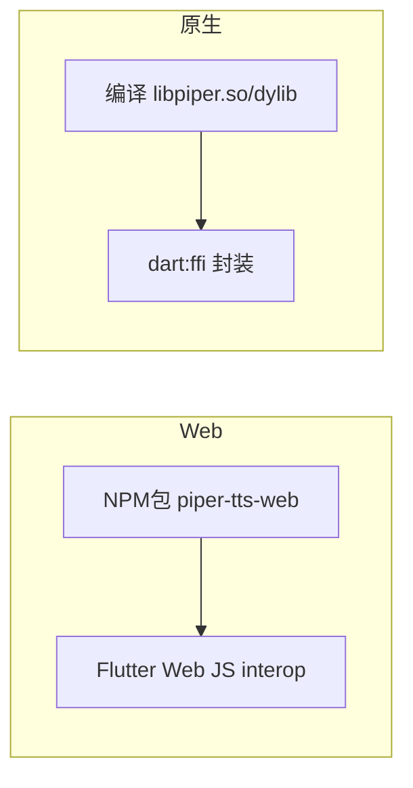
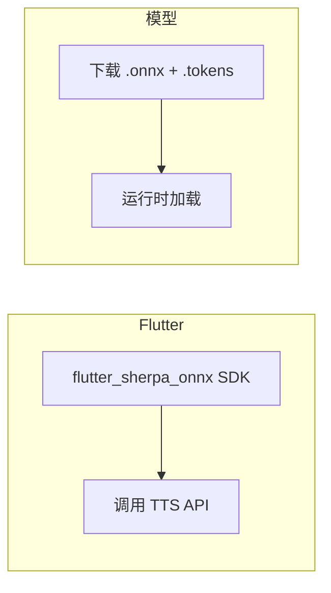

# TTS 引擎选型对比：Piper vs Sherpa-ONNX

> 日期：2026-05-21
> 目标：为 CoEvo 选择跨平台离线 TTS 引擎
> 重点：中文能力、中英混合、Flutter 集成、跨平台

---

## 一、对比总览

| 维度 | Piper | Sherpa-ONNX |
|:----|:------|:------------|
| 中文模型 | 1条音色（huayan） | 多条（Matcha/VITS/ZipVoice/Kokoro） |
| 中英混合 | 无专门支持 | ✅ **Matcha 中英混合模型** |
| 中文音质 | 可懂，机械感 | 较自然，接近早期云端水平 |
| Flutter 集成 | 无官方，需自编译 FFI | ✅ **官方 Flutter SDK + dart:ffi** |
| WASM/Web | NPM 包（第三方） | ✅ 官方 WASM + Hugging Face Spaces |
| Android | 自编译 .so → FFI | ✅ 预编译 .so + Flutter plugin |
| iOS | 自编译 .dylib → FFI | ✅ 但从源码编译 |
| Web | NPM 包 → JS interop | ✅ 官方 WASM 构建 |
| 模型大小 | 2-50MB | 10-100MB |
| 社区活跃 | 已归档，OHF 维护 | 12.4k stars，活跃开发中 |
| License | GPL-3.0 (fork 后) | Apache-2.0 |

---

## 二、中文能力详细对比

### Piper 中文

| 模型 | 大小 | 音质 | 中英混合 |
|:----|:----:|:----:|:--------:|
| `zh_CN-huayan-x_low` | ~2MB | 极低质量，机械感强 | 可读英文但带口音 |
| `zh_CN-huayan-medium` | ~20MB | 中等，仍较机械 | 可读英文但带口音 |

- 只有一条音色（huayan）
- 通过 espeak-ng 做音素化，中文发音准确但韵律不自然
- 对中英混合文本无特殊优化

### Sherpa-ONNX 中文

| 模型 | 语言 | 音质 | 中英混合 |
|:----|:----:|:----:|:--------:|
| **Matcha-TTS** | 中文 | ✅ 较自然，流畅 | ❌ 仅中文 |
| **Matcha-TTS (中英)** | 中文+英文 | ✅ 较自然 | ✅ **原生支持混合输入** |
| VITS | 中文+多语言 | 较好 | 有限 |
| Kokoro-82M | 中文+多语言 | 较好 | 支持 |
| ZipVoice | 中文+英文 | 含语音克隆 | 支持 |

- 由 **k2-fsa** 团队维护（国内团队），中文是核心支持语言
- Matcha 模型质量在开源 TTS 中属于前列
- **关键：有专门的中英混合模型，适合英语教学场景**

---

## 三、集成路径

### Piper（计算工作量：3-4 天）



**工作量**：
- Web：1天（JS interop + 模型缓存）
- Android：1天（交叉编译 .so + FFI）
- iOS：1-2天（交叉编译 .dylib + 注意 GPL 合规）
- 模型下载/缓存策略：0.5天

### Sherpa-ONNX（计算工作量：1-2 天）



**工作量**：
- 全平台：0.5天（SDK 安装 + 基础调用）
- 中文 Matcha 模型配置：0.5天
- 中英混合模型测试：0.5天
- 切换逻辑（中文→Matcha 中文，纯英→Web Speech）：0.5天

---

## 四、推荐方案

### 首选：Sherpa-ONNX

理由：

1. **中文质量明显更好** — Matcha 模型比 Piper huayan 自然一个档次
2. **中英混合模型** — 英语教学场景的核心需求，Piper 无此能力
3. **Flutter 官方 SDK** — 省去编译 FFI 的时间，`flutter_sherpa_onnx` 直接可用
4. **Apache-2.0 License** — 商业友好，无 GPL 合规顾虑
5. **国内团队维护** — k2-fsa 团队在国内，中文支持和更新更及时

### 渐进式替换策略

```
Phase 1: Web Speech API（现状，已做音色选择优化）
  └── 只有纯英文用 en-US，有中文就走 zh-CN（已避免崩溃）

Phase 2: Sherpa-ONNX for Chinese（1-2 天）
  └── 检测到中文 → Sherpa Matcha 模型
  └── 纯英文 → 继续用 Web Speech API（不崩，够用）
  └── 中英混合 → Sherpa Matcha 混合模型（关键场景）

Phase 3: 可选的英文模型增强
  └── 如果对英文发音不满意，再加载英文 Matcha 模型
```

---

## 五、下一步

1. **试听**：用户先试听 Sherpa-ONNX 的 Matcha 中英混合 Demo
   - [Matcha 中英混合 Demo](https://huggingface.co/spaces/k2-fsa/web-assembly-zh-en-tts-matcha)
   - [Matcha 中文 Demo](https://huggingface.co/spaces/k2-fsa/web-assembly-zh-tts-matcha)

2. **评估通过后**：在 Flutter 项目中接入 `flutter_sherpa_onnx`
   - 下载模型文件
   - 编写 `TtsService` 的 Sherpa 后端实现
   - 测试 Android / Web / iOS 三个平台

3. **线上验证**：灰度替换，对比用户留存/使用时长
