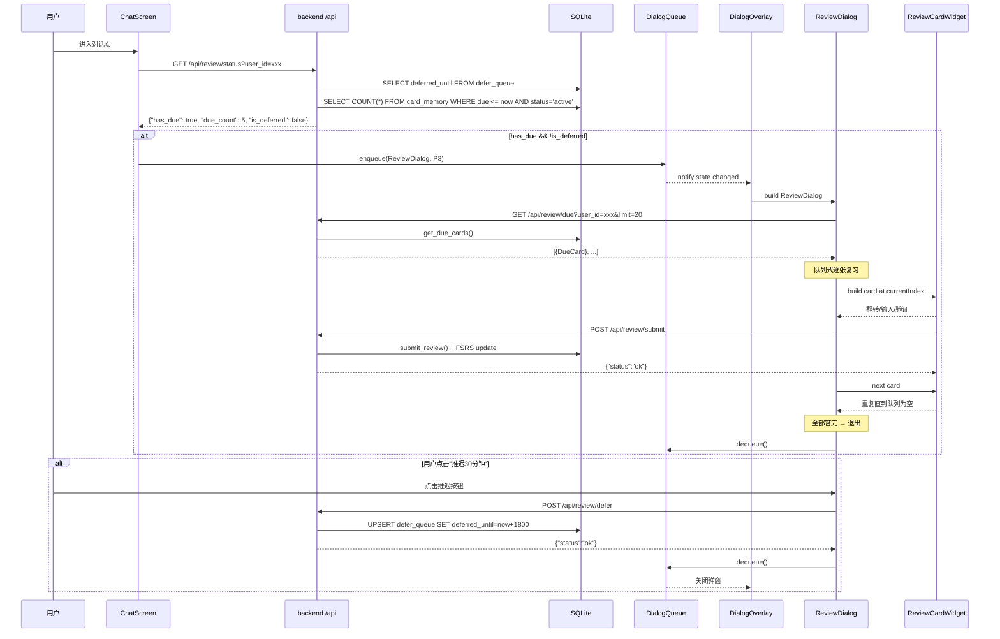
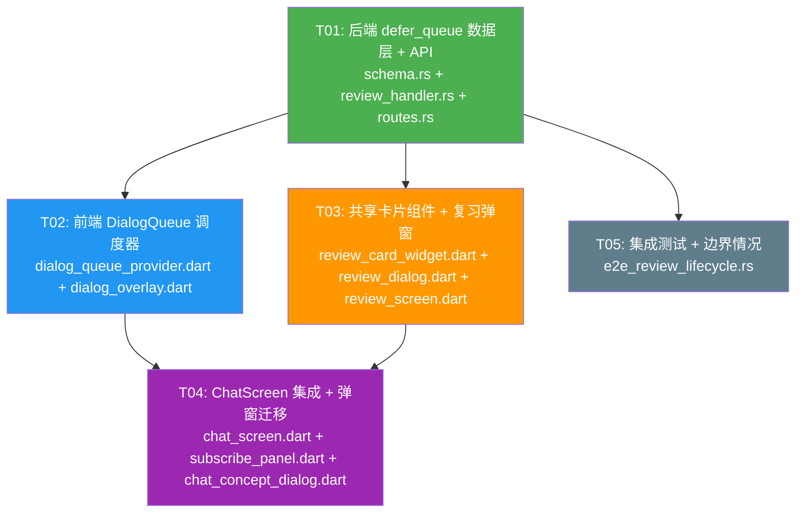

# CoEvo 主动复习弹窗系统 — 架构设计 & 任务分解

> **作者**: Bob (Architect)  
> **项目**: CoEvo — AI 对话学习产品  
> **日期**: 2025-07-17

---

## Part A: System Design

### 1. Implementation Approach

#### 1.1 核心技术挑战

| 挑战 | 说明 | 方案 |
|------|------|------|
| **不破坏 FSRS due** | 推迟按钮不能改 `card_memory.due`，否则 FSRS 间隔算法失真 | 新增独立 `defer_queue` 表存储推迟状态，与 FSRS 调度解耦 |
| **弹窗冲突管理** | 6 种弹窗（支付/分享/CP1/成就/H5/复习）可能同时触发 | 全局 `DialogQueue` 单点渲染 + 优先级调度 |
| **复习卡片复用** | 弹窗内复习要用 `ReviewScreen` 同样的卡片翻转/验证/提交逻辑 | 抽取共享 `ReviewCardWidget`，弹窗和独立页共用 |
| **会话级触发** | 进入对话页时检测到期卡片，取当前 `conversation_id` 的卡片 | ChatScreen.init 中查询 `/api/review/status` |

#### 1.2 框架选型

| 层 | 技术 | 理由 |
|----|------|------|
| 后端 | **Rust/axum** (已有) | 项目现有技术栈，不引入新语言 |
| 后端 DB | **rusqlite** (已有) | SQLite 嵌入式数据库，项目现有 |
| 前端 | **Flutter/Riverpod** (已有) | 项目现有技术栈 |
| 弹窗管理 | **Riverpod StateNotifier** | 已有 Riverpod 生态，无需额外包 |

#### 1.3 架构模式

> 🗑 **2026-10-09 已删除**：下图里的 `DialogQueue` / `DialogOverlay` 两个模块**已从代码中移除**
> （`providers/dialog_queue_provider.dart` + `widgets/dialog_overlay.dart`）。两个理由：
> ① **零消费者**（`enqueue` 全库无调用方）；② 它建在**已退役的概念**上（`P0_PAYMENT` / `P1_SHARE` /
> `P2_CP1_CONCEPT` —— 分销 / 概念制卡时代）。更糟的是**它是个陷阱**：`_showDialog` 在
> `MaterialApp.builder` 的上下文（**在 Navigator 之上**）里调 `showDialog` ⇒ 一旦真被用起来，
> 弹窗会**静默不出现**（异常被它自己的 `catch` 吞掉）。
> 📄 依据与证据：`docs/review/subscription-expiry-overlay-investigation-2026-10-09.md` §三.a
>
> ⚠️ 本节其余内容（`ChatScreen` / `ReviewDialog` / `SubscribePanel` / 分销链）是
> **2026-09-25 的历史快照**，均与现状不符 —— 读架构请以代码为准。

```
┌───────────────────────────────────────────────────────────┐
│                     Flutter 前端                           │
│                                                           │
│  ┌──────────────┐  ┌─────────────────┐  ┌──────────────┐ │
│  │ ChatScreen   │  │ DialogQueue     │  │ DialogOverlay │ │
│  │ (入口检测)    │─▶│ (Provider)      │─▶│ (单点渲染)    │ │
│  └──────────────┘  └───────┬─────────┘  └──────┬───────┘ │
│                            │                    │         │
│                   ┌────────▼────────┐  ┌───────▼───────┐ │
│                   │ ReviewDialog   │  │ SubscribePanel │ │
│                   │ (复习弹窗)      │  │ (支付弹窗)     │ │
│                   └───────┬────────┘  └───────┬───────┘ │
│                           │                   │         │
│                   ┌───────▼────────┐          │         │
│                   │ReviewCardWidget│          │         │
│                   │(共享卡片组件)   │          │         │
│                   └────────────────┘          │         │
│                                              │         │
│  ┌─────────────┐  ┌──────────────┐  ┌───────▼───────┐ │
│  │ChatClient   │  │PlanProvider  │  │ConceptDialog  │ │
│  │(API Client) │  │(计划状态)    │  │(CP1弹窗)      │ │
│  └──────┬──────┘  └──────────────┘  └───────────────┘ │
└─────────┼─────────────────────────────────────────────┘
          │ HTTP / WS
┌─────────▼─────────────────────────────────────────────┐
│                    Rust 后端                            │
│                                                       │
│  ┌──────────┐    ┌──────────────┐    ┌─────────────┐  │
│  │ routes.rs│───▶│review_handler│───▶│fsrs_scheduler│  │
│  │ (路由)   │    │(defer/status)│    │(due/submit)  │  │
│  └──────────┘    └──────┬───────┘    └─────────────┘  │
│                         │                              │
│                   ┌─────▼──────┐                      │
│                   │ defer_queue │                      │
│                   │   (DB表)    │                      │
│                   └────────────┘                      │
└───────────────────────────────────────────────────────┘
```

---

### 2. File List

#### 2.1 后端新增

| # | 文件路径 | 说明 |
|---|----------|------|
| 1 | `backend/crates/api_server/src/review_handler.rs` | 新增: `POST /api/review/defer`, `GET /api/review/status` 处理器 |

#### 2.2 后端修改

| # | 文件路径 | 说明 |
|---|----------|------|
| 2 | `backend/crates/api_server/src/schema.rs` | `SCHEMA_SQL` 中新增 `defer_queue` 表 DDL + 渐进式迁移 |
| 3 | `backend/crates/api_server/src/routes.rs` | 注册 `/api/review/defer` 和 `/api/review/status` 路由 |

#### 2.3 前端新增

| # | 文件路径 | 说明 |
|---|----------|------|
| 4 | `app/lib/providers/dialog_queue_provider.dart` | DialogQueue 全局状态管理 (Riverpod StateNotifier) · 🗑 **2026-10-09 已删除**（零消费者） |
| 5 | `app/lib/widgets/dialog_overlay.dart` | 单点渲染 DialogOverlay widget (替换散装 showDialog) · 🗑 **2026-10-09 已删除**（同上，且它是「一用就静默失败」的陷阱） |
| 6 | `app/lib/widgets/review_dialog.dart` | 复习弹窗组件 (ReviewDialog) |
| 7 | `app/lib/widgets/review_card_widget.dart` | 共享卡片组件 (从 ReviewScreen 抽出) |

#### 2.4 前端修改

| # | 文件路径 | 说明 |
|---|----------|------|
| 8 | `app/lib/screens/review_screen.dart` | 引用 `review_card_widget` 替换内联卡片渲染 |
| 9 | `app/lib/screens/chat_screen.dart` | 初始化时查询复习状态; 弹窗调用迁移到 DialogQueue |
| 10 | `app/lib/widgets/subscribe_panel.dart` | showDialog 调用迁移到 DialogQueue |
| 11 | `app/lib/screens/chat/chat_concept_dialog.dart` | ConceptDialog 注册到 DialogQueue |

---

### 3. Data Structures and Interfaces

#### 3.1 defer_queue 表 DDL

```sql
-- 推迟队列表（不修改 card_memory.due）
CREATE TABLE IF NOT EXISTS defer_queue (
    user_id TEXT PRIMARY KEY,
    deferred_until INTEGER NOT NULL,          -- Unix 时间戳，推迟到期时间
    card_ids TEXT NOT NULL DEFAULT '[]',       -- JSON 数组: 本次推迟的到期卡 ID 队列
    created_at INTEGER NOT NULL,
    FOREIGN KEY (user_id) REFERENCES users(id)
);
```

**渐进式迁移** (添加到 `run_migrations_inner`):

```sql
"CREATE TABLE IF NOT EXISTS defer_queue (
    user_id TEXT PRIMARY KEY,
    deferred_until INTEGER NOT NULL DEFAULT 0,
    card_ids TEXT NOT NULL DEFAULT '[]',
    created_at INTEGER NOT NULL DEFAULT 0
)"
```

#### 3.2 后端 API 接口

##### `GET /api/review/status`

请求参数 (Query):
```
user_id: string          // 用户 ID
```

响应:
```json
{
  "has_due": true,                            // 是否有到期卡片
  "due_count": 5,                             // 到期卡片数量
  "is_deferred": true,                        // 是否处于推迟期
  "deferred_until": 1721196000,               // 推迟到期时间戳（如有）
  "remaining_seconds": 1200                    // 推迟剩余秒数（如有）
}
```

##### `POST /api/review/defer`

请求体:
```json
{
  "user_id": "string",
  "defer_seconds": 1800,        // 推迟秒数，默认 1800 (30分钟)
  "card_ids": ["c1", "c2"]     // 本次推迟的到期卡 ID 列表
}
```

响应:
```json
{
  "status": "ok",
  "deferred_until": 1721196000,
  "card_ids_deferred": 5
}
```

#### 3.3 Class Diagram

```mermaid
classDiagram
    class DeferQueue {
        +String user_id
        +int deferred_until
        +List~String~ card_ids
        +int created_at
    }

    class ReviewHandler {
        +getReviewStatus(conn, user_id) Json
        +deferReview(conn, user_id, defer_seconds, card_ids) Json
    }

    class FsrsScheduler {
        +getDueCards(conn, user_id, limit, offset, conv_id, language) (Vec~DueCard~, i64)
        +submitReview(conn, card_id, rating, vtype, vresult, user_id, details) Result
    }

    class ReviewHandler ..> FsrsScheduler : uses for due query

    class DialogQueue {
        -List~DialogItem~ _queue
        -DialogItem _activeDialog
        +enqueue(item) void
        +dequeue() void
        +clear() void
        +prioritize() DialogItem
    }

    class DialogItem {
        +String id
        +DialogPriority priority
        +WidgetBuilder builder
        +bool isPreemptive
        +bool isDismissible
        +DialogType type
    }

    class DialogPriority {
        <<enumeration>>
        P0_PAYMENT
        P1_SHARE
        P2_CP1_CONCEPT
        P2_ACHIEVEMENT
        P2_NOTIFICATION_H5
        P3_REVIEW
    }

    class DialogType {
        <<enumeration>>
        PAYMENT
        SHARE
        CONCEPT_EXTRACTION
        ACHIEVEMENT_POSTER
        NOTIFICATION_H5
        REVIEW_POPUP
    }

    class ReviewDialog {
        +List~DueCard~ dueCards
        +int currentIndex
        +bool isDeferred
        +startReview() void
        +nextCard() void
        +handleDefer() void
        +onReviewComplete() void
    }

    class ReviewCardWidget {
        +DueCard card
        +bool isFlipped
        +bool isVerifying
        +String verificationResult
        +build(context) Widget
        +startVerification() void
        +submitReview() void
    }

    class DialogOverlay {
        +build(context) Widget
    }

    class ChatScreen {
        +checkReviewStatus() void
        +showReviewDialog() void
    }

    DialogOverlay --> DialogQueue : watches
    DialogQueue o-- DialogItem
    ReviewDialog --> ReviewCardWidget : uses
    ReviewScreen --> ReviewCardWidget : uses
    ChatScreen --> DialogQueue : enqueues review
```

#### 3.4 Sequence Diagram — 主动复习弹窗全流程



---

### 5. Anything UNCLEAR

| 问题 | 假设/决策 |
|------|-----------|
| **推迟后到期卡数量变化** | 推迟期间新到期卡仍会累计，但前端不弹窗；推迟到期后一次性查询所有到期卡 |
| **其他弹窗冲突时复习弹窗行为** | 遇 P0 弹窗自动 defer 30 分钟；P1/P2 弹窗弹出时复习弹窗保持挂起（队列头部），等优先级弹窗关闭后恢复 |
| **退出对话页时复习弹窗未完成** | 关闭对话页时弹窗自动 dequeue，不保留状态 |
| **多个到期卡如何处理** | 全部入队（最多 20 张），逐张复习。答完一张自动下一张 |
| **复习弹窗内"跳过"功能** | 参考 ReviewScreen 行为，点击跳过 → 调用 `PATCH /api/cards/status` 设为 skipped |
| **弹窗之间的过渡动画** | DialogQueue 提供默认 fade 过渡，不额外引入动画框架 |

---

## Part B: Task Decomposition

### 6. Required Packages

**后端 (Cargo.toml — 已有)**:
```
rusqlite = { version = "0.31", features = ["bundled"] }
serde = { version = "1", features = ["derive"] }
serde_json = "1"
uuid = { version = "1", features = ["v4"] }
chrono = "0.4"
axum = "0.7"
tracing = "0.1"
tokio = { version = "1", features = ["full"] }
```

**前端 (pubspec.yaml — 已有)**:
```
flutter_riverpod: ^2.4.0
http: ^1.1.0
web_socket_channel: ^2.4.0
go_router: ^12.0.0
```

无需新增第三方包，全部复用项目现有依赖。

### 7. Task List (ordered by dependency)

| Task ID | Task Name | Source Files | Deps | Priority |
|---------|-----------|-------------|------|----------|
| **T01** | **后端: defer_queue 数据层 + API** | `schema.rs`, `review_handler.rs` (新增), `routes.rs` | 无 | P0 |
| **T02** | **前端: DialogQueue 全局弹窗调度器** | `dialog_queue_provider.dart` (新增), `dialog_overlay.dart` (新增) | T01 | P0 |
| **T03** | **前端: 共享卡片组件 + 复习弹窗** | `review_card_widget.dart` (新增), `review_dialog.dart` (新增), `review_screen.dart` (修改) | T02 | P0 |
| **T04** | **前端: ChatScreen 集成 + 弹窗迁移** | `chat_screen.dart` (修改), `subscribe_panel.dart` (修改), `chat_concept_dialog.dart` (修改) | T02, T03 | P0 |
| **T05** | **集成测试 + 边界情况** | e2e 测试文件 (review_handler 测试) | T01 | P1 |

#### T01: 后端 — defer_queue 数据层 + API

**文件**:
- `backend/crates/api_server/src/schema.rs` — 新增 `defer_queue` 表 DDL 到 `SCHEMA_SQL` 和迁移函数
- `backend/crates/api_server/src/review_handler.rs` — **新增文件**，包含:
  - `GET /api/review/status` handler
  - `POST /api/review/defer` handler
  - `DeferStatusQuery` 和 `DeferInput` 请求结构体
- `backend/crates/api_server/src/routes.rs` — 注册两条新路由

**内容要点**:
- `defer_queue` 表: `(user_id TEXT PK, deferred_until INTEGER, card_ids TEXT, created_at INTEGER)`
- `GET /api/review/status`: 查 `defer_queue` + 查 `card_memory.due <= now` 的到期卡数
- `POST /api/review/defer`: `INSERT OR REPLACE` 写 `deferred_until = now + defer_seconds`
- 验证：到期卡优先以当前 `conversation_id` 过滤，无 conv_id 时查全局

**Dependencies**: 无 (独立后端改动)

#### T02: 前端 — DialogQueue 全局弹窗调度器

**文件**:
- `app/lib/providers/dialog_queue_provider.dart` — **新增**:
  - `DialogPriority` enum (P0~P3)
  - `DialogType` enum (6 种弹窗)
  - `DialogItem` 数据类
  - `DialogQueueNotifier extends StateNotifier<DialogQueueState>`
  - 公开 Provider: `dialogQueueProvider`
- `app/lib/widgets/dialog_overlay.dart` — **新增**:
  - `DialogOverlay` widget
  - 监听 `dialogQueueProvider`
  - `Stack` 模式叠加在 `MaterialApp.builder` 中
  - 优先级仲裁逻辑: `enqueue()` 时自动判断是否抢占

**内容要点**:
- `DialogQueueState`: `{List<DialogItem> queue, DialogItem? active}`
- `enqueue()`: P0 直接抢占 (替换 active); P1/P2 排队; P3 遇其他弹窗自动 defer
- `dequeue()`: 关闭当前弹窗 → 取队列头部下一个
- `DialogOverlay` 在 `main.dart` 的 `MaterialApp.builder` 中注入

**Dependencies**: T01 (需要后端 API 确认接口格式，但可先 mock)

#### T03: 前端 — 共享卡片组件 + 复习弹窗

**文件**:
- `app/lib/widgets/review_card_widget.dart` — **新增**:
  - 从 `review_screen.dart` 抽出卡片翻转/文本输入/AI问答/Judge结果渲染
  - `ReviewCardWidget` 组件: `(DueCard card, bool isFlipped, ...) → Widget`
  - 保持与 ReviewScreen 一致的视觉样式
- `app/lib/widgets/review_dialog.dart` — **新增**:
  - `ReviewDialog` StatefulWidget
  - 接收 `List<DueCard>` 作为队列
  - 逐张调用 `ReviewCardWidget`
  - "推迟30分钟" 按钮 → 调用 `POST /api/review/defer`
  - 全部答完 → 弹出"今日复习完成"统计 → 调用 `DialogQueue.dequeue()`
- `app/lib/screens/review_screen.dart` — **修改**:
  - 内联卡片渲染替换为 `ReviewCardWidget`
  - `_buildInlineReview()` 方法精简，委托给共享组件

**Dependencies**: T02 (DialogQueue 接口确定后方可集成)

#### T04: 前端 — ChatScreen 集成 + 弹窗迁移

**文件**:
- `app/lib/screens/chat_screen.dart` — **修改**:
  - `_init()` 末尾新增: `_checkDueCards()` → `GET /api/review/status`
  - 如有到期卡且非推迟状态 → `dialogQueueProvider.notifier.enqueue(ReviewDialog, P3)`
  - 已有 showDialog 调用 (订阅弹窗) 迁移到 DialogQueue
- `app/lib/widgets/subscribe_panel.dart` — **修改**:
  - showDialog → `dialogQueueProvider.notifier.enqueue(SubscribePanel, P0)`
- `app/lib/screens/chat/chat_concept_dialog.dart` — **修改**:
  - `ConceptDialog.show()` 内部 showDialog → 注册到 DialogQueue
  - 注意: `ConceptDialog` 是 showDialog 返回 Future，迁移后需改为回调模式

**Dependencies**: T02, T03 (依赖 DialogQueue 和 ReviewDialog 就绪)

#### T05: 集成测试 + 边界情况

**文件**:
- `backend/crates/api_server/tests/e2e_review_lifecycle.rs` — **修改**:
  - 添加 defer_queue 测试: defer → status 验证推迟期 → 推迟到期后恢复正常
- `backend/crates/api_server/src/review_handler.rs` — 补充边界情况:
  - 空队列 defer
  - 重复 defer (覆盖旧值)
  - defer 时间=0 (视为取消推迟)

**Dependencies**: T01 (需要 review_handler 就绪)

---

### 8. Shared Knowledge

1. **后端认证**: 所有 API 请求需要 `Authorization: Bearer <token>` header，通过 `auth_middleware::verify_auth()` 验证
2. **API 响应格式**: `{"status": "ok", ...}` 成功 / `{"error": "..."}` 失败
3. **DB 连接**: 使用 `crate::db_pool::get_conn()` 获取数据库连接
4. **时间戳**: 全部使用 Unix 时间戳 (i64)，通过 `chrono::Utc::now().timestamp()` 获取
5. **前端 DialogQueue 生命周期**: DialogQueue 在 `main.dart` 的 `ProviderScope` 中注册，全局唯一
6. **弹窗迁移原则**: 不一次性迁移所有弹窗。T04 只迁移 3 个关键弹窗（订阅/CP1/复习），其余保持现状
7. **推迟不修改 FSRS**: `card_memory.due` 绝对不变，只操作 `defer_queue` 表

---

### 9. Task Dependency Graph



**并行执行说明**:
- T01 (后端) 可完全独立并行
- T02 (DialogQueue) 在 T01 接口确认后可 mock 并行业务代码
- T03 (复习弹窗) 需 T01 接口确认，可与 T02 略微并行（组件自身不依赖 DialogQueue）
- T04 需 T02 + T03 都就绪
- T05 需 T01 就绪
